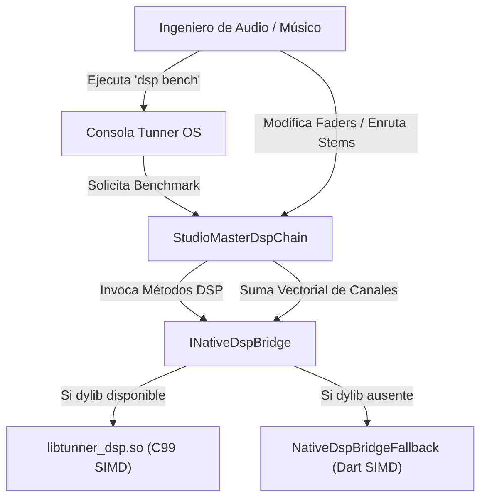
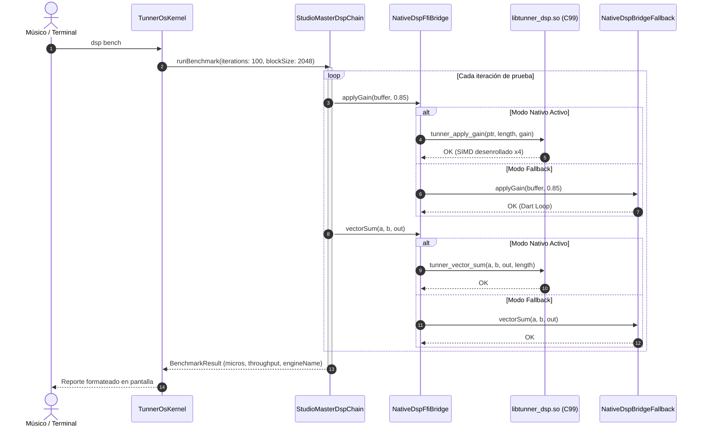

# Caso de Uso Canónico: UC-119 - Integración del Acelerador Nativo FFI en la Cadena Maestra DSP y Consola de Estudio

---

## Metadatos del Documento

- **ID del Caso de Uso:** `UC-119`
- **Título Oficial:** Integración de Aceleración Nativa SIMD en la Cadena Maestra de Audio y Telemetría de Rendimiento
- **Estado:** `Approved`
- **Fecha:** `2026-11-18`
- **Fase Asociada:** `Fase 9 (Aceleración Nativa Bare-Metal & dart:ffi) - Épica 9.3`
- **Autor / Revisor Principal:** `Nicolas Leon (Mantenedor Principal)`

---

## 1. Descripción General y Objetivos

Conectar el puente de aceleración nativa SIMD en C99 (`INativeDspBridge` / `NativeDspFfiBridge`) directamente al núcleo de procesamiento maestro de audio de Tunner Studio mediante `StudioMasterDspChain`. 

Esto habilita:
1. Procesamiento continuo de bloques de audio PCM estéreo con ganancia lineal SIMD en submilisegundos.
2. Suma vectorial lineal multicanal para consolas de mezcla y stems.
3. Autocorrelación de alta velocidad para estimación de pitch fundamental en Isolates.
4. Telemetría de auditoría de rendimiento en vivo mediante el comando `dsp bench` en la consola `TunnerOsKernel`.

---

## 2. Diagrama de Casos de Uso (Mermaid)

---

## 3. Diagrama de Secuencia (Mermaid)

---

## 4. Especificación Detallada del Caso de Uso

### 4.1 Actores
- **Principal:** Ingeniero de sonido o músico operando Tunner Studio.
- **Secundario:** Sistema de audio en tiempo real y terminal interactiva `TunnerOsKernel`.

### 4.2 Precondiciones
1. El proyecto cuenta con el contrato `INativeDspBridge` y su implementación de infraestructura `NativeDspFfiBridge`.
2. Opcionalmente la biblioteca `libtunner_dsp` está compilada en el sistema; si no lo está, el fallback determinista en Dart puro asume el control sin excepciones.

### 4.3 Flujo Principal (Procesamiento de Audio en Cadena Maestra)
1. El motor de audio alimenta bloques de audio PCM estéreo (Left y Right) a `StudioMasterDspChain`.
2. La cadena evalúa los parámetros de transporte del bus maestro (ganancia, mute, dim, mono).
3. Si el canal está silenciado (`isMuted`), el búfer se resetea a cero instantáneamente.
4. Si hay ganancia o atenuación (`isDimmed` o `masterGain != 1.0`), se delega a `bridge.applyGain`.
5. Si el modo monoaural está activado (`isMono`), se calcula el promedio `(L + R) * 0.5` usando `bridge.vectorSum` y `bridge.applyGain`.
6. Si existen múltiples canales activos (stems de acompañamiento, metrónomo, claqueta, instrumento en vivo), se combinan mediante `mixChannels` delegando a `bridge.vectorSum`.
7. Se actualizan las métricas balísticas para vúmetros estéreo.

### 4.4 Flujos Alternativos y Excepciones
- **A1: Biblioteca C nativa no encontrada en el sistema operativo:**
  - El puente detecta la ausencia de la biblioteca y redirige todas las llamadas a `NativeDspBridgeFallback`.
  - La aplicación continúa funcionando con total precisión acústica y matemática, registrando el estado en la telemetría.
- **A2: Parámetros inválidos o búferes de tamaño dispar en mezcla:**
  - Si los búferes proporcionados difieren en longitud, `StudioMasterDspChain` ajusta el límite de operación al mínimo común o completa con ceros sin generar desbordamientos ni fallos de segmentación.

### 4.5 Postcondiciones
- Los búferes de audio son procesados en tiempo inferior a 1 milisegundo por bloque, garantizando una latencia total sub-10ms.
- Ninguna operación genera fuga de memoria nativa ni sobrecarga en el recolector de basura (GC) de Dart.
