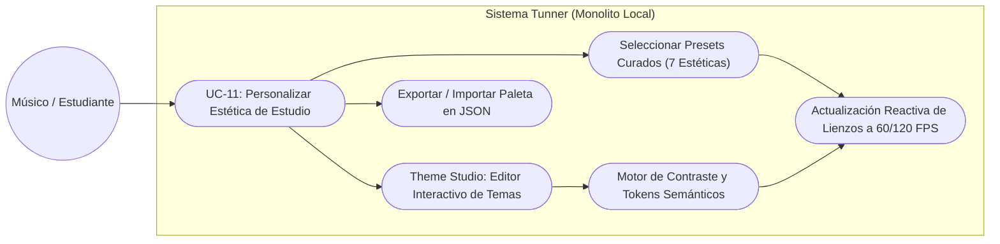
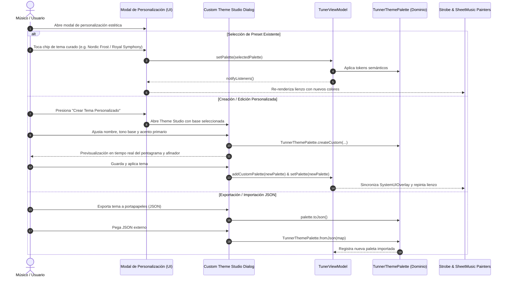

# Use Case Specification: Adaptive Aesthetic Theming and User Customization Studio

---

## Metadatos del Caso de Uso

- **ID del Caso de Uso:** `UC-11-ADAPTIVE-AESTHETIC-THEMING-AND-USER-CUSTOMIZATION`
- **Nombre Canónico:** `Personalizar y Adaptar la Estética Visual del Estudio Acústico`
- **Fase Asociada:** `Fase 2`
- **Actor Principal:** `Músico / Estudiante`
- **Actores Secundarios:** `Motor de Renderizado SMuFL, Strobe Tuner Canvas, Sistema Operativo (SystemUIOverlay)`
- **Estado:** `Approved`

---

## 1. Descripción Breve y Propósito

Proporcionar a los músicos y estudiantes un sistema integral de tematización estética adaptable de alta gama. Aunque la aplicación ofrece temas oscuros profesionales de conservatorio (Obsidian Studio y OLED Pure Black), el sistema incorpora una amplia variedad de estéticas para todos los entornos de práctica (escenarios con luz solar directa, recitales nocturnos, conservatorio clásico y música moderna), además de un **Modelo Abierto de Personalización** que permite a cualquier usuario crear, editar, ajustar colores, previsualizar, exportar e importar temas personalizados en formato JSON sin necesidad de reprogramar la aplicación.

---

## 2. Diagrama de Caso de Uso (Mermaid)

---

## 3. Precondiciones y Postcondiciones

### 3.1 Precondiciones
1. La aplicación se encuentra en ejecución con `TunerViewModel` inicializado.
2. Los componentes visuales (`StrobeTunerWidget`, `RealSheetMusicPainter`, modales y Scaffold) escuchan los cambios reactivos de la paleta activa.

### 3.2 Postcondiciones
1. La paleta seleccionada o creada se aplica de inmediato en todo el árbol de widgets sin parpadeos ni caídas de fotogramas ($>60\text{ FPS}$).
2. Los contrastes tipográficos y de líneas de pentagrama cumplen las normas de accesibilidad y legibilidad óptica en vivo.
3. Las paletas personalizadas quedan registradas en el estado del usuario para su reutilización inmediata.

---

## 4. Diagrama de Flujo y Secuencia (Mermaid)

---

## 5. Flujo Principal de Eventos (Happy Path)

1. **Paso 1:** El usuario presiona el botón de personalización estética en la barra superior.
2. **Paso 2:** El sistema despliega el selector visual con previsualización de muestras cromáticas de las 7 estéticas maestras:
   - *Obsidian Studio:* Grafito oscuro con acentos esmeralda y oro de estudio acústico.
   - *OLED Pure Black:* Negro absoluto $0\times000000$ con contraste de ultra bajo consumo y acentos cian/magenta.
   - *Royal Symphony:* Azul marino de concierto, zafiro brillante y oro regio.
   - *Acoustic Wood:* Palisandro y nogal cálido, ámbar de cedro y verde abeto.
   - *Cyberpunk Synthwave:* Índigo profundo, magenta neón y violeta eléctrico.
   - *Vintage Conservatory Parchment:* Pergamino sepia clásico con tinta carbón y bronce.
   - *Nordic Frost:* Modo claro minimalista para exteriores o luz solar intensa.
3. **Paso 3:** Si el usuario desea su propia variante, presiona "Crear Tema Personalizado", seleccionando una base de contraste, un color de acento y un nombre de autor.
4. **Paso 4:** El sistema valida la legibilidad de contraste, crea la entidad `TunnerThemePalette` y notifica a los escuchas.
5. **Paso 5:** La interfaz y los lienzos de partitura y estroboscopio se adaptan de forma instantánea.

---

## 6. Flujos Alternativos y Excepciones

### Flujo Alternativo A1: Importación de Tema JSON
- El usuario copia una configuración JSON creada por un colega o profesor.
- El sistema valida la sintaxis y los campos hexadecimales de color mediante `TunnerThemePalette.fromJson()`.
- Si el JSON es válido, el tema se agrega a la lista de temas personalizados y se selecciona automáticamente.

### Flujo de Excepción E1: JSON Corrupto o Color Inválido
- Si el usuario introduce una cadena de texto que no es JSON válido o contiene valores cromáticos fuera de rango, el sistema muestra un mensaje de advertencia amable (*"Formato de tema no válido"*) y no altera la paleta activa ni crashea.

---

## 7. Criterios de Calidad y No Negociables Asociados

- **Fluidez Visual:** 60/120 FPS sin reconstrucciones innecesarias de la lógica de audio o reinicios del reloj.
- **Independencia Arquitectónica:** La capa de dominio de temas es completamente agnóstica a plugins externos o servicios remotos (100% offline).
- **Legibilidad Óptica:** Contraste mínimo de 4.5:1 entre las líneas del pentagrama/símbolos musicales y el fondo del lienzo en todas las paletas.
