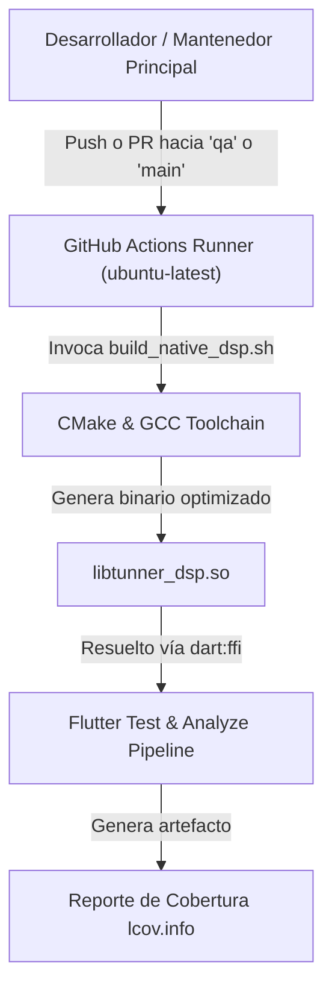
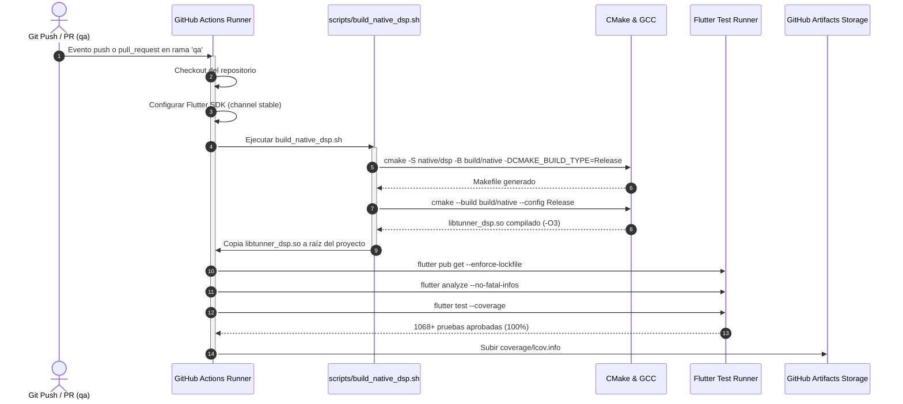

# Caso de Uso Canónico: UC-120 - Compilación Cruzada en CI y Supervisión de Rama QA

---

## Metadatos del Documento

- **ID del Caso de Uso:** `UC-120`
- **Título Oficial:** Automatización de Compilación Cruzada Nativa C99 y Supervisión de Integración Continua para Rama QA
- **Estado:** `Approved`
- **Fecha:** `2026-11-18`
- **Fase Asociada:** `Fase 9 (Aceleración Nativa Bare-Metal & dart:ffi) - Épica 9.4`
- **Autor / Revisor Principal:** `Nicolas Leon (Mantenedor Principal)`

---

## 1. Descripción General y Objetivos

Integrar la compilación automática de la biblioteca nativa C99 (`libtunner_dsp.so`) mediante CMake y extender la supervisión del flujo de integración continua (CI Pipeline en GitHub Actions) para proteger la rama de aseguramiento de calidad `qa`.

Esto garantiza:
1. Que todo cambio empujado o propuesto hacia `qa` ejecute automáticamente el pipeline de validación estática y pruebas en la nube.
2. Que los runners de CI compilen la biblioteca nativa en C antes de ejecutar la suite de pruebas unitarias y de widgets, verificando tanto la paridad matemática del motor nativo SIMD como la resiliencia del fallback de Dart puro.

---

## 2. Diagrama de Casos de Uso (Mermaid)

---

## 3. Diagrama de Secuencia (Mermaid)

---

## 4. Especificación Detallada del Caso de Uso

### 4.1 Actores
- **Principal:** Sistema de Integración Continua (GitHub Actions).
- **Secundario:** Mantenedor Principal (@Nicolas11Leon) y contribuidores del proyecto.

### 4.2 Precondiciones
1. El archivo `.github/workflows/ci.yml` existe en el repositorio.
2. El script `scripts/build_native_dsp.sh` cuenta con permisos de ejecución y compila limpiamente mediante CMake y GCC/Clang.

### 4.3 Flujo Principal
1. Se abre un Pull Request hacia `qa` o se realiza un push directo a `qa`.
2. GitHub Actions detecta el evento y arranca el job `ci-quality-gate` en un entorno `ubuntu-latest`.
3. Se clona el repositorio y se inicializa la versión oficial de Flutter SDK.
4. Se ejecuta el script `./scripts/build_native_dsp.sh`.
5. CMake configura el proyecto C99 y GCC compila la biblioteca `libtunner_dsp.so` con opciones `-O3 -fPIC`.
6. El script copia la biblioteca generada a la raíz del espacio de trabajo.
7. Se instalan las dependencias de Dart/Flutter con `flutter pub get --enforce-lockfile`.
8. Se ejecuta el análisis estático con `flutter analyze --no-fatal-infos`, verificando cero advertencias.
9. Se ejecuta la suite completa de pruebas unitarias con `flutter test --coverage`.
10. Las pruebas de paridad numérica (`native_dsp_ffi_simd_test.dart`) y de integración de cadena maestra (`studio_master_dsp_chain_ffi_integration_test.dart`) localizan el binario `.so` nativo y verifican la aceleración SIMD.
11. Se exporta el reporte de cobertura `coverage/lcov.info` como artefacto del pipeline.

### 4.4 Flujos Alternativos y Excepciones
- **A1: Entorno sin CMake o compilador de C:**
  - Si en un runner alternativo no estuviese instalado CMake, el script de compilación reportará error descriptivo antes de ejecutar las pruebas de Flutter, deteniendo el pipeline de forma preventiva.
- **A2: Fallo en compilación o paridad matemática:**
  - Si un cambio en C99 introduce discrepancia numérica mayor a $10^{-5}$ respecto a Dart puro, las pruebas fallarán de inmediato, impidiendo fusiones no deseadas en `qa`.

### 4.5 Postcondiciones
- La rama `qa` queda completamente blindada contra regresiones de código C y de Flutter.
- El artefacto de cobertura y los registros de compilación quedan almacenados para auditoría.
