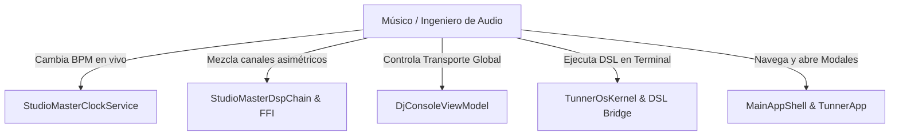
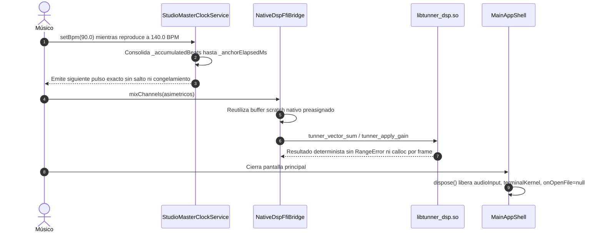

# Caso de Uso Canónico: UC-121 - Estabilidad Crítica de Runtime, Cero Fugas y Precisión Temporal Pre-v1.0.0

---

## Metadatos del Documento

- **ID del Caso de Uso:** `UC-121`
- **Título Oficial:** Endurecimiento de Tiempo de Ejecución, Reloj Maestro Sin Deriva, Memoria Nativa Determinista y Ciclo de Vida Libre de Fugas
- **Estado:** `Approved`
- **Fecha:** `2026-11-19`
- **Fase Asociada:** `Pre-Release Gate v1.0.0 - Ola 1 (Issue #68)`
- **Autor / Revisor Principal:** `Nicolas Leon (Mantenedor Principal)`

---

## 1. Descripción General y Objetivos

Garantizar que los subsistemas de tiempo real, reloj maestro, aislamiento DSP, puente DSL, consola DJ, persistencia de matriz de hardware y ciclo de vida de UI operen sin fallos de `RangeError`, congelamientos al cambiar BPM, fugas de `Isolate`/`ReceivePort`/`Timer`/`TextEditingController` ni reconstrucciones innecesarias a 60 FPS en `MaterialApp`.

---

## 2. Diagrama de Casos de Uso (Mermaid)

---

## 3. Diagrama de Secuencia (Mermaid)

---

## 4. Especificación Detallada del Caso de Uso

### 4.1 Precondiciones
1. La rama `qa` se encuentra consolidada hasta la Épica 9.4 (`83032a8`).
2. `libtunner_dsp.so` se compila mediante CMake cuando está disponible en el sistema.

### 4.2 Flujo Principal
1. `StudioMasterClockService` mantiene un ancla de fase acumulada (`_accumulatedBeats` + `_anchorElapsedMs`) de modo que cualquier cambio de BPM en caliente preserva el compás y pulso exactos sin retrocesos ni congelamientos.
2. `NativeDspFfiBridge` y `StudioMasterDspChain` reutilizan buffers nativos scratch preasignados y acotan las operaciones al mínimo común entre búferes de entrada y salida.
3. `tunner_autocorrelate` en C99 acumula en precisión `double` (64 bits) antes de escribir al búfer `float` de salida.
4. `TunnerApp` utiliza `context.select` únicamente sobre `TunnerThemePalette` para evitar reconstruir `MaterialApp` en cada frame de pitch o metrónomo.
5. `MainAppShell` y `TunnerViewModel` comparten la misma instancia de `StudioAudioDeviceMatrixService`, y todos los servicios/modales liberan determinísticamente sus `Isolate`, `ReceivePort`, `Timer` y `TextEditingController`.

### 4.3 Flujos Alternativos y de Error
- **A1: Fallo al abrir hardware de micrófono en `PitchDetectorService`:**
  - El bloque `catch` cierra inmediatamente `_fromWorkerPort` y termina `_dspIsolate` para evitar Isolates huérfanos.
- **A2: Parámetros inválidos de metrónomo (`bpm <= 0` o `ticksPerMeasure <= 0`):**
  - El Isolate acota defensivamente ambos parámetros antes de calcular el intervalo en microsegundos.

### 4.4 Postcondiciones
- Cero `RangeError` en mezcla DSP asimétrica.
- Cero fugas de memoria nativa, `Isolate`, `ReceivePort`, `Timer` o `TextEditingController`.
- Cumplimiento del 100% de reglas de `AGENTS.md` (incluyendo cero emojis en código de producción).
