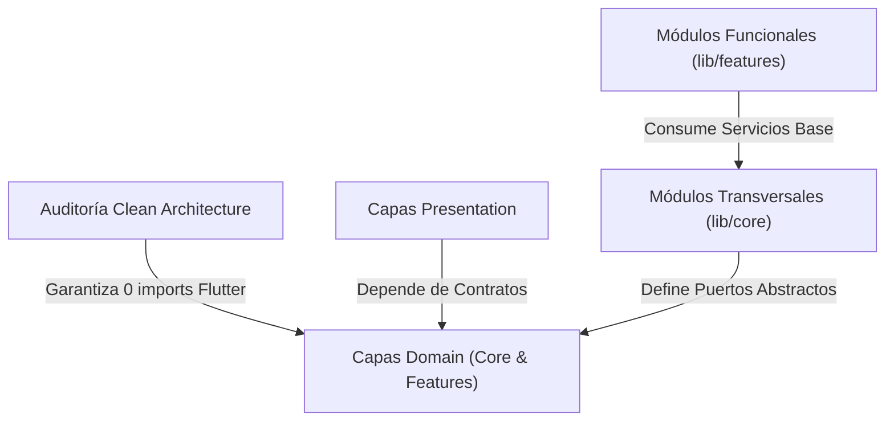
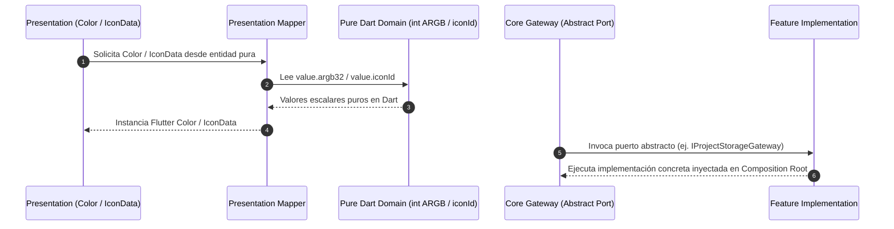

# Caso de Uso Canónico: UC-122 - Purificación de Capa de Dominio y Fronteras Clean Architecture Pre-v1.0.0

---

## Metadatos del Documento

- **ID del Caso de Uso:** `UC-122`
- **Título Oficial:** Purificación de Dominio (100% Dart Puro) y Eliminación de Inversiones Core hacia Features
- **Estado:** `Approved`
- **Fecha:** `2026-11-19`
- **Fase Asociada:** `Pre-Release Gate v1.0.0 - Ola 2 (Issue #69)`
- **Autor / Revisor Principal:** `Nicolas Leon (Mantenedor Principal)`

---

## 1. Descripción General y Objetivos

Cumplir estrictamente la regla arquitectónica cardinal de `AGENTS.md`:
1. La capa `domain/` en todo el proyecto debe ser **100% Dart puro**, con cero importaciones de `package:flutter/*`, `dart:ui` ni capas `infrastructure/` / `data/` / `presentation/`.
2. La capa `core/` debe permanecer completamente agnóstica de `features/` (cero importaciones `core -> features`).
3. La capa `infrastructure/` / `data/` nunca debe importar `presentation/`.
4. Reubicar archivos huérfanos fuera de sus módulos (`tuner_viewmodel.dart`, `tuner_screen.dart`, `tunner_theme.dart`) preservando retrocompatibilidad mediante exports controlados durante la transición.

---

## 2. Diagrama de Casos de Uso (Mermaid)

---

## 3. Diagrama de Secuencia / Flujo de Dependencias (Mermaid)

---

## 4. Especificación Detallada del Caso de Uso

### 4.1 Precondiciones
1. Ola 1 fusionada en `qa` (`6ad6a9d`).
2. `meta` disponible como dependencia directa para `@immutable` en Dart puro.

### 4.2 Flujo Principal
1. Se reemplazan todas las importaciones de `package:flutter/foundation.dart` usadas únicamente por `@immutable` en `domain/` por `package:meta/meta.dart`.
2. Las entidades visuales de dominio (`StudioThemeSkinEntity`, `VisualInterfaceProfile`, `AppToolItem`, `AcousticRigorProfile`, `StudioDockablePanelEntity`) almacenan descriptores agnósticos (`int argb32`, `String iconId`, `StudioPanelDescriptor`) y delegan la construcción de `Color`, `IconData` y `WidgetBuilder` a extensiones/mappers en `presentation/`.
3. `StudioMasterClockService` queda en `core/audio/domain/` como clase pura sin `ChangeNotifier` ni `VoidCallback`, acompañado de un adaptador `StudioMasterClockNotifier` en `presentation/` (o wrapper compatible).
4. Los modales dependientes de `TunerViewModel` ubicados en `core/design_system/molecules/` se mueven a `features/navigation/presentation/modals/`.
5. `StudioWorkspaceFileSystemService`, `StudioOsAudioKernelBridge` y `TunnerOsKernel` consumen interfaces abstractas en `core/` en lugar de importar directamente implementaciones de `features/`.
6. `tuner_viewmodel.dart`, `tuner_screen.dart` y `tunner_theme.dart` se ubican en sus capas canónicas (`features/tuner/presentation/` y `core/design_system/presentation/`).

### 4.3 Postcondiciones
- `0` importaciones de `package:flutter/*` en todo `**/domain/**`.
- `0` importaciones `core -> features`.
- `0` importaciones `infrastructure -> presentation`.
- `100%` de pruebas unitarias y de widgets aprobadas.
