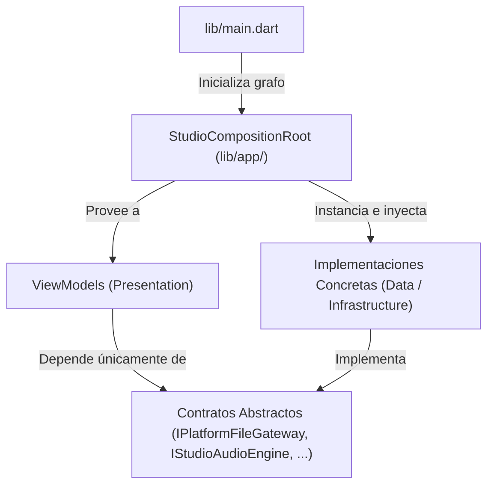
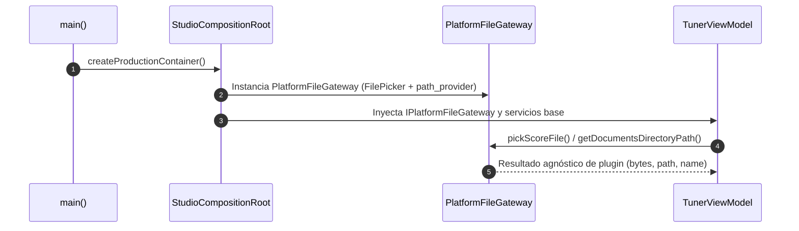

# Caso de Uso Canónico: UC-123 - Composition Root, Inversión de Dependencias y Eliminación de Singletons

---

## Metadatos del Documento

- **ID del Caso de Uso:** `UC-123`
- **Título Oficial:** Centralización de Inyección de Dependencias (Composition Root), Abstracción de Plataforma y Ciclo de Vida Gestionado
- **Estado:** `Approved`
- **Fecha:** `2026-11-19`
- **Fase Asociada:** `Pre-Release Gate v1.0.0 - Ola 3 (Issue #70)`
- **Autor / Revisor Principal:** `Nicolas Leon (Mantenedor Principal)`

---

## 1. Descripción General y Objetivos

Fortalecer el Principio de Inversión de Dependencias (DIP) en la capa de presentación y desacoplar los servicios de infraestructura que operaban como Singletons globales mutables o invocaban directamente plugins de plataforma (`FilePicker`, `path_provider`) desde ViewModels.

---

## 2. Diagrama de Casos de Uso (Mermaid)

---

## 3. Diagrama de Secuencia (Mermaid)

---

## 4. Especificación Detallada del Caso de Uso

### 4.1 Precondiciones
1. Ola 2 fusionada en `qa`.
2. Contratos de dominio puros establecidos.

### 4.2 Flujo Principal
1. Se crea el puerto `IPlatformFileGateway` en `core/file_system/domain/i_platform_file_gateway.dart` y su implementación `PlatformFileGateway` en `core/file_system/data/platform_file_gateway.dart` encapsulando `FilePicker` y `path_provider`.
2. `TunerViewModel` reemplaza los imports directos de `file_picker` y `path_provider` por `IPlatformFileGateway` inyectado (con fallback por defecto o vía Composition Root).
3. Se crea `StudioCompositionRoot` en `lib/app/studio_composition_root.dart` para ensamblar centralizadamente los servicios core (`StudioAudioEngine`, `StudioAudioInputEngine`, `StudioAudioDeviceMatrixService`, `StudioMasterClockService`, `StudioWorkspaceFileSystemService`, `StudioPatchbayRoutingService`, `StudioThemeCatalogService`, `PlatformFileGateway`) y proveerlos en `main.dart`.
4. Se añaden constructores `isolated()` / configurables a los 4 servicios que usaban singleton `_instance` (`StudioAudioEngine`, `StudioPatchbayRoutingService`, `StudioThemeCatalogService`, `StudioWorkspaceFileSystemService`) para permitir instancias independientes gestionadas por el Composition Root y pruebas unitarias 100% aisladas.

### 4.3 Postcondiciones
- `TunerViewModel` ya no importa `package:file_picker` ni `package:path_provider`.
- `main.dart` delega el ensamblaje completo del grafo de dependencias a `StudioCompositionRoot`.
- Los 4 servicios clave soportan instanciación aislada sin contaminación entre pruebas.
