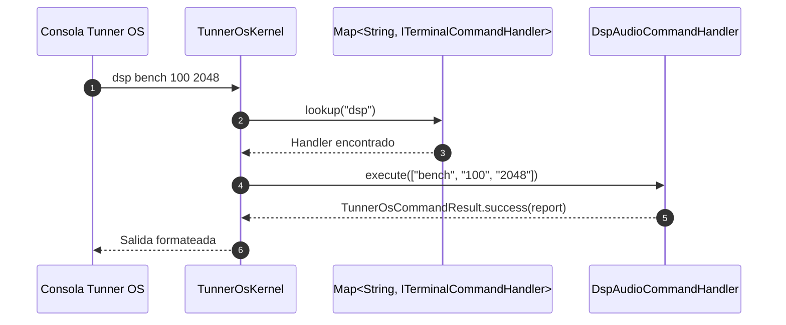

# Caso de Uso Canónico: UC-124 - Descomposición Modular de Clases Monolíticas y Patrón Command

---

## Metadatos del Documento

- **ID del Caso de Uso:** `UC-124`
- **Título Oficial:** Descomposición Cohesiva de Orquestadores, Terminal OS, Intents de Navegación y Sub-Widgets Monolíticos
- **Estado:** `Approved`
- **Fecha:** `2026-11-19`
- **Fase Asociada:** `Pre-Release Gate v1.0.0 - Ola 4 (Issue #71)`
- **Autor / Revisor Principal:** `Nicolas Leon (Mantenedor Principal)`

---

## 1. Descripción General y Objetivos

Reducir la complejidad ciclomática, el tamaño de métodos `build()` hiperlargos y el acoplamiento por archivo en los módulos más extensos del código base (`TunnerOsKernel`, `MainAppShell`, `VocalAutoTuneModal`, `TunerViewModel`), aplicando el patrón **Command Registry**, **Extract Sub-Widget / Delegate** y **Mixins/Partes cohesivas**, manteniendo intacta la superficie pública para preservar compatibilidad con la batería de pruebas.

---

## 2. Diagrama de Casos de Uso (Mermaid)

```mermaid
flowchart TD
    Kernel["TunnerOsKernel"]
    CmdReg["Registro ITerminalCommandHandler"]
    Shell["MainAppShell"]
    Intents["studio_keyboard_intents.dart"]
    Suggest["studio_prompt_suggestions_builder.dart"]
    Vocal["VocalAutoTuneModal"]
    SubW["Sub-Widgets Cohesivos"]

    Kernel -->|Despacha comandos O(1)| CmdReg
    Shell -->|Delega atajos DAW| Intents
    Shell -->|Delega autocompletado| Suggest
    Vocal -->|Compone secciones UI| SubW
```

---

## 3. Diagrama de Secuencia (Mermaid)



---

## 4. Especificación Detallada del Caso de Uso

### 4.1 Precondiciones
1. Ola 3 (`StudioCompositionRoot`) fusionada en `qa`.

### 4.2 Flujo Principal
1. **Patrón Command en `TunnerOsKernel` (`1,199` LOC):**
   - Se define `ITerminalCommandHandler` y se extraen los manejadores por dominio (`AudioDspTerminalHandler`, `TransportTerminalHandler`, `SynthDslTerminalHandler`, `PedagogyTerminalHandler`, `WorkspaceTerminalHandler`), reduciendo el archivo núcleo de `TunnerOsKernel` y eliminando la cascada monolítica `switch`.
2. **Descomposición de `MainAppShell` (`1,763` LOC):**
   - Se extraen los 25 `Intent`s de DAW a `lib/features/navigation/presentation/studio_keyboard_intents.dart`.
   - Se extrae `_buildPromptSuggestions` (`398` LOC) a `lib/features/navigation/presentation/studio_prompt_suggestions_builder.dart`.
3. **Descomposición de `VocalAutoTuneModal` (`800` LOC, `build()` de `774` LOC):**
   - Se fragmenta el método `build()` monolítico en sub-widgets privados/modulares cohesivos (`_VocalPitchTelemetryCard`, `_VocalScaleSelectorSection`, `_VocalDspSlidersSection`, `_VocalMelodynePianoRollSection`).
4. **Descomposición de `TunerViewModel` (`3,062` LOC):**
   - Se modularizan sus responsabilidades en archivos `part` cohesivos por dominio funcional (`tuner_viewmodel_recorder.dart`, `tuner_viewmodel_score_editor.dart`, `tuner_viewmodel_lab_and_pedagogy.dart`, `tuner_viewmodel_vocal_and_minus_one.dart`), manteniendo un archivo principal compacto y legible sin romper ninguna firma pública ni las `1,075+` pruebas existentes.

### 4.3 Postcondiciones
- Métodos `build()` críticos por debajo de 150-200 LOC.
- `TunnerOsKernel` y `TunerViewModel` modularizados por responsabilidad única.
- `0` advertencias en `flutter analyze` y `100%` de pruebas pasando.
