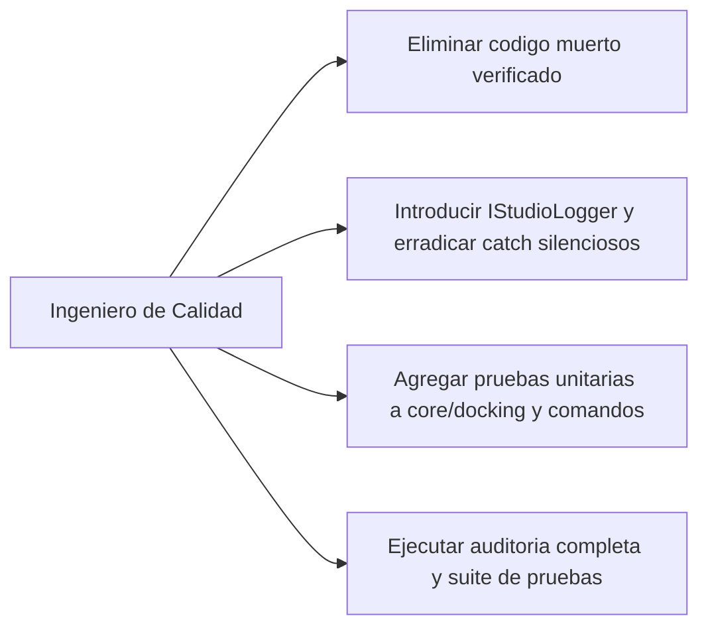
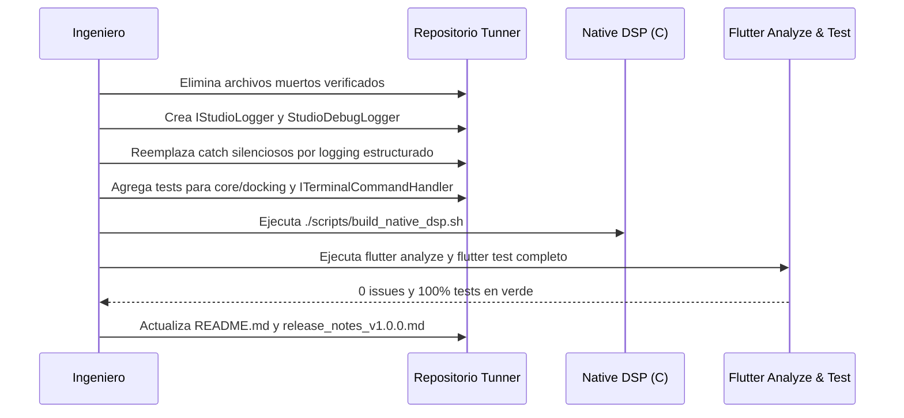

# Caso de Uso 125: Endurecimiento Final Pre-v1.0.0 y Compuerta de QA

- **ID:** UC-125
- **Fase:** Pre-v1.0.0 Hardening (Ola 5)
- **Actor Principal:** Ingeniero de Calidad / Release Manager
- **Issue Asociado:** #72

## 1. Precondiciones
1. Las Olas 1, 2, 3 y 4 estan fusionadas en la rama `qa`.
2. Los scripts de auditoria estatica (`audit_tunner.py` y `audit_deep.py`) se encuentran disponibles para validar la ausencia de regresiones.

## 2. Diagrama de Casos de Uso

## 3. Diagrama de Flujo / Secuencia

## 4. Flujo Principal
1. Se eliminan los archivos muertos verificados con cero referencias en `lib/` y `test/`: `task_card_base.dart`, `tone_generator_service.dart` y `connection_matrix_modal.dart`.
2. Se define el puerto puro `IStudioLogger` en `lib/core/logging/domain/i_studio_logger.dart` y su implementacion `StudioDebugLogger` en `lib/core/logging/infrastructure/studio_debug_logger.dart`.
3. Se reemplazan los bloques `catch (_)` silenciosos criticos en persistencia JSON, motor de entrada de audio y `TunerViewModel` por registro estructurado mediante `IStudioLogger`, evitando la ocultacion de fallos de hardware o almacenamiento.
4. Se agregan pruebas unitarias dedicadas para `StudioDockingController` (`test/core/docking/studio_docking_controller_test.dart`) y para el registro dinamico `ITerminalCommandHandler` en `TunnerOsKernel`.
5. Se recompila el modulo nativo C (`./scripts/build_native_dsp.sh`), se ejecutan los scripts de auditoria estatica, `flutter analyze --no-fatal-infos` y la suite completa `flutter test`.
6. Se actualizan las notas de lanzamiento `docs/07_releases/release_notes_v1.0.0.md` y el contador de pruebas en `README.md`.

## 5. Flujos Alternativos y de Error
- **Fallo en compilacion nativa o pruebas:** Si alguna prueba unitaria o de regresion falla tras la limpieza de codigo muerto o sustitucion de `catch`, se detiene la promocion a `qa` y se corrige la regresion antes de abrir el Pull Request.
- **Hallazgo de violacion arquitectonica en auditoria:** Si el script de auditoria detecta cualquier importacion prohibida (`Domain -> Flutter`, `Domain -> Infra`, `Core -> Features`, `Infra -> Presentation`), se corrige antes del cierre de la Ola 5.

## 6. Postcondiciones
1. Cero archivos muertos huerfanos en el arbol fuente.
2. Cero bloques `catch (_)` silenciosos criticos en infraestructura y estado de afinacion.
3. Cobertura de pruebas verificada en `core/docking` y `ITerminalCommandHandler`.
4. La rama `qa` queda certificada y lista para las pruebas manuales finales del creador antes del merge a `main` para `v1.0.0`.
