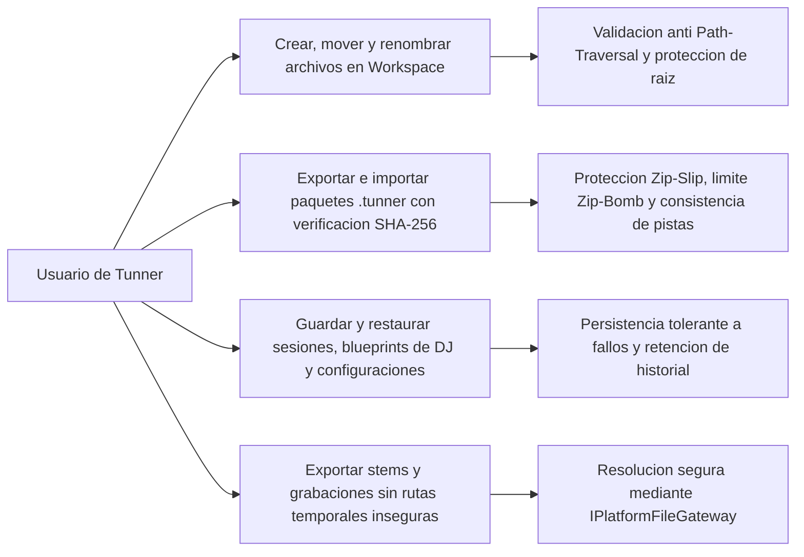
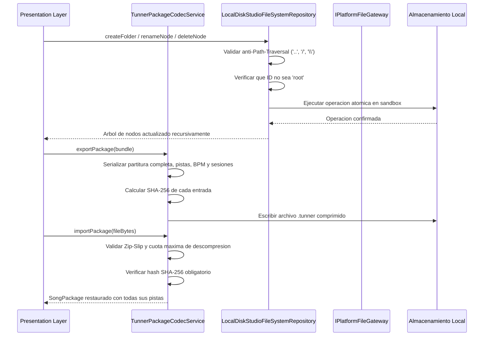

# Caso de Uso 126: Blindaje de Seguridad en Sistema de Archivos y Persistencia Critica

- **ID:** UC-126
- **Fase:** Pre-v1.0.0 Feature Hardening (Ola 1)
- **Actor Principal:** Usuario de Tunner / Motor de Persistencia de Estudio
- **Issue Asociado:** #78

## 1. Precondiciones
1. El usuario ejecuta la aplicacion en entorno de escritorio (Linux, macOS, Windows) o movil.
2. La arquitectura base de repositorios y paquetes canonicos (.tunner, .tnt, .sf2) esta presente.
3. Se requiere evitar de forma absoluta cualquier destruccion accidental de proyectos, ejecucion de path traversal o corrupcion de configuraciones de usuario.

## 2. Diagrama de Casos de Uso

## 3. Diagrama de Flujo / Secuencia

## 4. Flujo Principal
1. **Acceso y manipulacion del Workspace:** `LocalDiskStudioFileSystemRepository` y `StudioWorkspaceFileSystemService` validan toda ruta contra secuencias de escape de directorio (`..`, caracteres nulos, barras absolutas no autorizadas).
2. **Proteccion de raiz:** El nodo raiz con identificador `'root'` no puede ser eliminado ni renombrado bajo ninguna circunstancia.
3. **Consistencia jerarquica:** Al renombrar o mover un directorio contenedor, todos los nodos descendientes actualizan su `relativePath` de forma determinista y recursiva.
4. **Exportacion e importacion de paquetes `.tunner`:** `TunnerPackageCodecService` serializa la totalidad de la partitura (`scoreJson`), el arreglo de compases y notas, las pistas (`tracks`), el compas (`timeSignature`), la sesion de DJ y la sesion del rack modular. Durante la importacion, se valida la cuota de descompresion (maximo 250 MB), se bloquea cualquier intento de Zip-Slip y se valida estrictamente el hash SHA-256 de cada recurso.
5. **Persistencia de configuracion:** `AppUserSettingsEntity` conserva de forma inmutable las 50 sesiones de afinacion mas recientes mediante `sublist(math.max(0, length - 50))` e implementa deserializacion tolerante elemento por elemento para evitar que un registro corrupto invalide el archivo completo.
6. **Almacenamiento de Blueprints y Keymaps:** `DjConsoleBlueprintStorageService` y `DjKeymapPersistenceService` almacenan sus configuraciones en disco local en lugar de mantenerlas unicamente en memoria volatil.
7. **Resolucion segura de archivos temporales:** Se erradica toda ruta literal `/tmp/` delegando la obtencion de directorios temporales y de documentos a `IPlatformFileGateway`.

## 5. Flujos Alternativos y de Error
- **Intento de Path Traversal:** Si una solicitud incluye caracteres de escape o rutas relativas no contenidas en el sandbox del proyecto, el repositorio lanza `ArgumentError` estructurado y deniega la accion.
- **Intento de borrado de la raiz:** Si se solicita eliminar el nodo raiz `'root'`, la operacion es rechazada de inmediato sin alterar el arbol.
- **Paquete `.tunner` corrupto o adulterado:** Si el checksum SHA-256 no coincide, o si el archivo comprimido supera los limites seguros, `TunnerPackageCodecService` rechaza la importacion y emite error sin modificar el estado del estudio.
- **Configuracion corrupta en disco:** Si un elemento individual en el historial de sesiones no es deserializable, es omitido de manera segura registrando una advertencia, preservando intacto el resto de la configuracion.

## 6. Postcondiciones
1. Ninguna operacion de archivo puede escapar de la raiz del proyecto del usuario.
2. El formato `.tunner` preserva fielmente la totalidad del proyecto musical (partitura, pistas, configuraciones).
3. La configuracion de usuario y las 50 sesiones de afinacion mas recientes persisten sin perdidas ni reinicios forzados.
4. Cero rutas `/tmp/` hardcodeadas en la capa de presentacion y servicios.
