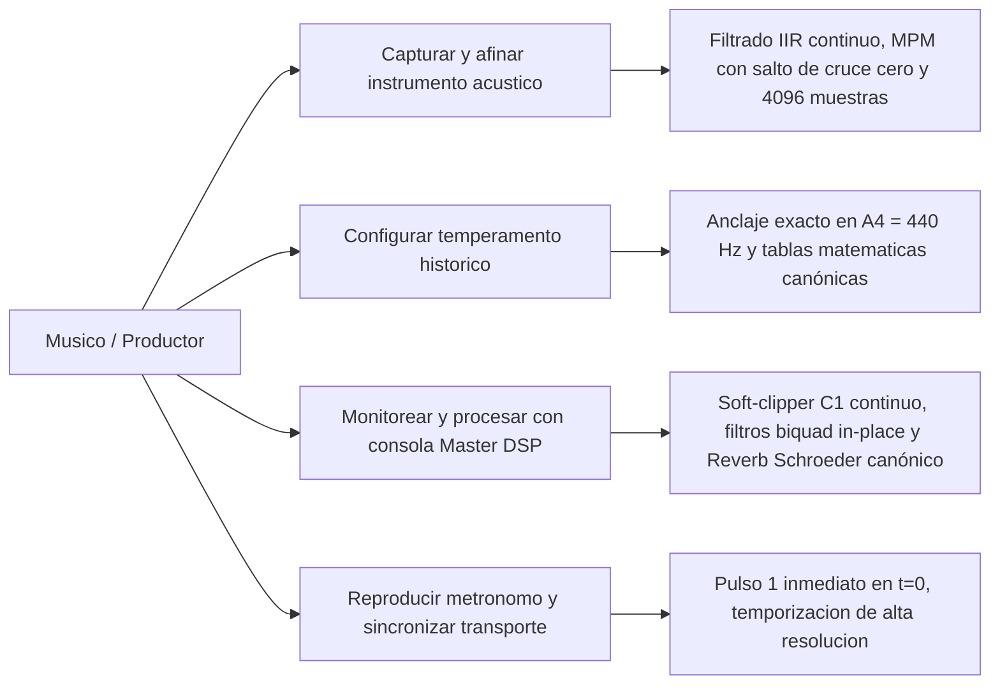
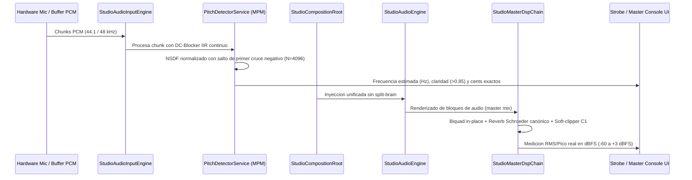

# Caso de Uso 127: Unificacion de Inyeccion de Dependencias, Motor de Audio Core, DSP y Precision Acustica

- **ID:** UC-127
- **Fase:** Pre-v1.0.0 Feature Hardening (Ola 2)
- **Actor Principal:** Usuario de Tunner / Motor de Audio DSP y Afinador
- **Issue Asociado:** #79

## 1. Precondiciones
1. La Ola 1 (seguridad, sistema de archivos y persistencia) esta integrada en `qa`.
2. El sistema requiere audio full-duplex de baja latencia (sub-10ms), deteccion de tono monofonico en tiempo real desde $A_0 = 27.5\text{ Hz}$ hasta $C_8 = 4186\text{ Hz}$, medicion de mastering en dBFS y sincronia de transporte musical sin deriva.

## 2. Diagrama de Casos de Uso

## 3. Diagrama de Flujo / Secuencia

## 4. Flujo Principal
1. **Unificacion de Inyeccion de Dependencias (DI):** `StudioCompositionRoot` mantiene la instancia canonica unica de `IStudioAudioEngine` e `IStudioAudioInputEngine`. Todos los ViewModels (`TunerViewModel`, `DjConsoleViewModel`, `ModularRackViewModel`) consumen esta instancia inyectada. Al cerrarse la sesion de la aplicacion, `StudioCompositionRoot.dispose()` libera los recursos de hardware sin provocar cierres prematuros de canales compartidos por ViewModels hijos.
2. **Sincronizacion de Sistemas de Diseno:** `StudioThemeController` y `TunnerThemePalette` sincronizan bidireccionalmente sus tokens de color, bordes y superficies en tiempo real.
3. **Cadena Master DSP y Medicion Real:**
   - `StudioMasterAudioMixer`: implementa un soft-clipper cuadrático $C^1$-continuo que elimina el salto abrupto del 21% en $\pm0.95$.
   - `AllPassFilter` y `SchroederReverbEngine`: implementan la ecuacion de diferencias canónica en tiempo discreto:
     $$y[n] = -g \cdot x[n] + x[n - D] + g \cdot y[n - D]$$
     con escalado dinamico por `sampleRate` y ganancia unitaria en estado estacionario, suprimiendo la explosion de ganancia de +8.9 dB.
   - `BinauralPannerEngine`: garantiza continuidad angular en la transicion de $\pm180^\circ$.
   - `StudioMasterBiquadFilter`: permite actualizacion in-place de coeficientes (`updateParameters`) sin realocacion constante de memoria en el hilo de audio.
   - `StudioMasterDspChain`: aplica `gain.abs()` y normalizacion conjunta de convolucion.
4. **Motor de Afinacion MPM y Temperamentos Historicos:**
   - `PitchDetectorService`: ejecuta el filtro IIR de eliminacion de componente continua (DC-Blocker) de forma continua sobre cada flujo de datos entrante (eliminando impulsos espurios en la muestra 0).
   - `McLeodPitchMethod`: omite el primer semiciclo negativo al buscar el primer pico del NSDF (Normalized Square Difference Function), erradicando falsas octavas superiores en registros graves y voz humana.
   - Se expande el buffer de correlacion a 4096 muestras para resolver con fidelidad frecuencias bajas hasta $A_0 = 27.5\text{ Hz}$ ($N \ge 2 \cdot f_s / 27.5$).
   - Se propaga el `sampleRate` real (44100 / 48000 Hz) detectado por el hardware de entrada, eliminando el sesgo sistematico de +147 cents en interfaces de 48 kHz.
   - `TemperamentEngine`: ancla el calculo de frecuencias a $A_4$ como referencia inmutable, corrigiendo la desviacion de -15.64 cents en Just Intonation, ajusta las tablas de Vallotti y Young II, corrige el identificador `'werckmeister_iii'`, y `NoteEntity` soporta notas enarmonicas con bemoles y nomenclatura internacional en ingles.
5. **Reloj Maestro y Metronomo:**
   - `StudioMasterClockService`: emite inmediatamente el Pulso 1 en $t=0$ al iniciar el transporte.
   - `MetronomeService`: escala la duracion de compas segun el denominador ritmico y ejecuta count-in exacto con acento acustico en el pulso 1.
   - `TapTempo`: procesa pulsaciones instantaneas desde 20 BPM con respuesta inmediata en `onTapDown`.

## 5. Flujos Alternativos y de Error
- **Tasa de Muestreo no Estandar:** Si el hardware opera a 48 kHz, 96 kHz o 44.1 kHz, el motor propaga la tasa dinamica y ajusta los filtros biquad, tiempos de retardo y factores de correlacion automaticamente.
- **Senal en Silencio o Ruido:** Si el RMS cae por debajo del umbral de ruido, el detector de tono apaga el calculo en 200 ms sin emitir frecuencias aleatorias.
- **Canal de Audio en Disposicion:** Si un componente de presentacion finaliza (`dispose()`), unicamente desuscribe sus escuchas sin cerrar el motor de hardware global mientras otros modulos esten activos.

## 6. Postcondiciones
1. Cero split-brain en motores de audio: todas las vistas controlan y escuchan el mismo hardware.
2. Cero saltos discontinuos o ganancias divergentes en la cadena Master DSP.
3. Precision acustica sub-cent en todos los temperamentos historicos y rango extendido $A_0 - C_8$.
4. El pulso 1 del metronomo suena exactamente en el instante de inicio sin retrasos de un tiempo.
