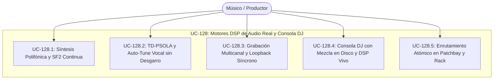
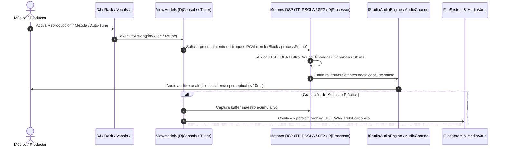

# Caso de Uso UC-128: Endurecimiento de Motores de Síntesis, Auto-Tune Vocal, Grabación de Estudio y Consola DJ Pro (Ola 3)

## 1. Descripción
Este caso de uso formaliza el endurecimiento técnico y la activación de procesamiento DSP de audio real en los subsistemas de Síntesis Polifónica SF2/WAV (`PolyphonicVoicePool`, `SoundFontSynthesizerService`), Auto-Tune Vocal y Corrección Tonal (`VocalAutoTuneProcessor` con TD-PSOLA), Grabadora de Práctica Multicanal y Loopback (`PracticeRecorderService`), Laboratorio Acústico (`HarmonicSpectrogram`, `ChromaVectorCalculator`), Consola DJ Profesional en Tiempo Real (`DjConsoleViewModel`, `DjAudioProcessor`, `DjMixWavEncoder`) y la matriz de enrutamiento reactivo (`StudioPatchbayRoutingService`, `SignalBus`).

Elimina de raíz simulaciones en bucle ciego, implementando síntesis de bloques PCM estéreo continuos, solapamiento OLA sin desgarro de fase espectral, codificación de mezclas DJ a disco con cabeceras RIFF canónicas y deduplicación atómica en el bus de señales modular.

---

## 2. Diagrama de Caso de Uso

---

## 3. Diagrama de Secuencia y Flujo de Datos

---

## 4. Especificaciones del Flujo

### 4.1 Precondiciones
- Instancia única de `StudioCompositionRoot` inicializada.
- Motor nativo o Pure Dart de síntesis y DSP listo para procesar bloques PCM sin bloqueo de UI (60/120 FPS).
- Rutas de almacenamiento local resueltas sin llamadas a `/tmp/`.

### 4.2 Flujo Principal
1. El usuario interactúa con la Consola DJ, Rack Modular o Suite Vocal.
2. `PolyphonicVoicePool` sintetiza bloques reales estéreo calculando envolventes ADSR completas y leyendo regiones SF2/PCM.
3. `VocalAutoTuneProcessor` procesa marcos de voz mediante TD-PSOLA (Time-Domain Pitch Synchronous Overlap-Add), modificando la periodicidad fundamental sin alterar los formantes ni desgarrar la fase acústica.
4. `DjAudioProcessor` ejecuta filtrado estéreo en tiempo real: ecualización de 3 bandas (Low, Mid, High), atenuación de stems, filtro resonante y retardo con retroalimentación sin producir clics de fader.
5. `DjMixWavEncoder` almacena la mezcla física en disco de forma incremental en formato PCM Little-Endian con cabecera estándar de 44 bytes.
6. `StudioPatchbayRoutingService` y `SignalBus` entregan eventos de señal punto a punto y en difusión sin duplicación de paquetes ni descalibración de puertos.

### 4.3 Flujos Alternativos y Excepciones
- **Excepción de Formato de Audio Corrupto:** Si una pista cargada en Deck DJ presenta cabecera WAV inválida, se rechaza la ingesta y se notifica al usuario sin desestabilizar el transporte del deck opuesto.
- **Voz no Periódica (Unvoiced):** En consonantes fricativas o sibilantes, el motor de Auto-Tune omite la cuantización forzada, preservando el timbre natural del cantante.
