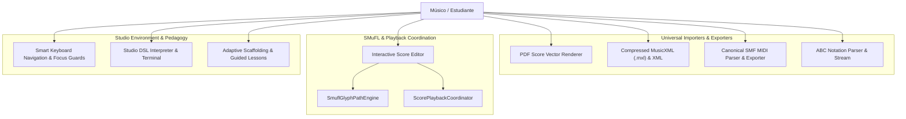
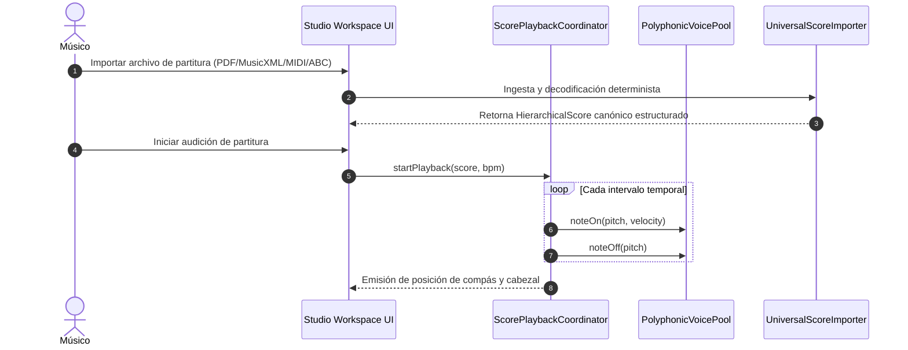

# Caso de Uso 129: Endurecimiento de Notación SMuFL, Parsers/Exporters, Navegación, Terminal DSL y Pedagogía

## 1. Identificador y Clasificación
- **ID:** `UC-129`
- **Nombre:** Endurecimiento Pre-v1.0.0 de Notación Musical SMuFL, Parsers/Exporters, Atajos de Navegación, Intérprete DSL y Suite Pedagógica
- **Fase:** Pre-v1.0.0 Hardening (Ola 4)
- **Prioridad:** Alta

---

## 2. Descripción General
Garantiza la máxima fidelidad musical y robustez de renderizado en los componentes de partitura (SMuFL, jerarquía de compases, parsing/exportación de PDF, MusicXML, MIDI y ABC), la ergonomía de navegación táctil y de teclado (evitando secuestro de eventos en campos de texto), la ejecución determinista del intérprete DSL en la terminal de estudio y la solidez diagnóstica de los módulos pedagógicos adaptativos.

---

## 3. Diagrama de Casos de Uso (Mermaid)

---

## 4. Diagrama de Secuencia (Mermaid)

---

## 5. Precondiciones, Postcondiciones y Flujos

### Precondiciones
1. El usuario carga o edita partituras dentro del entorno de Tunner.
2. La suite pedagógica y el motor de atajos globales están activos.

### Flujo Principal
1. El sistema ingesta partituras desde formatos universales (MusicXML, MIDI, ABC, PDF) aplicando sanitización contra división por cero y bucles infinitos.
2. El motor SMuFL dibuja cabezas de notas huecas (blancas, redondas) y plicas vectoriales con dimensiones normalizadas.
3. El coordinador de reproducción dispara eventos de NoteOn y NoteOff a tiempo, interpretando correctamente notas en bemoles y sostenidos (`Si`, `Sib`, `Mib`, etc.).
4. El sistema de navegación restringe los atajos de teclado globales cuando un `TextField` o diálogo mantiene el foco activo.
5. El intérprete DSL procesa scripts musicales y secuencias sin bloqueos ni errores sintácticos descontrolados.

### Flujos Alternativos y Excepciones
- **Archivo corrupto o truncado:** Los parsers capturan y transforman cualquier error binario en mensajes informativos sin causar crashes en la UI.
- **Entrada en campos de texto:** Si el usuario presiona barras espaciadoras o teclas de control mientras tipea en un cuadro de texto, la acción de transporte se inhabilita para proteger el texto.
