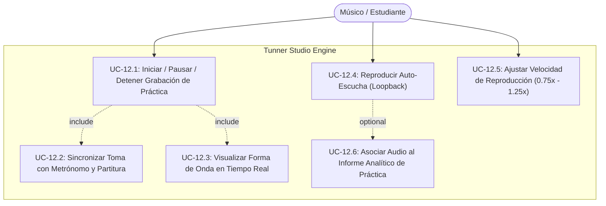
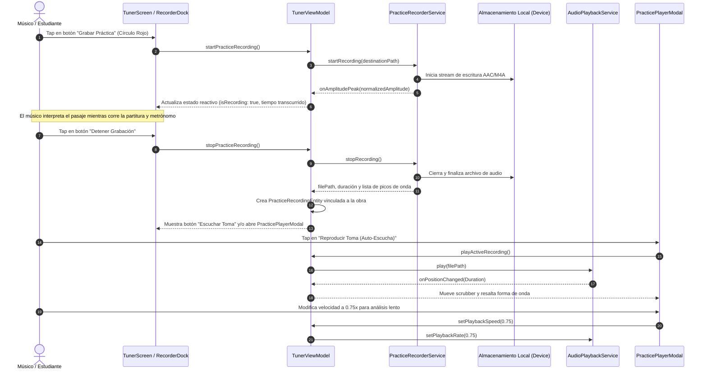

# Use Case 12: Practice Audio Recorder & Loopback Auto-Listening Studio
## Grabadora de Práctica & Auto-Escucha Inmediata (Audio Loopback)

---

## Metadatos del Caso de Uso

- **ID del Caso de Uso:** `UC-2026-012`
- **Título Oficial:** `Grabación de Práctica Instrumental y Reproducción de Auto-Escucha con Forma de Onda`
- **Actor Principal:** `Músico / Estudiante de Instrumento o Canto`
- **Fase Asociada:** `Fase 4`
- **Estado:** `Approved`
- **Prioridad:** `Alta (Imprescindible para Autoevaluación Auditiva)`

---

## 1. Diagrama de Casos de Uso (Mermaid)

---

## 2. Diagrama de Secuencia y Flujo de Interacción (Mermaid)

---

## 3. Especificación Formal del Caso de Uso

### 3.1 Precondiciones
1. La aplicación cuenta con permiso del sistema operativo para acceder al micrófono (solicitado previamente en la inicialización del afinador).
2. El dispositivo cuenta con espacio disponible en el almacenamiento local para almacenar archivos de audio comprimidos ($\approx 1\text{ MB}$ por minuto).

### 3.2 Postcondiciones
1. Se genera un archivo de audio canónico válido en el almacenamiento de la aplicación sin dependencias de red.
2. Se crea una entidad `PracticeRecordingEntity` que contiene la ruta del archivo, la fecha, la duración, el título de la canción practicada y la curva de amplitud de onda.
3. El usuario puede reproducir el audio grabado en bucle, pausarlo, desplazarse por cualquier punto del scrubber y ajustar la velocidad de reproducción.

### 3.3 Flujo Principal (Happy Path)
1. El usuario visualiza la barra de grabación en `TunerScreen`.
2. El usuario presiona el botón circular de grabación.
3. El indicador pasa a estado activo con una animación de pulso carmesí y comienza el contador de tiempo `00:01`, `00:02`...
4. El usuario interpreta la pieza en su instrumento o voz. La forma de onda va registrando las dinámicas interpretativas.
5. El usuario pulsa nuevamente el botón para detener la grabación.
6. La aplicación finaliza el archivo y emite una confirmación visual.
7. Se despliega el reproductor de auto-escucha (`PracticePlayerModal`) mostrando la forma de onda completa, la duración total y el botón de reproducción.
8. El usuario escucha su interpretación, ajustando la velocidad si desea auditar un pasaje rápido con mayor escrutinio.

### 3.4 Flujos Alternativos y Excepciones
- **A1: Grabación demasiado corta (< 0.5 s):**  
  Si el usuario detiene la grabación inmediatamente por error, el sistema detecta que la duración es insignificante, elimina el archivo temporal y notifica al usuario sin contaminar la lista de tomas.
- **A2: Falta de permisos en el sistema operativo:**  
  Si el permiso fue revocado en ajustes, el sistema captura la excepción, desactiva el estado de grabación y muestra un snackbar informativo invitando a conceder el permiso en la configuración del dispositivo.
- **A3: Grabación durante el Modo de Práctica Evaluada:**  
  Si el usuario activa la grabación durante una sesión de evaluación, al presionar "Finalizar Práctica", el reporte de práctica (`PracticeReportModal`) integra automáticamente el reproductor de la toma para una correlación visual-auditiva instantánea de los errores reportados.
