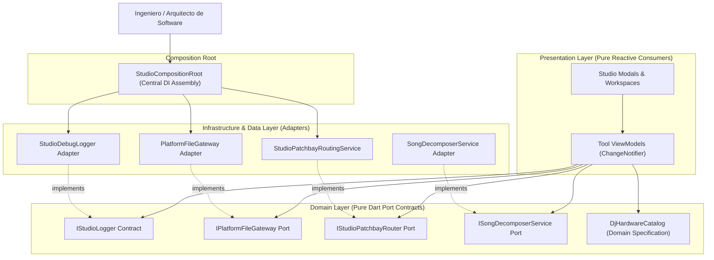
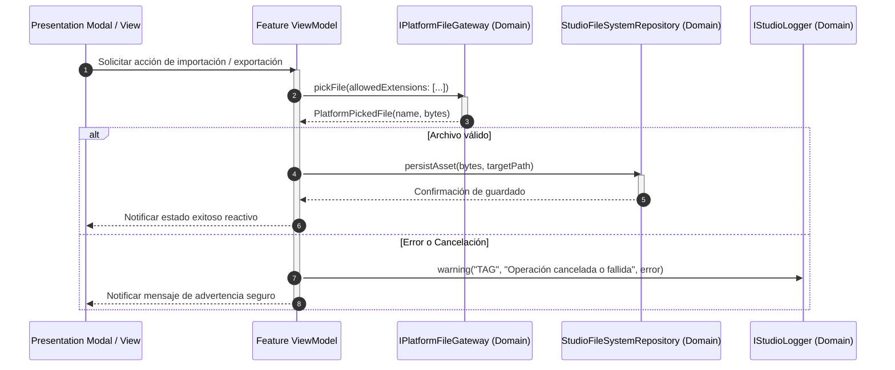

# Caso de Uso 130: Clean Architecture Estricta, Inversión de Dependencias (DIP) y Descomposición Modular

## 1. Identificador y Clasificación
- **ID:** `UC-130`
- **Nombre:** Endurecimiento Pre-v1.0.0 de Clean Architecture, Inversión de Dependencias (DIP), Centralización Estructurada de Logs y Descomposición Modular
- **Fase:** Pre-v1.0.0 Hardening (Ola 5)
- **Prioridad:** Alta

---

## 2. Descripción General
Erradica las violaciones residuales de Clean Architecture e Inversión de Dependencias (DIP) en el codebase de Tunner antes del lanzamiento v1.0.0. Esto comprende:
1. Eliminar importaciones prohibidas directas de la capa de Presentación hacia Capa de Datos o Infraestructura (`presentation -> data`), derivando contratos abstractos hacia `domain/`.
2. Prohibir operaciones crudas de disco (`dart:io`, `file_picker`, `path_provider`) dentro de widgets o modales de la interfaz de usuario, canalizándolas a través del puerto de dominio `IPlatformFileGateway` y los repositorios de almacenamiento del espacio de trabajo.
3. Desmantelar patrones singleton basados en constructores fábrica que devuelven variables estáticas globales sin abstracción (`.instance`), promoviendo constructores aislados e inyección explícita a través de `StudioCompositionRoot`.
4. Reemplazar los bloques de captura vacíos (`catch (_) {}`) por diagnóstico estructurado resiliente, y migrar las llamadas dispersas a `debugPrint` hacia la interfaz canónica de registro `IStudioLogger`.
5. Reubicar y organizar componentes que residían fuera de su estructura de carpetas canónica.

---

## 3. Diagrama de Casos de Uso (Mermaid)

---

## 4. Diagrama de Secuencia (Mermaid)

---

## 5. Precondiciones
1. Las Olas 1 a 4 están completamente estabilizadas, probadas y fusionadas en la rama `qa`.
2. El contrato de logging `IStudioLogger` y el adaptador `StudioDebugLogger` están definidos en `lib/core/logging/`.
3. El puerto de selector y rutas `IPlatformFileGateway` está definido en `lib/core/file_system/domain/`.

---

## 6. Flujo Principal (Camino Feliz)
1. Los modales y componentes visuales en `lib/features/*/presentation/` dependen estrictamente de sus ViewModels y contratos de `domain/`.
2. Las operaciones de guardado y lectura de archivos en disco se ejecutan a través de puertos abstractos de dominio (`IPlatformFileGateway`, `StudioFileSystemRepository`), sin importar `dart:io`, `file_picker` ni `path_provider` directamente en widgets de presentación.
3. Los servicios de catálogo (`DjHardwareCatalog`, `ProceduralInstrumentSynthesizer`) residen en `domain/` como entidades y especificaciones procedurales puras sin dependencias de plataforma.
4. Todos los bloques de captura aplican manejo explícito con registro en `IStudioLogger` sin silenciar fallas con bloques vacíos.
5. Los registros de diagnóstico utilizan `IStudioLogger` / `StudioDebugLogger.instance` garantizando visibilidad en tiempo de depuración y pruebas sin contaminación no estructurada.

---

## 7. Flujos Alternativos y Excepciones
- **Excepción en I/O o Selector de Archivos:** La falla es capturada explícitamente y registrada a través de `IStudioLogger.warning(...)` o `error(...)`, devolviendo un estado seguro al ViewModel sin provocar fallas no controladas ni silenciar excepciones.

---

## 8. Postcondiciones
1. Cero importaciones directas de `presentation -> data/infra` en los módulos intervenidos.
2. Cero importaciones de `dart:io`, `file_picker` o `path_provider` dentro de componentes de `presentation/`.
3. Cero bloques `catch (_) {}` vacíos en el código de producción.
4. Análisis estático `flutter analyze --no-fatal-infos` con 0 errores y 0 advertencias.
5. Cobertura completa de la suite `flutter test` al 100%.
