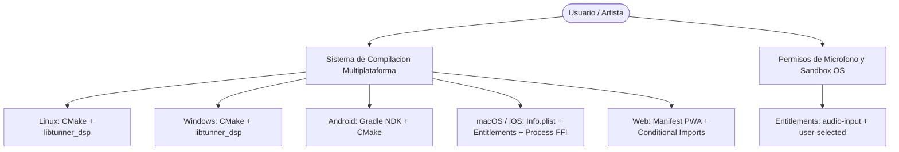
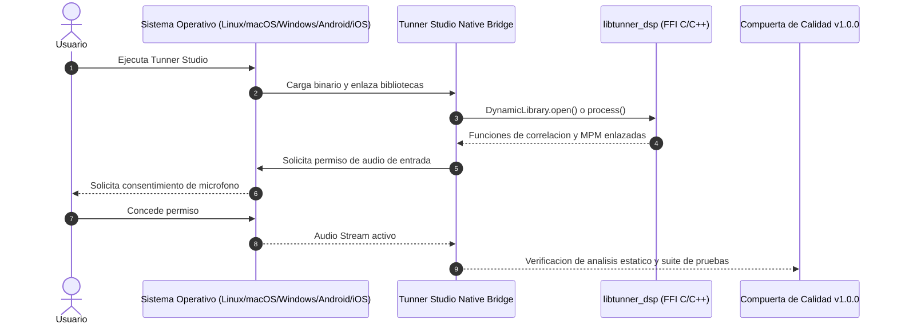

# Caso de Uso 131: Empaquetado Multiplataforma, Permisos Nativos y Compuerta Final Pre-v1.0.0

## Metadatos
- **ID:** `UC-131`
- **Nombre:** Empaquetado Multiplataforma, Permisos Nativos y Compuerta Final v1.0.0
- **Fase:** Fase 4 / Hardening Pre-v1.0.0
- **Prioridad:** Bloqueante (Release Blocker)
- **Actor Principal:** Usuario de Tunner Studio (Desktop Linux/macOS/Windows, Mobile Android/iOS, Navegador Web)

---

## 1. Descripción
Este caso de uso formaliza los requerimientos de compilación nativa cruzada, permisos de sistema operativo (micrófono y archivos), aislamiento de dependencias web y verificación de la compuerta final de calidad antes de la liberación oficial de Tunner Studio v1.0.0.

---

## 2. Diagrama de Casos de Uso (Mermaid)

---

## 3. Diagrama de Flujo y Secuencia (Mermaid)

---

## 4. Precondiciones, Flujo Principal y Postcondiciones

### Precondiciones
1. Las Olas 1 a 5 de hardening han sido completadas y fusionadas en la rama `qa`.
2. Las herramientas de compilación cruzada y CMakeLists.txt están estructuradas.

### Flujo Principal
1. El compilador compila el módulo FFI `libtunner_dsp` en las plataformas de destino.
2. macOS solicita permisos de micrófono y acceso a archivos con cadenas descriptivas oficiales.
3. Se purga `pitch_detector_dart` de `pubspec.yaml` (dependencia huérfana).
4. El Application ID canónico `org.tunner.studio` está registrado de forma consistente en Android, Linux, macOS y Windows.
5. Se ejecutan `flutter analyze --no-fatal-infos` (0 advertencias) y `flutter test` (100% pruebas superadas).

### Flujos Alternativos y de Error
- **FA-01 Plataforma Web:** Si se ejecuta en navegador Web, FFI y llamadas a `dart:io` no se enlazan gracias a importaciones condicionales y se utiliza el pipeline de fallback Web Audio.
- **FE-01 Permiso denegado:** Si el usuario no otorga permiso de micrófono, la interfaz de audio entra en modo seguro de visualización sin crasheos.
