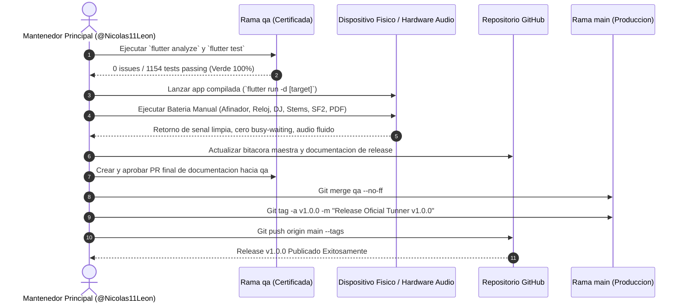

# Caso de Uso 132: Certificación de Release v1.0.0, Validación Manual en Dispositivo y Aprobación Canónica

---

## Metadatos del Documento

- **ID del Caso de Uso:** `UC-132`
- **Título Oficial:** `Certificación de Release v1.0.0, Validación Manual en Dispositivo y Aprobación Canónica`
- **Fase Asociada:** `Pre-Release Gate v1.0.0 / Fase 8-9 Global`
- **Estado:** `Aprobado`
- **Fecha de Creación:** `2026-11-19`
- **Última Modificación:** `2026-11-19`
- **Autor / Revisor Principal:** `@Nicolas11Leon (Mantenedor Principal)`
- **ADR Relacionado:** [ADR-0121](../04_adrs/0121_v1_0_0_official_release_and_manual_qa_certification.md)
- **Plan de Implementación:** [plan_v1_0_0_official_release_and_qa_certification.md](../05_implementation_plans/plan_v1_0_0_official_release_and_qa_certification.md)

---

## 1. Resumen Ejecutivo (Executive Summary)

El presente Caso de Uso formaliza el protocolo final de auditoría, verificación manual de campo y gobernanza para la publicación de la versión **v1.0.0** de **Tunner**. Establece el flujo metodológico mediante el cual el Mantenedor Principal (@Nicolas11Leon) ejecuta la batería de 10 pruebas manuales en hardware real (micrófono, latencia, afinación estroboscópica, sintetizador SF2, consola DJ y exportadores de partituras), valida la compuerta de calidad de 1,154 pruebas automatizadas y 0 issues de analizador estático en la rama `qa`, y certifica el merge definitivo hacia `main` con su respectiva etiqueta canónica firmada `v1.0.0`.

---

## 2. Diagrama de Casos de Uso (Mermaid)

```mermaid
flowchart TD
    subgraph Actores
        Dev["Mantenedor Principal (@Nicolas11Leon)"]
        Tester["Evaluador Acustico / QA"]
    end

    subgraph Plataforma Tunner (v1.0.0)
        UC132_1["Verificar Compuerta Automatizada (1154 Tests / 0 Lints)"]
        UC132_2["Ejecutar Protocolo de Pruebas Manuales de Campo (10 Escenarios)"]
        UC132_3["Auditar Telemetria y Latencia Sub-10ms en Hardware"]
        UC132_4["Firmar y Actualizar Bitacora Maestra de QA"]
        UC132_5["Aprobar Merge Oficial de qa hacia main"]
        UC132_6["Crear Tag Oficial v1.0.0 y Publicar Release"]
    end

    Dev --> UC132_1
    Tester --> UC132_2
    Tester --> UC132_3
    Dev --> UC132_4
    Dev --> UC132_5
    Dev --> UC132_6
```

---

## 3. Diagrama de Secuencia y Flujo de Aprobación (Mermaid)



---

## 4. Precondiciones y Postcondiciones

### 4.1 Precondiciones
1. Todas las 6 Olas del Plan de Endurecimiento Pre-v1.0.0 (`#84` a `#89`) deben estar squash-merged en la rama `qa`.
2. La suite de pruebas automatizadas debe reportar exactamente 1,154 pruebas pasando al 100% en tiempo de ejecución.
3. El analizador estático de Dart (`flutter analyze --no-fatal-infos`) debe reportar 0 errores y 0 advertencias.
4. El repositorio debe contar con un árbol de trabajo limpio (`clean working tree`) en la rama `qa`.

### 4.2 Postcondiciones
1. La bitácora maestra de pruebas manuales (`docs/06_qa_and_manual_testing/bitacora_maestra_pruebas_manuales.md`) queda firmada con la fecha y estado de validación.
2. Las notas de lanzamiento oficiales de la versión 1.0.0 (`docs/07_releases/release_notes_v1.0.0.md`) quedan actualizadas.
3. El `README.md` principal exhibe las métricas reales consolidadas de la versión 1.0.0.
4. La rama `main` contiene el historial inmutable de la plataforma y el tag oficial `v1.0.0`.

---

## 5. Flujo Principal (Camino Feliz)

1. El mantenedor ejecuta la verificación automatizada en terminal local asegurando el pase del 100% de la suite.
2. El evaluador compila la aplicación en un dispositivo físico de prueba (Linux Desktop, Android, macOS o Windows).
3. Se ejecutan los 10 escenarios del protocolo de pruebas manuales de campo:
   - Captura de micrófono y calibración $A_4 = 440\text{ Hz}$.
   - Afinación estroboscópica virtual y respuesta visual de desviación en cents.
   - Reloj maestro de estudio, metrónomo acústico y Tap Tempo.
   - Transcripción en vivo de micrófono a partitura vectorial SMuFL.
   - Sintetizador SoundFont SF2 y reproducción polifónica.
   - Suite vocal con Auto-Tune TD-PSOLA en tiempo real.
   - Consola DJ dual-deck, ecualizador de 3 bandas y grabación de mezcla.
   - Patchbay matricial de señales de estudio.
   - Exportación e importación de contenedores `.tunner`, MusicXML, MIDI y PDF.
   - Intercambio de temas visuales y memoria de estado de ventanas.
4. El mantenedor registra los resultados en la bitácora maestra.
5. El mantenedor ejecuta el merge soberano hacia `main` y publica el tag `v1.0.0`.

---

## 6. Flujos Alternativos y de Contingencia

### 6.1 Fallo en Escenario de Hardware (e.g. Micrófono sin Permiso en SO)
- El sistema invoca el `HardwarePermissionBroker` y muestra al usuario un diálogo modal no bloqueante indicando las instrucciones exactas del sistema operativo para otorgar permisos.
- Si el usuario rechaza los permisos, los motores de audio operan en modo generador interno (síntesis de diapasón, metrónomo, consola DJ) sin crashear.

### 6.2 Detección de Regresión Crítica en Hardware
- Si se detecta un fallo acústico no cubierto por tests en un hardware específico, se registra el issue de forma atómica en GitHub vinculándolo a la bitácora con estado `[!] Con Observaciones`.
- El mantenedor detiene el merge a `main`, se crea una rama de hotfix quirúrgica desde `qa`, se añade el test de regresión unitario, se aprueba el PR hacia `qa` y se reanuda el protocolo.

---

## 7. Criterios de Aceptación (Definition of Done)

- [x] 1,154 pruebas unitarias, de integración y de widgets pasando al 100%.
- [x] 0 advertencias de linter (`flutter analyze`).
- [x] Documentación de Casos de Uso completa (UC-01 al UC-132).
- [x] Documentación de ADRs completa (ADR-0001 al ADR-0121).
- [x] Bitácora Maestra y Protocolo Manual de QA documentados formalmente.
- [x] Release Notes v1.0.0 rigurosas y sincronizadas.
