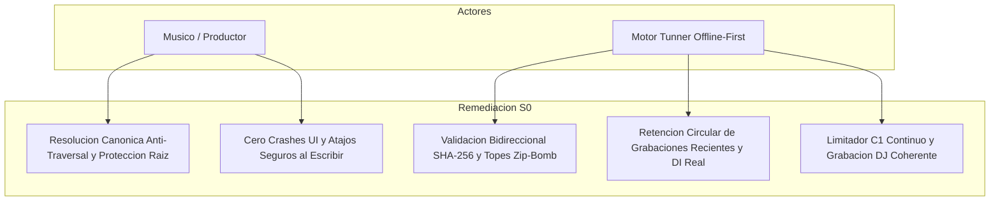
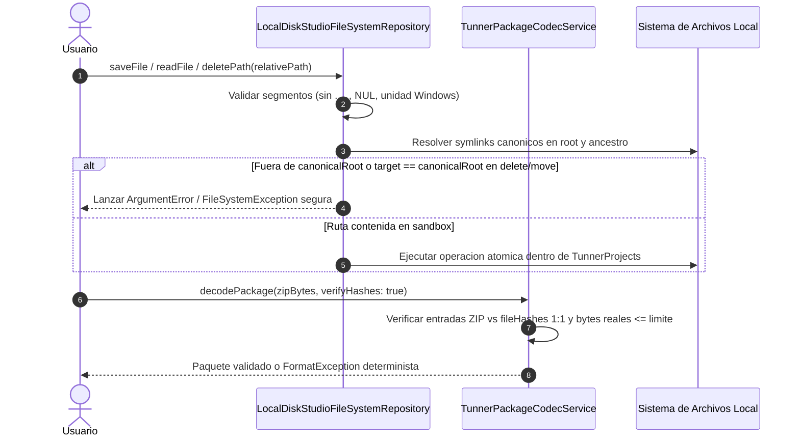

# Caso de Uso 133: Remediación de Bloqueantes S0 (Seguridad FS, Integridad de Datos, Crashes UI, Limiter y Teclado)

---

## Metadatos del Documento

- **ID del Caso de Uso:** `UC-133`
- **Título Oficial:** `Remediación Integral de Bloqueantes S0 Pre-v1.0.0 (Ola Final A)`
- **Fase Asociada:** `Pre-Release Gate v1.0.0 — Ola Final A`
- **Estado:** `Aprobado`
- **Fecha de Creación:** `2026-11-19`
- **Última Modificación:** `2026-11-19`
- **Autor / Revisor Principal:** `@Nicolas11Leon (Mantenedor Principal)`
- **ADR Relacionado:** [ADR-0122](../04_adrs/0122_pre_v1_final_wave_a_s0_blockers.md)
- **Plan de Implementación:** [plan_pre_v1_final_wave_a_s0_blockers.md](../05_implementation_plans/plan_pre_v1_final_wave_a_s0_blockers.md)

---

## 1. Resumen Ejecutivo

Este Caso de Uso formaliza la eliminación de los bloqueantes críticos de severidad S0 detectados en la auditoría forense sobre la rama `qa`: escapes de sandbox y borrado recursivo de raíz en disco, bypass parcial de verificación SHA-256 y límites de descompresión en `.tunner`/`.mxl`/`.pdf`/`TUNP`, pérdida silenciosa de grabaciones recientes (>50), repositorios `NoOp` en producción, distorsión de plegado a cero en `_softLimit`, grabación DJ mono-como-estéreo 2x, exportaciones mudas/vacías, secuestro global de teclado y 6 crashes reproducibles en widgets de interfaz.

---

## 2. Diagrama de Casos de Uso (Mermaid)

---

## 3. Diagrama de Secuencia: Resolución Segura de Rutas y Verificación `.tunner` (Mermaid)

---

## 4. Precondiciones y Postcondiciones

### 4.1 Precondiciones
1. Repositorio sincronizado en rama `fix/pre-v1-final-wave-a-s0-blockers` desde `qa`.
2. Suite base de 1,154 pruebas en verde.

### 4.2 Postcondiciones
1. Cero escapes de sandbox ni borrado de raíz posibles en `LocalDiskStudioFileSystemRepository`.
2. Verificación SHA-256 1:1 y límites de descompresión activos en `.tunner`, `.mxl`, `.pdf` y `TUNP`.
3. `AppUserSettingsEntity` conserva las 50 grabaciones más recientes (desde índice 0).
4. `StudioCompositionRoot` inyecta repositorios reales en DJ, Rack y `StemExportPersistenceService`.
5. `_softLimit` es $C^1$-continuo sin discontinuidad en $|x|=1.0$.
6. La grabación DJ usa `numChannels: 1` acorde al buffer mono, sin sintetizar 4s por tick de 33 ms.
7. Los 6 crashes UI y el secuestro global de teclado quedan erradicados.

---

## 5. Flujo Principal y Flujos de Error

- **Flujo Principal:** Cada operación de E/S, persistencia, audio y UI ejecuta validaciones deterministas antes de operar sobre disco, buffers o árbol de widgets.
- **Flujos de Error:** Rutas maliciosas, archivos comprimidos manipulados o búferes menores a 48 muestras en TD-PSOLA lanzan excepciones controladas o retornan de forma segura sin corrupción ni crashes.
