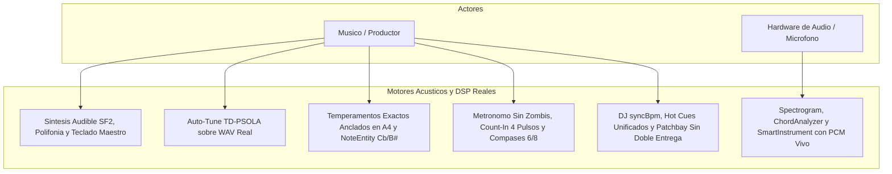
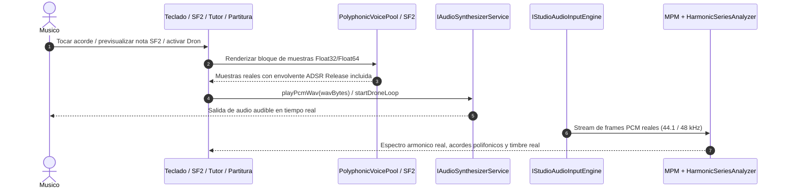

# Caso de Uso 134: Motores de Audio Reales, DSP, MPM, Temperamentos, Metrónomo, SF2, Auto-Tune y Consola DJ

---

## Metadatos del Documento

- **ID del Caso de Uso:** `UC-134`
- **Título Oficial:** `Cableado de Audio Real, Precisión Matemática DSP, Temperamentos Históricos, Metrónomo Compuesto y Consola DJ (Ola Final B)`
- **Fase Asociada:** `Pre-Release Gate v1.0.0 — Ola Final B`
- **Estado:** `Aprobado`
- **Fecha de Creación:** `2026-11-19`
- **Última Modificación:** `2026-11-19`
- **Autor / Revisor Principal:** `@Nicolas11Leon (Mantenedor Principal)`
- **ADR Relacionado:** [ADR-0123](../04_adrs/0123_pre_v1_final_wave_b_audio_dsp_sf2_and_dj.md)
- **Plan de Implementación:** [plan_pre_v1_final_wave_b_audio_dsp_sf2_and_dj.md](../05_implementation_plans/plan_pre_v1_final_wave_b_audio_dsp_sf2_and_dj.md)

---

## 1. Resumen Ejecutivo

Este Caso de Uso formaliza la activación real de audio y la corrección matemática DSP en todos los motores sonoros de Tunner: reproducción audible real en `PolyphonicVoicePool`, SoundFont SF2 preview, `UniversalMasterKeyboardWidget` y `HarmonicTutor`; procesamiento WAV real en `VocalAutoTuneProcessor` con `TdPsolaPitchShifter`; alimentación de muestras PCM reales hacia `HarmonicSpectrogramModal`, `ChordAnalyzer` y `SmartInstrumentDetector`; calibración de tablas de temperamentos históricos (`Vallotti`, `Young II`, `Werckmeister IV`, `Kirnberger I`) con anclaje en $A_4$; reloj y count-in exacto en compases simples y compuestos (`6/8`, `9/8`, `12/8`); decodificación real de generadores `.sf2` con signo y fase Release; sincronización de velocidad DJ (`syncBpm`), selector local de pistas DJ y unificación de índices Hot Cue; y enrutamiento limpio sin doble entrega en `StudioPatchbayRoutingService` y `SignalBus`.

---

## 2. Diagrama de Casos de Uso (Mermaid)

---

## 3. Diagrama de Secuencia: Flujo Acústico PCM Real y Síntesis Audible (Mermaid)

---

## 4. Precondiciones y Postcondiciones

### 4.1 Precondiciones
1. Rama `fix/pre-v1-final-wave-b-audio-dsp-sf2-and-dj` creada desde `qa` con Ola A fusionada (`e41bcd3`).

### 4.2 Postcondiciones
1. Todo motor sonoro (SF2 preview, `PolyphonicVoicePool`, `UniversalMasterKeyboardWidget`, `HarmonicTutor`, `VocalAutoTune` WAV) produce audio real audible o archivos WAV procesados reales.
2. `TemperamentEngine`, `NoteEntity` (`Cb`/`B#` y `♭`/`♯`), `StudioMasterClockService`, `MetronomeService` y `TapTempoEngine` operan con precisión musicológica $\pm 0.1\text{ cents}$ y sin deriva ni Isolates zombis.
3. `StudioPatchbayRoutingService` y `SignalBus` entregan cada evento exactamente una vez respetando `Mute`, `Gain` y dirección `PortDirection.input`.
