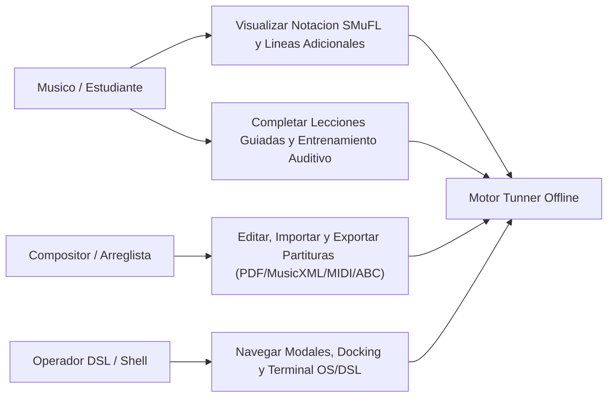
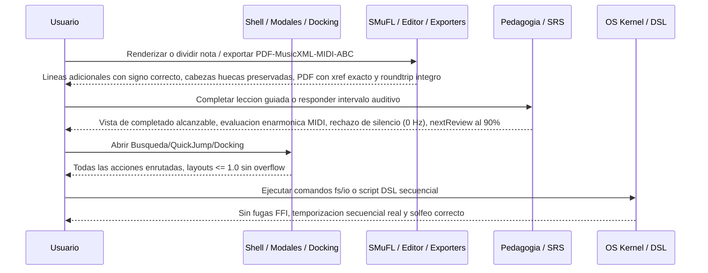

# UC-135: Endurecimiento Pre-v1.0.0 Ola C (Notacion SMuFL, Parsers/Exporters, Pedagogia, Navegacion, Shell y DSL)

## 1. Metadata
- **ID:** UC-135
- **Issue:** #94
- **Milestone:** Pre-v1.0.0 Final Wave C
- **Actores:** Musico / Estudiante, Compositor / Arreglista, Ingeniero de Audio / Operador DSL, Sistema Tunner

## 2. Descripcion
Garantiza la correccion estructural, matematica y de flujo de usuario en los subsistemas de notacion musical SMuFL, edicion de partitura, exportacion/importacion (PDF, MusicXML, MIDI, ABC, OMR), evaluacion pedagogica (lecciones guiadas, entrenamiento auditivo, repeticion espaciada), transcripcion en vivo, navegacion/modales del shell, docking y ejecucion del DSL/Terminal OS.

## 3. Diagrama de Casos de Uso

## 4. Diagrama de Secuencia (Flujos Endurecidos)

## 5. Precondiciones y Postcondiciones
- **Precondiciones:** Wave B integrada en `qa`.
- **Postcondiciones:**
  - `SmuflGlyphPathEngine` dibuja lineas adicionales arriba/abajo con el signo correcto y usa `PathFillType.evenOdd` en redondas.
  - `ScoreEditorOperations` preserva la cola al dividir notas y marca silencios con `isRest: true`; `AlgorithmicExerciseGenerator` marca silencios con `isRest: true`.
  - `CanonicalPdfExporter` no corrompe bemoles en espanol (`MIB4` -> `Eb4`), no tapa cabezas huecas y lee el compas real.
  - `PedagogicalReportPdfGenerator` genera `xref` con offsets de bytes `latin1` exactos, sin operador ilegal `arc`, usando matriz absoluta `Tm`, hash `sha256` real, respetando `includeRhythmJitter` y marca `"TUNNER"`.
  - `GuidedLessonsModal`, `PracticeEvaluatorService`, `BlindEarTrainerEngine` y `EbbinghausSpacedRepetitionEngine` evaluan enarmonicos por MIDI, rechazan `0 Hz`, muestran pantalla de completado y alinean `nextReview` con `retentionAt(nextReview) == 0.90`.
  - Parsers/Exporters (MusicXML, MIDI, ABC, PDF/OMR, AudioToScore) y `TunnerOsKernel` / `TunnerDslInterpreter` / `StudioWorkspaceDockingContainer` / `ToolSearchModal` / `TaskQuickJumpModal` operan sin datos mock, fugas ni overflows.

## 6. Flujo Principal y Alternativos
- **Flujo Principal:** Cada componente valida entradas malformadas o casos borde (enarmonicos, compases compuestos, silencios, layouts extremos) y produce salida determinista.
- **Flujos Alternativos / Error:**
  - WAV con `channels == 0` o `sampleRate == 0` es rechazado con error controlado sin division por cero.
  - Scripts DSL con `isDryRun: true` simulan sin despachar audio ni mutar estado.
  - Paneles dockeados con suma `left + right > 1.0` se ajustan proporcionalmente al espacio disponible.
