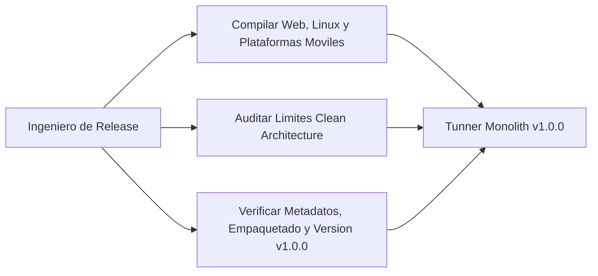
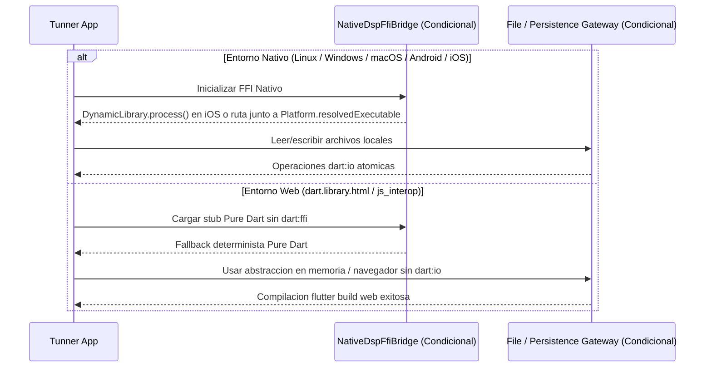

# UC-136: Endurecimiento Pre-v1.0.0 Ola D (Clean Architecture, Multiplataforma Real, CI/CD y Pulido v1.0.0)

## 1. Metadata
- **ID:** UC-136
- **Issue:** #95
- **Milestone:** Pre-v1.0.0 Final Wave D (Release Candidate v1.0.0)
- **Actores:** Ingeniero de Release, Desarrollador Multiplataforma, Usuario Web/Desktop/Mobile, Sistema Tunner

## 2. Descripcion
Completa la preparacion final de Tunner `v1.0.0`: habilita compilacion Web limpia mediante importaciones condicionales (`dart.library.ffi` / `dart.library.io`), endurece la carga FFI nativa en iOS/Desktop (`DynamicLibrary.process()` y busqueda relativa a `Platform.resolvedExecutable`), corrige empaquetado iOS/Android/macOS/Linux/Windows/Web, limpia dependencias huerfanas, corrige violaciones criticas de Clean Architecture en `domain/` y `core/`, y unifica la version y telemetria real `v1.0.0` en UI y documentacion.

## 3. Diagrama de Casos de Uso

## 4. Diagrama de Secuencia (Carga Multiplataforma y Compilacion)

## 5. Precondiciones y Postcondiciones
- **Precondiciones:** Olas A, B y C integradas en `qa`.
- **Postcondiciones:**
  - `flutter build web --no-pub` compila con codigo de salida 0 mediante importaciones condicionales.
  - `NativeDspFfiBridge` usa `DynamicLibrary.process()` en iOS y busca junto a `Platform.resolvedExecutable` en escritorio; `native/dsp/CMakeLists.txt` no emite warnings de `PUBLIC_HEADER`.
  - Identificadores `com.example.tunner` eliminados en Android/macOS/iOS (`org.tunner.studio`), titulos de ventana/web actualizados a `Tunner`, y dependencias huerfanas (`cupertino_icons`, `permission_handler`) removidas de `pubspec.yaml`.
  - `studio_desktop_app_shell.dart` y `tunner_os_terminal_drawer.dart` muestran `v1.0.0` y telemetria real; `CONTRIBUTING.md`, `RELEASE_NOTES_v1.0.md` y `README.md` reflejan la configuracion y conteo de pruebas reales.
  - Violaciones `**/domain/**` (`universal_media_io_service.dart`, `app_user_settings_entity.dart`, `i_studio_workspace_file_system.dart`, `i_studio_patchbay_routing_service.dart`, `studio_patchbay_routing_service.dart`) y `Core -> Features` resueltas sin romper la suite de pruebas.

## 6. Flujo Principal y Alternativos
- **Flujo Principal:** Ejecutar compilacion estatica, compilacion Web y Linux, y suite completa de pruebas en `qa`.
- **Flujos Alternativos / Error:** Si una plataforma carece de libreria nativa `.so`/`.dll`/`.dylib`, `NativeDspFfiBridge` degrada de forma segura al motor Pure Dart sin lanzar excepciones fatales.
