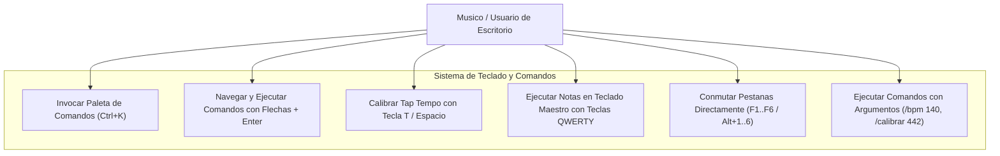
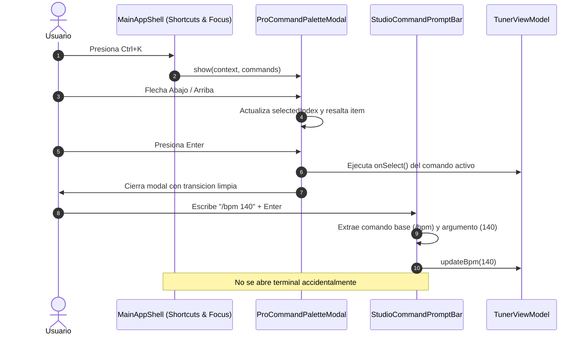

# Caso de Uso 137: UX Wave 1 - Atajos de Teclado, Gestion de Foco, Paleta de Comandos y Prompt Bar

## Metadatos
- **ID:** `UC-137`
- **Titulo:** Experiencia de Usuario de Teclado Fisico, Navegacion Spotlight y Prompt de Comandos
- **Fase:** Fase 4 - Hardening Pre-v1.0.0
- **Estado:** Aprobado
- **Fecha:** 2026-11-20
- **Autor:** Antigravity AI & Nicolas Leon

---

## 1. Descripcion General
Permitir a musicos profesionales, productores y educadores operar Tunner con fluidez mediante teclado fisico en sistemas de escritorio (Linux, macOS, Windows) y entornos web. Garantiza navegacion por flechas y ejecucion con Enter en la Paleta de Comandos (`Ctrl+K`), aislamiento del foco para prevenir activaciones no deseadas de botones previamente pulsados con `Space` o `Enter`, soporte integral de atajos globales (`Ctrl+S`, `Ctrl+O`, `Ctrl+N`, `Ctrl+B`, `Ctrl+Shift+D`, `F1..F6`, `Alt+1..6`, `F12`, `?`), entrada de teclado para Tap Tempo y Teclado Maestro, y filtrado sintactico robusto de comandos en la barra de prompts sin apertura accidental de terminales.

---

## 2. Diagrama de Casos de Uso (Mermaid)

---

## 3. Diagrama de Secuencia (Mermaid)

---

## 4. Precondiciones y Postcondiciones

### Precondiciones
1. La aplicacion Tunner se encuentra activa en un entorno con teclado fisico o sintetizador de eventos de teclado.
2. El arbol de widgets mantiene configurado el sistema de `Shortcuts` y `Actions` de Flutter.

### Postcondiciones
1. La navegacion con flechas en la paleta de comandos destaca de forma visible el elemento enfocado y la tecla Enter ejecuta su accion.
2. Los botones de la interfaz de usuario no secuestran los comandos de transporte global (`Space`, `Enter`) tras recibir un clic de ratón.
3. Los 12 atajos documentados responden de manera determinista tanto en modo normal como en modo DJ.
4. El comando `/bpm <valor>` o `/calibrar <hz>` en el prompt bar actualiza el tempo o afinacion sin desplegar la consola de terminal.
