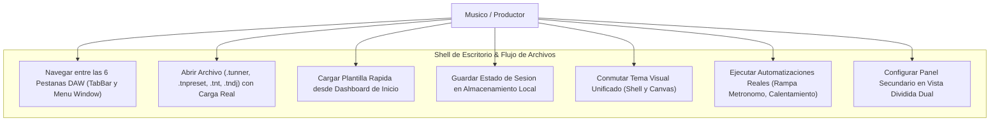
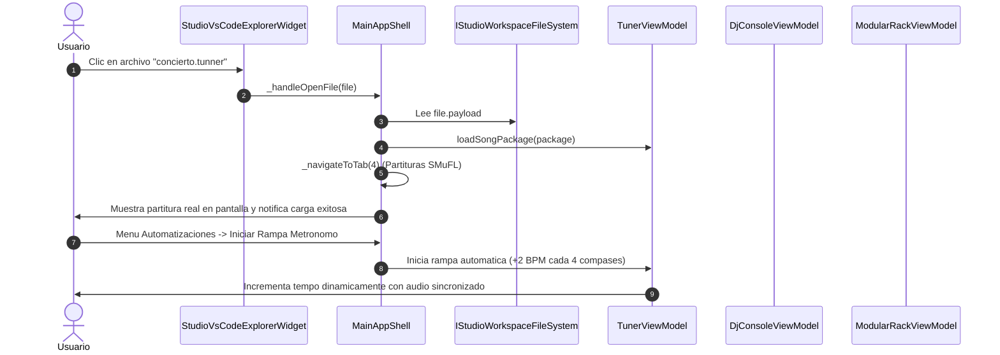

# Caso de Uso 138: UX Wave 2 - Shell de Escritorio, Pestanas DAW, Explorador de Archivos y Automatizaciones Reales

## Metadatos
- **ID:** `UC-138`
- **Titulo:** Shell de Escritorio DAW, Sincronizacion de Pestanas, Carga de Archivos y Automatizaciones Reales
- **Fase:** Fase 4 - Hardening Pre-v1.0.0
- **Estado:** Aprobado
- **Fecha:** 2026-11-20
- **Autor:** Antigravity AI & Nicolas Leon

---

## 1. Descripcion General
Garantizar la coherencia visual, estructural y funcional del Shell de Escritorio en Tunner. Corrige la barra superior de pestanas DAW (`StudioWorkspaceTabBar`) y el menu `Window` para reflejar con precision las 6 areas de trabajo del sistema (Inicio, Afinador, Aprender, Rack, Partituras y Consola DJ). Transforma el Explorador de Archivos y las plantillas rapidas del Dashboard en flujos 100% operativos mediante la deserializacion e inyeccion real de payloads en sus respectivos ViewModels. Conecta el sistema de personalizacion visual y asegura que las automatizaciones de estudio (rampas de BPM y rutinas guiadas) alteren el estado real de la sesion musical.

---

## 2. Diagrama de Casos de Uso (Mermaid)

---

## 3. Diagrama de Secuencia (Mermaid)

---

## 4. Precondiciones y Postcondiciones

### Precondiciones
1. El arbol de widgets de Tunner cuenta con las 6 vistas principales instanciadas y enlazadas a sus ViewModels.
2. El sistema de archivos local o en memoria cuenta con descriptores de archivo `StudioFileEntity` validos.

### Postcondiciones
1. Las 6 pestanas de `StudioWorkspaceTabBar` y las 6 opciones del menu `Window` navegan con precision a los indices 0 a 5.
2. Hacer clic en cualquier archivo en el explorador lateral carga sus datos reales en el ViewModel correspondiente.
3. Las 4 plantillas del Dashboard configuran el estado operativo antes de transicionar de pestana.
4. Las automatizaciones y personalizaciones alteran los parametros de ejecucion del sistema en lugar de cerrarse como stubs.
5. La vista dividida dual permite alternar que herramienta se despliega en el marco secundario.
