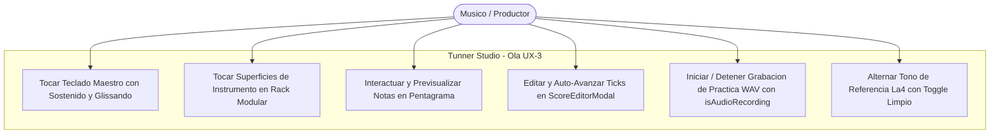
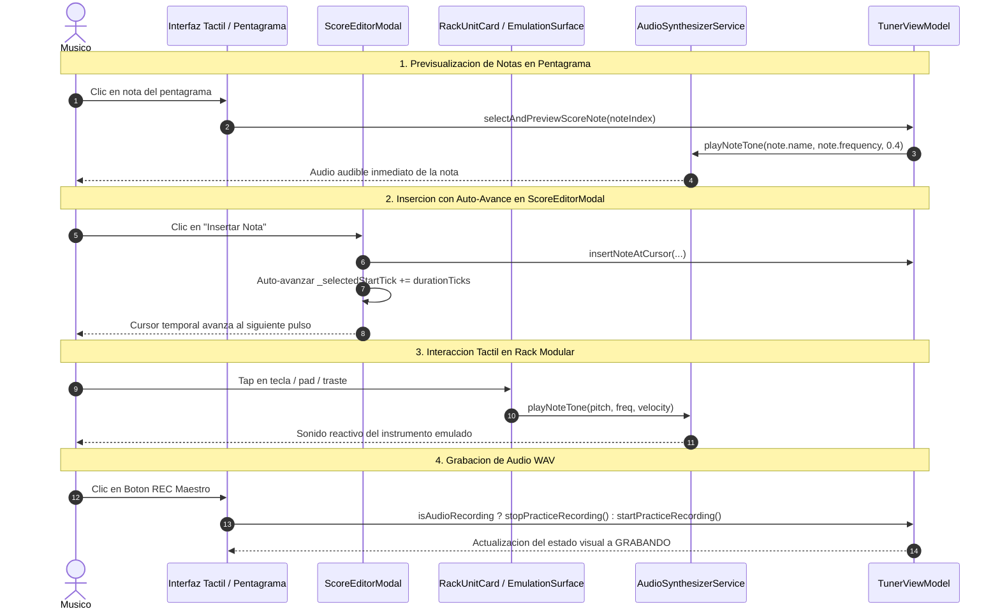

# Caso de Uso 139: Interaccion Tactil, Editor de Partituras, Superficies Rack y Grabadora (Ola UX-3)

## 1. Descripcion General
Este caso de uso formaliza la interaccion directa de puntero (clic) y tactil (touch) en Tunner Studio, asegurando retroalimentacion auditiva y visual inmediata en el Teclado Maestro Universal, las superficies de emulacion de instrumentos del Rack Modular (teclas, trastes, pads), el pentagrama interactivo, el modal de edicion de partituras y los botones de grabacion de practica de audio.

---

## 2. Diagrama de Caso de Uso (Mermaid)

---

## 3. Diagrama de Secuencia (Mermaid)

---

## 4. Precondiciones y Postcondiciones

### Precondiciones
1. La aplicacion Tunner se encuentra en ejecucion en modo Desktop o Tablet/Movil.
2. El sistema de audio local esta inicializado sin dependencias de red.

### Postcondiciones
1. Cada pulsacion tactil o clic sobre notas del pentagrama, teclas del teclado maestro y superficies del rack modular produce sonido audible local.
2. Los botones de grabacion de tomas de practica en el Dock y en la Consola Maestra reflejan con precision el estado de grabacion WAV (`isAudioRecording`).
3. El editor de partituras avanza el cursor temporal de manera fluida al insertar notas sin forzar ajustes manuales del slider.
4. El tono de referencia La4 es un toggle limpio que puede apagarse al pulsar nuevamente sin falsear el motor del afinador.
