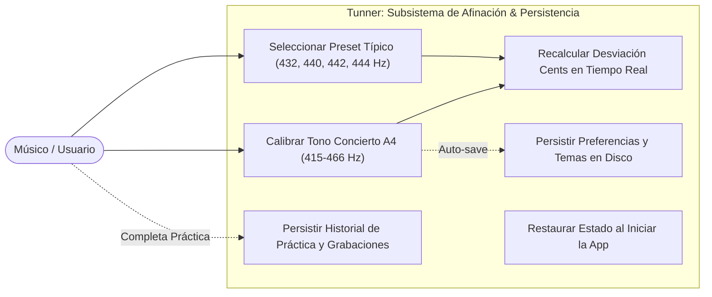
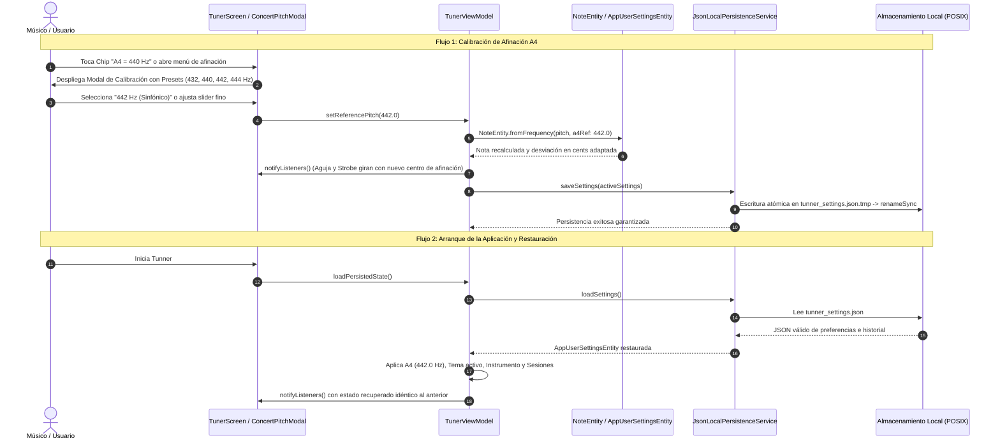

# Caso de Uso 13: Calibración de Afinación de Concierto A4 & Persistencia Local Offline

---

## 1. Identificación y Metadatos

- **ID:** `UC-13`
- **Nombre:** Calibración de Afinación de Concierto A4 y Motor de Persistencia Local Offline
- **Actor Principal:** Músico / Estudiante / Pedagogo
- **Fase:** Fase 4 (Estudio de Práctica & Integración Universal)
- **Prioridad:** Alta (Requisito de Precisión Acústica e Integridad de Sesión)

---

## 2. Descripción

Permite al intérprete ajustar libremente la frecuencia de concierto del tono La4 ($A_4$) entre $415.0\text{ Hz}$ y $466.0\text{ Hz}$ (con presets a 432 Hz, 440 Hz, 442 Hz y 444 Hz), adaptando instantáneamente los cálculos de afinación estroboscópica y aguja de cents. Paralelamente, garantiza que las preferencias acústicas, los temas de interfaz personalizados, el historial de evaluación de notas y los metadatos de las grabaciones de auto-escucha queden respaldados en el almacenamiento no volátil del dispositivo sin requerir conexión a internet.

---

## 3. Diagramas Mermaid Obligatorios

### 3.1 Diagrama de Casos de Uso Formal

### 3.2 Diagrama de Flujo / Secuencia Detallado

---

## 4. Precondiciones, Postcondiciones y Flujos

### 4.1 Precondiciones
- La aplicación está instalada y dispone de acceso de lectura/escritura en su directorio privado de documentos (`getApplicationDocumentsDirectory()`).

### 4.2 Postcondiciones
- El motor de afinación calcula el temperamento igual respecto a la frecuencia $A_4$ elegida.
- El archivo `tunner_settings.json` contiene la última versión serializada del estado de la aplicación.
- No se produce ningún consumo de red ni busy-waiting en el hilo de UI.

### 4.3 Flujo Principal
1. El usuario visualiza en la interfaz del afinador la frecuencia de referencia actual ($A_4 = 440.0\text{ Hz}$).
2. El usuario toca el indicador y se abre el modal `ConcertPitchSelectorModal`.
3. El usuario pulsa una pastilla rápida (ej. "442 Hz Orquesta") o desliza el regulador de precisión.
4. El sistema actualiza el estado, recalcula instantáneamente las notas captadas por el micrófono y programa la persistencia en segundo plano.
5. El modal se cierra y la interfaz refleja el nuevo centro tonal.

### 4.4 Flujos Alternativos y de Error
- **FA-1 (Archivo de configuración inexistente o corrupto):** Si es la primera vez que se ejecuta la app o si el JSON estuviera corrupto, `JsonLocalPersistenceService` captura la excepción sin lanzar error y genera un estado por defecto canónico ($A_4 = 440.0$, tema Obsidian Studio, flauta traversa).
- **FA-2 (Frecuencia fuera de rango):** Si el usuario ingresa un valor menor a $415.0\text{ Hz}$ o mayor a $466.0\text{ Hz}$, el sistema lo restringe estrictamente (*clamping*) dentro del rango acústico seguro.
