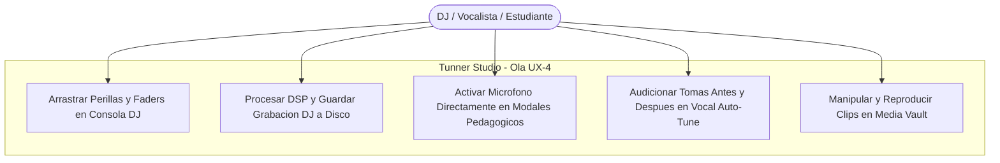
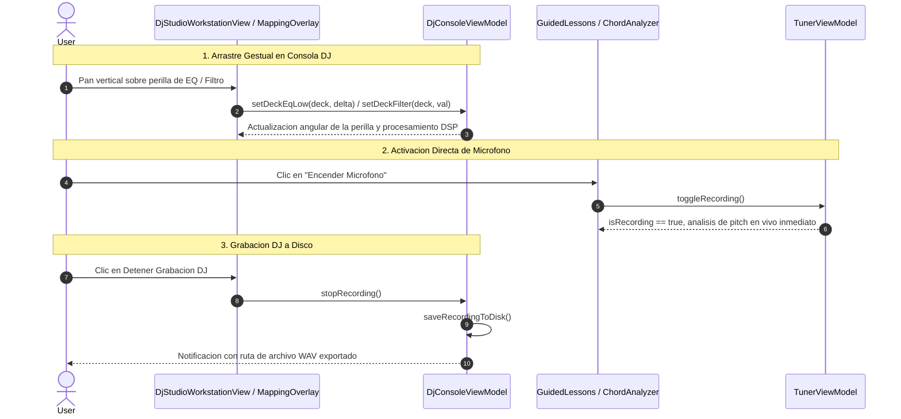

# Caso de Uso 140: Consola DJ Interactiva, DSP en Vivo, Pedagogia y Media Vault (Ola UX-4)

## 1. Descripcion General
Este caso de uso formaliza el soporte de arrastre gestual (`onPanUpdate`) en la consola DJ, procesamiento DSP audible en vivo (ecualizacion, filtros, kills, delay), activacion directa de microfono en modales pedagogicos y de analisis (sin requerir regresar al afinador), audicion comparativa en la suite vocal de afinacion y la manipulacion de clips en la boveda multimedia (Media Vault).

---

## 2. Diagrama de Caso de Uso (Mermaid)

---

## 3. Diagrama de Secuencia (Mermaid)

---

## 4. Precondiciones y Postcondiciones

### Precondiciones
1. La aplicacion Tunner Studio se encuentra en ejecucion en el entorno de escritorio o movil.
2. Los subsistemas de audio digital operan localmente sin dependencias de red externa.

### Postcondiciones
1. El usuario puede modular perillas y faders mediante gestos de arrastre táctil o raton con respuesta gráfica inmediata.
2. La sesion grabada en la consola DJ se guarda fisicamente como archivo `.wav` en el almacenamiento local.
3. El microfono se puede encender y apagar directamente desde los modales de lecciones guiadas y analisis de acordes.
4. Las pistas de audio de práctica y clips multimedia pueden audicionarse y manipularse interactivamente.
