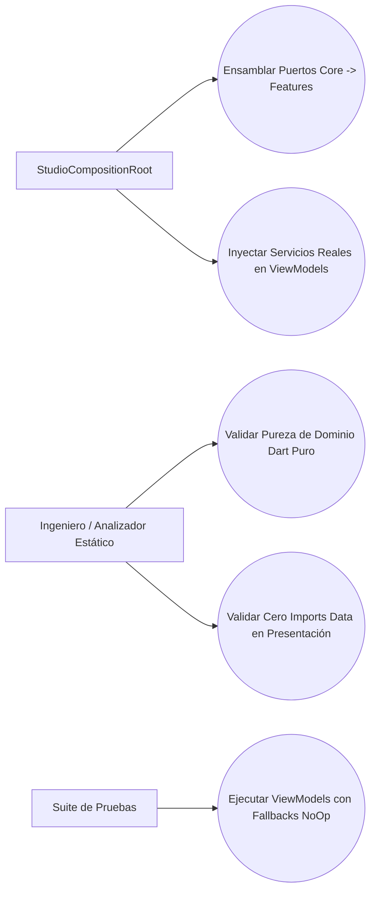
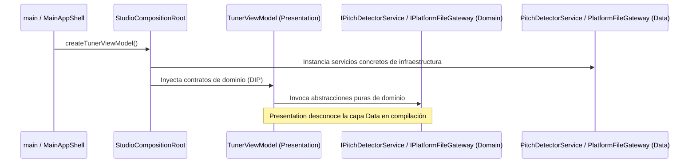

# Caso de Uso 141: Pureza de Capas Clean Architecture e Inversión de Dependencias Estricta (ARCH-1)

## Metadatos
- **ID:** `UC-141`
- **Issue Relacionado:** `#108`
- **ADR Relacionado:** `docs/04_adrs/0130_arch_1_clean_architecture_dip.md`
- **Plan de Implementación:** `docs/05_implementation_plans/plan_arch_1_clean_architecture_dip.md`
- **Prioridad:** Crítica (Arquitectónica)

## Actores
- **Ingeniero / Compilador Dart:** Verifica la dirección unidireccional de dependencias entre capas.
- **StudioCompositionRoot:** Único punto de ensamblaje que conecta implementaciones de `data` / `infrastructure` con contratos de `domain` e inyecta en `presentation`.
- **Sistema de Pruebas Automatizadas:** Instancia ViewModels y servicios con implementaciones en memoria (`NoOp` / Fakes) sin disparar I/O ni plugins nativos.

## Precondiciones
1. La rama `qa` contiene violaciones heredadas: imports de `package:flutter/foundation.dart` en `domain/`, imports de `lib/features/` dentro de `lib/core/` e imports de `data/` en `presentation/` (incluyendo 15 clases concretas en `TunerViewModel`).
2. `StudioCompositionRoot` existe en `lib/app/studio_composition_root.dart`, pero no inyecta todas las dependencias del grafo.

## Postcondiciones
1. Cero archivos bajo `/domain/` importan `package:flutter`, `dart:ui`, `dart:io` o capas `data`/`presentation`.
2. Cero archivos bajo `lib/core/` importan módulos de `lib/features/`.
3. Cero archivos bajo `/presentation/` importan clases concretas de `/data/` o `/infrastructure/`.
4. `StudioCompositionRoot` inyecta todas las implementaciones concretas de producción en `TunerViewModel`, `MediaVaultViewModel`, `TunnerOsKernel` y `LocalDiskStudioFileSystemRepository`.

## Diagrama de Casos de Uso

## Diagrama de Secuencia / Flujo

## Flujo Principal
1. El sistema elimina `package:flutter/foundation.dart` de los contratos de dominio de sistema de archivos y patchbay, exponiendo abstracciones Dart puro (`IStudioListenable` o streams/listeners propios y `dart:typed_data`).
2. `StudioThemeSwitcher` deja de importar `TunerViewModel`; `MainAppShell` escucha `StudioThemeController` y sincroniza el ViewModel desde la capa de composición/navegación.
3. `LocalDiskStudioFileSystemRepository` delega la generación de archivos iniciales a un puerto `IWorkspaceSeedProvider` inyectado desde `StudioCompositionRoot`.
4. `TunnerOsKernel` reemplaza sus imports directos a `lib/features/` por puertos abstractos en `lib/core/terminal/domain/` implementados en `lib/app/`.
5. `MediaVaultViewModel` consume `IUniversalMediaIoService` (dominio) en lugar de `UniversalMediaIoService` (data).
6. Los modales de presentación (`ScoreEditorModal`, `ScoreImportTabView`, `DjTrackLoaderModal`, `PedagogicalReportModal`) reciben `IPlatformFileGateway` por parámetro o desde el ViewModel en lugar de instanciar `const PlatformFileGateway()`.
7. `TunerViewModel` elimina sus 15 imports de `data/` e `infrastructure/`, empleando implementaciones `NoOp` puras de dominio como valores por defecto para pruebas aisladas, mientras `StudioCompositionRoot` inyecta las implementaciones reales.

## Flujos Alternativos y de Error
- **FA-1 (Ejecución en pruebas unitarias sin `StudioCompositionRoot`):** Si una prueba instancia `TunerViewModel()` o `MediaVaultViewModel()` sin argumentos, el constructor usa implementaciones `NoOp` puras en memoria, evitando `MissingPluginException` o escritura accidental en disco.
- **FE-1 (Puerto no inyectado en modal):** Si un modal de presentación se abre en un árbol de pruebas sin `IPlatformFileGateway` provisto explícitamente, recurre a `NoOpPlatformFileGateway` de dominio sin fallar por dependencias de plataforma.
