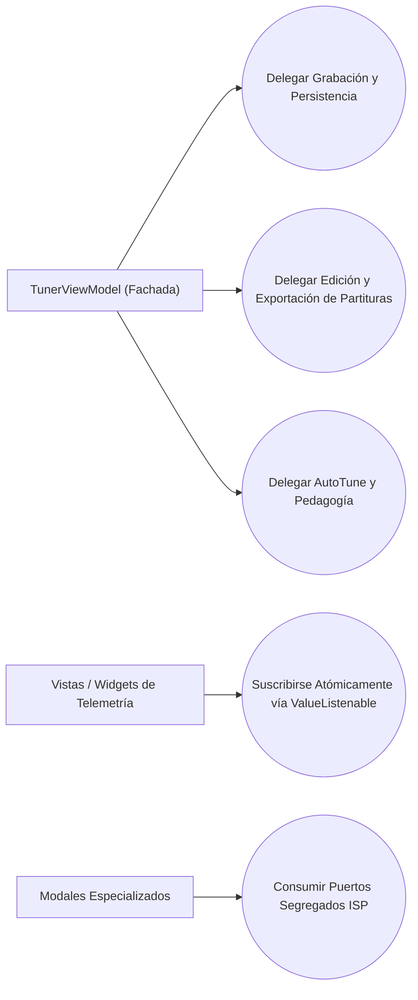
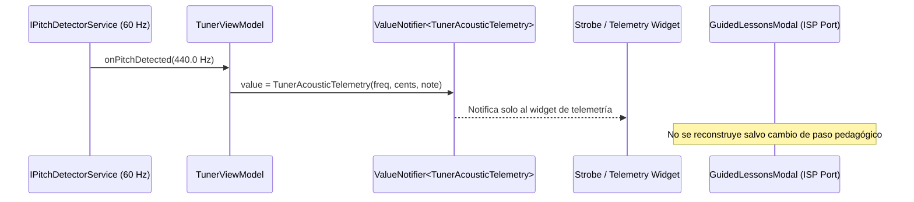

# Caso de Uso 142: Decomposición Modular de TunerViewModel, Desacoplamiento Hub-and-Spoke y Atomicidad Reactiva (ARCH-2)

## Metadatos
- **ID:** `UC-142`
- **Issue Relacionado:** `#109`
- **ADR Relacionado:** `docs/04_adrs/0131_arch_2_tuner_viewmodel_decomposition.md`
- **Plan de Implementación:** `docs/05_implementation_plans/plan_arch_2_tuner_viewmodel_decomposition.md`
- **Prioridad:** Alta (Arquitectura y Rendimiento UI)

## Actores
- **TunerViewModel (Fachada Coordinadora):** Expone el estado del estudio delegando en sub-controladores cohesivos y notificando métricas de alta frecuencia vía `ValueListenable`.
- **Sub-Controladores Cohesivos:** `PracticeRecorderController`, `ScoreEditorController`, `VocalPedagogyController`.
- **Modales y Vistas de Presentación:** Consumen contratos segregados (ISP) y `ValueListenableBuilder` en lugar de reconstruir árboles completos a 60 Hz.

## Precondiciones
1. `TunerViewModel` reside en `lib/features/tuner_viewmodel.dart` junto a 3 archivos `part of` (`3,274` LOC combinadas) con estado compartido acoplado.
2. Las vistas de telemetría usan `context.watch<TunerViewModel>()` recibiendo rebuilds completos en cada frame del micrófono.

## Postcondiciones
1. Cero archivos `part` / `part of` en `TunerViewModel`. La lógica de grabación/persistencia, edición de partituras y pedagogía/Auto-Tune reside en controladores reales independientes.
2. `TunerViewModel` y `TunerScreen` residen canónicamente en `lib/features/tuner/presentation/`.
3. `TunerViewModel` expone `ValueListenable<TunerAcousticTelemetry>` para evitar rebuilds innecesarios de árboles estáticos cuando cambia el pitch a 60 Hz.
4. Existen puertos segregados (ISP) para lecciones guiadas, analizador de acordes y editor de partituras implementados por `TunerViewModel`.

## Diagrama de Casos de Uso

## Diagrama de Secuencia / Flujo

## Flujo Principal
1. Se extraen las responsabilidades de los 3 archivos `part of` hacia clases independientes en sus respectivos módulos (`PracticeRecorderController`, `ScoreEditorController`, `VocalPedagogyController`).
2. Se definen puertos segregados (ISP) en dominio/presentación (`IGuidedLessonSessionPort`, `IChordAnalyzerSessionPort`, `IScoreEditorSessionPort`) implementados por `TunerViewModel`.
3. Se introduce `ValueNotifier<TunerAcousticTelemetry>` en `TunerViewModel` para aislar los cambios de `frequency`, `cents`, `noteName` y `currentMicRmsLevel` en `TunerScreen` y widgets acústicos.
4. Se reubican `TunerViewModel` y `TunerScreen` dentro de `lib/features/tuner/presentation/`, manteniendo re-exports mínimos si es necesario para compatibilidad gradual.

## Flujos Alternativos y de Error
- **FA-1 (Llamadas síncronas/asíncronas desde fachada):** Toda llamada pública existente en `TunerViewModel` delega de forma transparente al sub-controlador correspondiente preservando las firmas y notificaciones esperadas por los 1,210 tests.
- **FE-1 (Disposición de recursos):** Al llamar `TunerViewModel.dispose()`, se liberan todos los sub-controladores y `ValueNotifier`s sin fugas ni `setState after dispose`.
