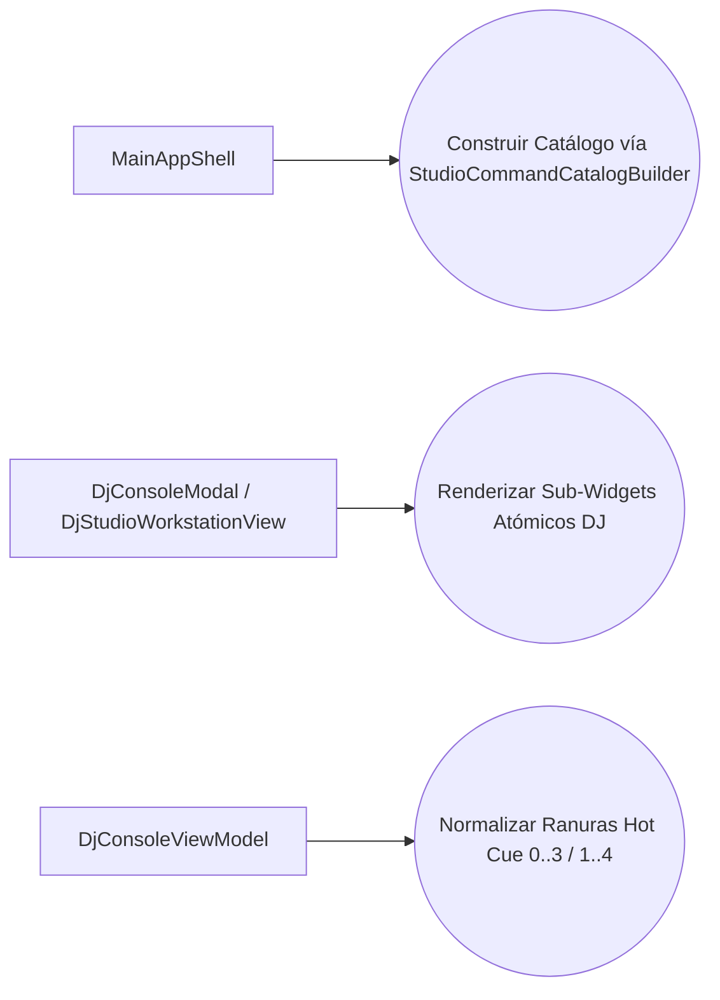
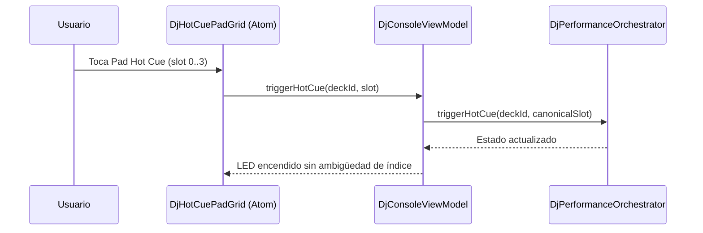

# Caso de Uso 143: Decomposición de Vistas Monolíticas y Unificación de Dominio DJ (ARCH-3)

## Metadatos
- **ID:** `UC-143`
- **Issue Relacionado:** `#110`
- **ADR Relacionado:** `docs/04_adrs/0132_arch_3_monolithic_views_and_dj_unification.md`
- **Plan de Implementación:** `docs/05_implementation_plans/plan_arch_3_monolithic_views_and_dj_unification.md`
- **Prioridad:** Alta (Cohesión, DRY y Mantenibilidad UI)

## Actores
- **MainAppShell:** Orquesta la navegación principal y delega la construcción de la paleta de comandos.
- **Vistas DJ (`DjConsoleModal`, `DjStudioWorkstationView`):** Consumen widgets atómicos compartidos de Deck/Pads/Mixer sin duplicación.
- **DjConsoleViewModel & DjPerformanceOrchestrator:** Normalizan la indexación de Hot Cues sin ambigüedad entre capas.

## Precondiciones
1. `MainAppShell` (1,731 LOC) construye en línea un catálogo masivo de 25 comandos en `_openCommandPalette`.
2. `DjConsoleModal` (1,015 LOC) y `DjStudioWorkstationView` (1,772 LOC) duplican lógica de presentación de hot cues y controles de deck.
3. Existen convenciones mixtas (base `0..3` vs base `1..4`) para los índices de Hot Cues entre presentación y dominio.

## Postcondiciones
1. `StudioCommandCatalogBuilder` encapsula fuera de `MainAppShell` la construcción declarativa de los comandos de la Command Palette.
2. Sub-widgets compartidos bajo `lib/features/dj_console/presentation/widgets/` (`DjHotCuePadGrid`, `DjTransportButtonsRow`) eliminan la duplicación de controles de deck en las vistas DJ.
3. `DjPerformanceOrchestrator` y `DjConsoleViewModel` normalizan los índices de Hot Cues a través de un helper canónico único (`normalizeHotCueSlot`), manteniendo compatibilidad con pruebas existentes.

## Diagrama de Casos de Uso

## Diagrama de Secuencia / Flujo

## Flujo Principal
1. Se extrae `StudioCommandCatalogBuilder` (`lib/features/navigation/presentation/studio_command_catalog_builder.dart`) reduciendo la complejidad de `MainAppShell`.
2. Se extraen sub-widgets reutilizables bajo `lib/features/dj_console/presentation/widgets/` (`DjHotCuePadGrid`) compartidos entre `DjStudioWorkstationView` y `DjConsoleModal`.
3. Se extrae el panel de modo esencial de `TunerScreen` hacia `lib/features/tuner/presentation/widgets/essential_tuner_panel.dart`.
4. Se centraliza la normalización de ranuras de Hot Cues en `DjConsoleViewModel` para eliminar la ambigüedad entre `0..3` y `1..4`.

## Flujos Alternativos y de Error
- **FA-1 (Llamadas externas con índice 1..4):** Si un comando de hardware o prueba invoca `triggerHotCue('A', 1..4)` directamente, el adaptador de ranura mantiene el mapeo exacto sin romper compatibilidad.
