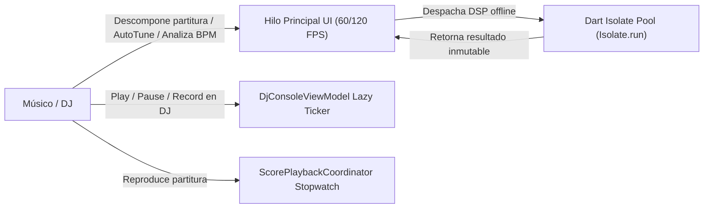
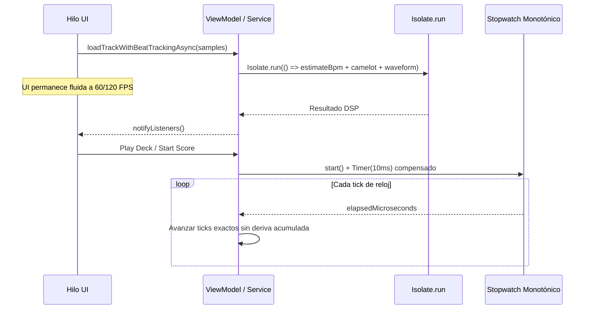

# UC-144: Ejecución de DSP Offline en Isolates, Ticker Perezoso en DJ Console y Reloj Monotónico en Partituras

**ID:** UC-144  
**Estado:** Aprobado  
**Issue:** #111 (ARCH-4)  
**Fase:** Hardening Arquitectónico Pre-v1.0.0  

---

## 1. Descripción General
Garantizar fluidez constante de 60/120 FPS en el hilo principal de UI y cero consumo de CPU en reposo mediante:
1. Despacho asíncrono en `Isolate.run(...)` para operaciones DSP offline pesadas (`SongDecomposerService.decomposeCustomScoreAsync`, `VocalAutoTuneProcessor.processPracticeTakeAsync`, `BpmBeatTrackerEngine.estimateBpmAsync` y `DjConsoleViewModel.loadTrackWithBeatTrackingAsync`).
2. Activación perezosa (*lazy*) del `_playbackTicker` de 33 ms en `DjConsoleViewModel` únicamente cuando algún deck está reproduciendo, grabando o en automix activo, deteniéndolo al entrar en reposo.
3. Reemplazo del `Timer.periodic` sin compensación de deriva en `ScorePlaybackCoordinator` por un reloj monotónico basado en `Stopwatch` y cálculo acumulado de *ticks* objetivo.

---

## 2. Diagrama de Casos de Uso

---

## 3. Diagrama de Secuencia

---

## 4. Precondiciones y Postcondiciones
- **Precondiciones:**
  - Las entidades transferidas entre isolates son estructuras Dart puras serializables/enviables (`Float32List`, `SongPackage`, `PracticeTakeEntity`, `AudioTrack`, `MeasureEntity`).
  - `DjConsoleViewModel` y `ScorePlaybackCoordinator` están correctamente inicializados.
- **Postcondiciones:**
  - Al instanciar `DjConsoleViewModel` en reposo, `isTickerActive` es `false` y no existen timers periódicos activos.
  - Cuando ambos decks se pausan/detienen, el grabador se detiene y automix está inactivo, `_playbackTicker` se cancela automáticamente.
  - `ScorePlaybackCoordinator` mantiene sincronización rítmica sin deriva acumulada respecto a `Stopwatch`.

---

## 5. Flujo Principal y Flujos Alternativos
1. **DSP Offline en Isolate:**
   - El llamador invoca `decomposeCustomScoreAsync`, `processPracticeTakeAsync`, `BpmBeatTrackerEngine.estimateBpmAsync` o `loadTrackWithBeatTrackingAsync`.
   - El cómputo corre en un worker `Isolate.run` fuera del UI Isolate.
2. **Ticker Perezoso DJ:**
   - En el constructor de `DjConsoleViewModel`, no se inicia `_playbackTicker`.
   - Cada acción que modifica reproducción, grabación o automix llama a `_syncTickerLifecycle()`, que inicia `_playbackTicker` si `_hasActivePlayback` es `true` y lo cancela cuando vuelve a `false`.
3. **Flujos Alternativos / Error:**
   - Si `DjConsoleViewModel` es desechado (`dispose()`) mientras un `Isolate.run` está en curso, el resultado se descarta de forma segura verificando `_isDisposed`.
   - Si el audio en `BpmBeatTrackerEngine.estimate` tiene duración menor a 1 segundo, retorna `120.0` BPM sin lanzar excepciones.
