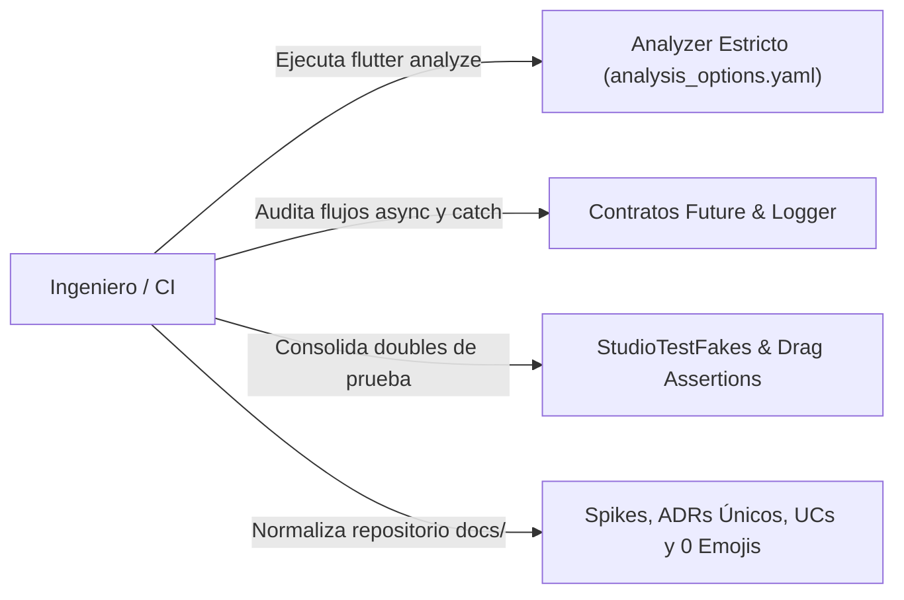
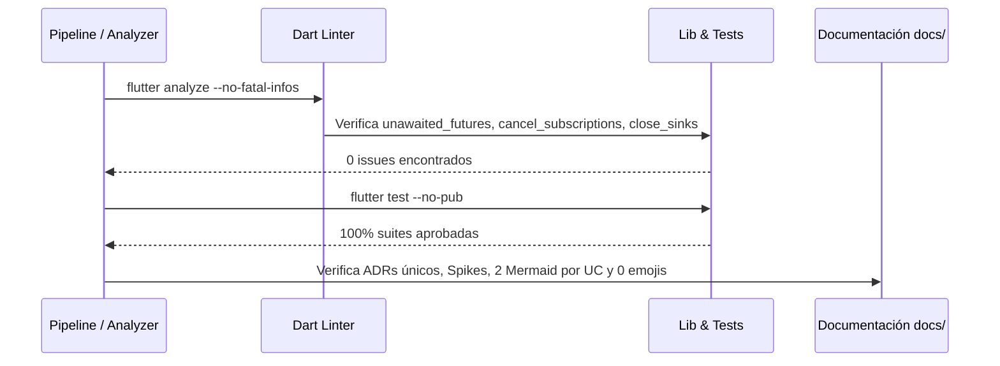

# UC-145: Endurecimiento de Linter, Higiene Asíncrona, Fakes Centralizados y Saneamiento Documental

**ID:** UC-145  
**Estado:** Aprobado  
**Issue:** #112 (ARCH-5)  
**Fase:** Hardening Arquitectónico Pre-v1.0.0  

---

## 1. Descripción General
Cerrar la brecha de calidad estática, seguridad asíncrona, observabilidad de errores, higiene de pruebas y cumplimiento documental estricto de `AGENTS.md`:
1. Activar reglas estrictas en `analysis_options.yaml` (`unawaited_futures`, `cancel_subscriptions`, `close_sinks`, `prefer_final_fields`, `use_super_parameters`).
2. Corregir firmas `void ...() async` a `Future<void>`, añadir `await` faltantes en guardado DJ y reemplazar bloques `catch (_)` silenciosos por trazabilidad estructurada.
3. Eliminar el buffer artificial `Float32List(512)` en `DjConsoleViewModel.stopRecording()` cuando no hay muestras reales capturadas.
4. Centralizar fakes compartidos en `test/helpers/studio_test_fakes.dart` y fortalecer la prueba de arrastre en `ux_wave_4_dj_dsp_and_vault_test.dart`.
5. Crear `docs/spikes/`, renumerar ADRs duplicados (`0014`, `0015`, `0016`), completar el segundo diagrama Mermaid en `52_uc_industry_standard_muscle_memory_shortcuts.md` y erradicar emojis residuales en documentación.

---

## 2. Diagrama de Casos de Uso

---

## 3. Diagrama de Secuencia

---

## 4. Precondiciones y Postcondiciones
- **Precondiciones:**
  - Ramas ARCH-1 a ARCH-4 integradas en `qa`.
- **Postcondiciones:**
  - `flutter analyze --no-fatal-infos` reporta 0 errores, 0 warnings y 0 lints con las reglas estrictas activas.
  - `flutter test --no-pub` aprueba al 100%.
  - Cero emojis en `docs/` y `lib/`, cero numeraciones duplicadas en `docs/04_adrs/`, `docs/spikes/` poblado y `UC-52` con dos diagramas Mermaid.

---

## 5. Flujo Principal y Flujos Alternativos
1. **Endurecimiento del Linter:** Se habilitan las 5 reglas en `analysis_options.yaml` y se corrigen las ocurrencias reportadas.
2. **Higiene Async y Errores:** Se migran `void ...() async` a `Future<void>`, se espera `saveRecordingToDisk`, se registran excepciones capturadas mediante logger estructurado y se elimina el relleno silencioso `Float32List(512)` en `stopRecording()`.
3. **Flujos Alternativos / Error:** Si un `Future` es intencionalmente fire-and-forget en UI/lifecycle, se documenta explícitamente con `unawaited(...)` de `dart:async`.
