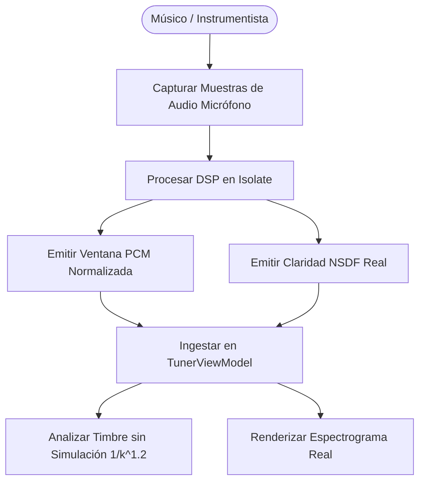
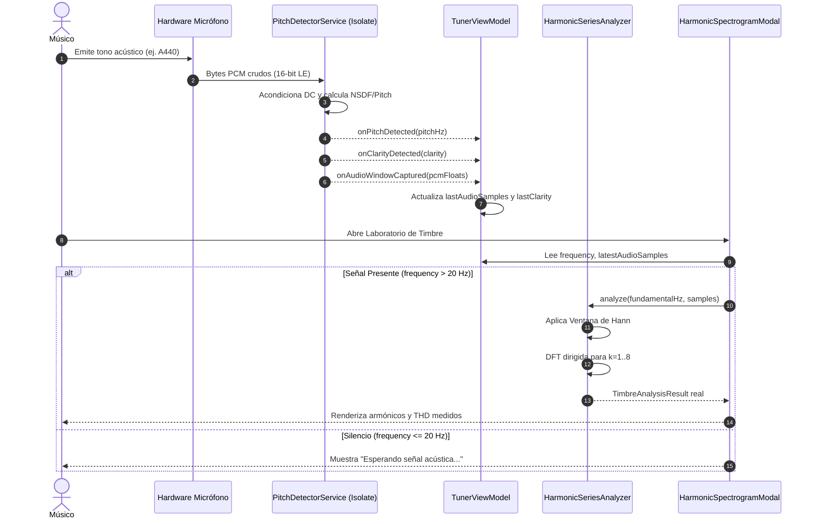

# Caso de Uso 146: Streaming Real de Ventana PCM, Claridad NSDF y Análisis Armónico

## Metadatos del Documento
- **ID del Documento:** `DOC-USECASE-2026-146`
- **Título Oficial:** Streaming Real de Ventana PCM, Claridad NSDF y Análisis Armónico Espectral
- **Estado:** Approved
- **Fecha de Creación:** 2026-11-21
- **Última Modificación:** 2026-11-21
- **Fase Asociada:** Fase 1 / Hardening Cero Hardcoding
- **Autor / Revisor Principal:** Tunner Core Team

---

## 1. Resumen Ejecutivo
Este caso de uso formaliza el desacoplamiento, la ingesta física continua y el flujo determinista de muestras de audio PCM crudo y métricas de claridad armónica desde el motor de captura por micrófono (`PitchDetectorService` en Isolate) hacia la capa de presentación (`TunerViewModel`) y las herramientas analíticas (`HarmonicSeriesAnalyzer` y `HarmonicSpectrogramModal`).
Elimina de raíz las simulaciones sintéticas ($1/k^{1.2}$ artificial) y los valores de frecuencia por defecto (440 Hz forzado ante silencio), sustituyéndolos por un pipeline acotado en tiempo real con ventana de Hann y evaluación de DFT dirigida.

---

## 2. Diagramas del Caso de Uso

### 2.1 Diagrama Formal de Caso de Uso (Mermaid)

### 2.2 Diagrama de Secuencia y Flujo Detallado (Mermaid)

---

## 3. Especificación Funcional

### 3.1 Precondiciones
1. Permiso de micrófono concedido a la aplicación.
2. Motor de captura `PitchDetectorService` iniciado y activo.

### 3.2 Postcondiciones
1. Las muestras PCM recibidas por el `TunerViewModel` provienen directamente del buffer flotante acondicionado del Isolate.
2. La métrica de claridad armónica corresponde al pico NSDF real calculado por MPM.
3. El `HarmonicSeriesAnalyzer` no genera armónicos sintéticos si no hay muestras reales disponibles.
4. El espectrograma muestra el estado de espera en lugar de inventar 440 Hz cuando no hay tono.

### 3.3 Flujo Principal
1. El usuario produce un sonido con su instrumento o voz.
2. El Isolate DSP procesa las muestras y emite la frecuencia detectada, la claridad y la ventana flotante.
3. `TunerViewModel` almacena la ventana de audio en `latestAudioSamples` y notifica a los oyentes.
4. Las vistas conectadas (laboratorio de timbre, espectrograma, detector de acordes) procesan las muestras físicas reales.

### 3.4 Flujos Alternativos y Excepciones
- **Señal Débil o Silencio:** Si la energía está por debajo del umbral de ruido, el Isolate emite silencio y `HarmonicSeriesAnalyzer` devuelve `TimbreAnalysisResult.empty`.
- **Frecuencia Fuera de Rango:** Si la frecuencia fundamental estimada es inferior a 20 Hz o superior al límite de Nyquist, se descarta el análisis sin arrojar excepciones.
