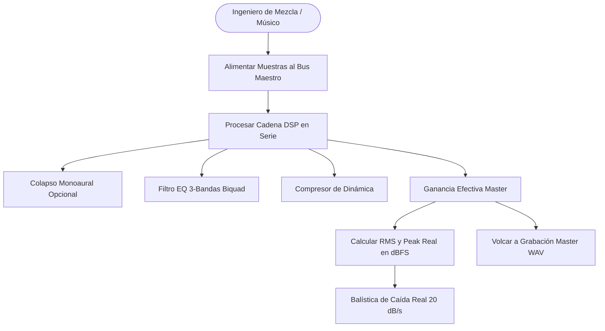
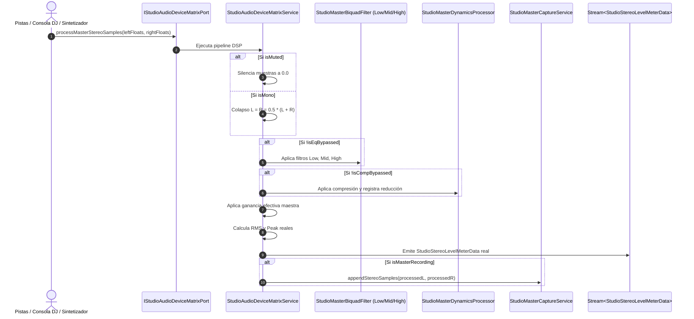

# Caso de Uso 147: Cadena DSP Master, Medición Balística Real y Captura de Audio

## Metadatos del Documento
- **ID del Documento:** `DOC-USECASE-2026-147`
- **Título Oficial:** Cadena de Procesamiento DSP Master, Vúmetro Balístico Real y Grabación Stereo sin Pérdidas
- **Estado:** Approved
- **Fecha de Creación:** 2026-11-22
- **Última Modificación:** 2026-11-22
- **Fase Asociada:** Fase 1 / Hardening Cero Hardcoding
- **Autor / Revisor Principal:** Tunner Core Team

---

## 1. Resumen Ejecutivo
Este caso de uso formaliza el pipeline de procesamiento de señal digital (DSP) del bus maestro de Tunner Studio, integrando en serie determinista el ecualizador paramétrico de 3 bandas (`StudioMasterBiquadFilter`), el procesador de dinámica (`StudioMasterDynamicsProcessor`), el cálculo estricto de valores eficaces RMS y picos en dBFS, y la captura continua hacia el subsistema de grabación maestra (`StudioMasterCaptureService`).
Elimina los valores pseudo-aleatorios o fijos del bucle de simulación del vúmetro, sustituyéndolos por un modelo de balística acústica profesional (ataque instantáneo y caída exponencial de 20 dB/s) accionado por muestras reales.

---

## 2. Diagramas del Caso de Uso

### 2.1 Diagrama Formal de Caso de Uso (Mermaid)

### 2.2 Diagrama de Secuencia y Flujo Detallado (Mermaid)

---

## 3. Especificación Funcional

### 3.1 Precondiciones
1. El servicio `StudioAudioDeviceMatrixService` se encuentra inicializado.
2. Los filtros Biquad y el procesador dinámico han configurado sus coeficientes a la tasa de muestreo activa (por defecto 44100 Hz).

### 3.2 Postcondiciones
1. Cada bloque de audio que transita por el bus maestro es modificado físicamente por el estado de EQ, compresión y ganancia.
2. La medición de nivel en el vúmetro refleja con exactitud el valor RMS ($V_{\text{RMS}} = \sqrt{\frac{1}{N}\sum s_i^2}$) y el pico más alto ($V_{\text{Peak}} = \max(|s_i|)$) en decibelios a escala completa (dBFS: $20 \log_{10}(V)$).
3. Ante la ausencia de muestras entrantes, los vúmetros caen suavemente a $-\infty$ dBFS mediante un factor de decaimiento temporal determinista ($0.85$ por ciclo de $33\text{ ms}$), sin exhibir ruido o valores estáticos inventados.
4. Si la grabación maestra está activa, las muestras post-DSP se escriben en el búfer de captura para generar un archivo WAV idéntico a lo reproducido.

### 3.3 Casos de Borde
- **Búferes de longitud desigual o vacíos:** El método `processMasterStereoSamples` maneja listas vacías retornando inmediatamente sin alterar estado.
- **Valores nulos o silencio absoluto:** Los cálculos de decibelios se protegen contra logaritmo de cero empleando una cota inferior de $-96.0\text{ dBFS}$ ($10^{-4.8}$).

---

## Flujos Alternativos y Manejo de Errores

### Flujo Alternativo A1: Bus Maestro en Estado Silenciado (Mute) o Bypass Parcial
1. Si `isMuted` está activo en `StudioAudioDeviceMatrixService`, el pipeline anula la amplitud de salida fijando todas las muestras L y R a `0.0` antes de la etapa de medición y grabación.
2. Si `isEqBypassed` o `isCompBypassed` están habilitados individualmente, las muestras omiten el bloque Biquad o el procesador dinámico respectivo manteniendo la continuidad de fase hacia la etapa de ganancia maestra.

### Flujo Alternativo A2: Colapso Monoaural Activo
1. Si el modo `isMono` se encuentra habilitado, cada par estéreo $(L_i, R_i)$ se promedia mediante $M_i = 0.5 \cdot (L_i + R_i)$ previo a la ecualización y compresión.

### Manejo de Errores E1: Búferes Vacíos o Desalineados
1. Cuando `leftSamples` o `rightSamples` están vacíos, `processMasterStereoSamples` aborta la ejecución de forma segura sin emitir eventos inválidos ni escribir tramas vacías en `StudioMasterCaptureService`.
2. Cuando las longitudes de los canales L y R difieren, el bucle de procesamiento opera sobre $\min(\text{left.length}, \text{right.length})$ evitando excepciones `RangeError` en tiempo real.

### Manejo de Errores E2: Prevención de Singularidades Matemáticas y Saturación Digital
1. Para muestras con energía nula ($V_{\text{RMS}} = 0$ o $V_{\text{Peak}} = 0$), la conversión logarítmica aplica un piso estricto de $-96.0\text{ dBFS}$, impidiendo valores `NaN` o `-Infinity` en el stream del vúmetro.
2. Durante la exportación en `StudioMasterCaptureService`, cualquier muestra que exceda el rango $[-1.0, 1.0]$ es limitada mediante `clamp(-1.0, 1.0)` antes de la cuantización PCM para evitar desbordamiento aritmético.

