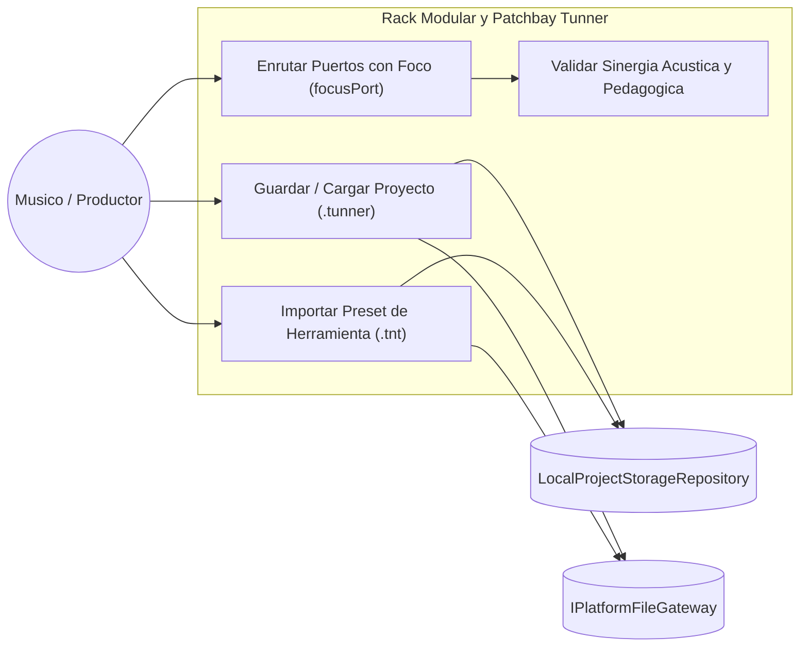
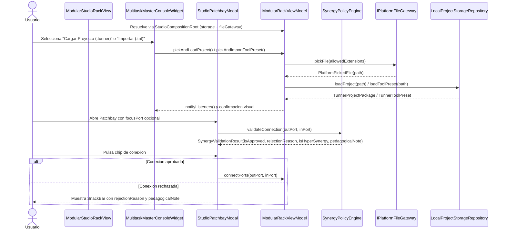

# UC-147: Importacion/Carga de Archivos .tnt y .tunner, Patchbay con Foco/Sinergia y Almacenamiento Real en Rack Modular

## 1. Informacion General

| Campo | Valor |
| :--- | :--- |
| **ID** | UC-147 |
| **Historia de Usuario** | US-5.2 (EPIC-05) |
| **Actores** | Musico / Productor (Usuario), Sistema Tunner (`ModularRackViewModel`, `StudioPatchbayModal`, `SynergyPolicyEngine`, `LocalProjectStorageRepository`) |
| **Precondiciones** | El usuario se encuentra en la vista del Rack Modular (`ModularStudioRackView`) con `StudioCompositionRoot` montado en el arbol de widgets (o un `ModularRackViewModel` inyectado). |
| **Postcondiciones** | Los proyectos `.tunner` y presets `.tnt` se leen y escriben en almacenamiento local real; el Patchbay resalta el puerto enfocado (`focusPort`) y comunica razones de rechazo o notas pedagogicas de `SynergyPolicyEngine`. |

---

## 2. Diagrama de Casos de Uso

---

## 3. Diagrama de Secuencia

---

## 4. Flujo Principal

1. Al montar `ModularStudioRackView` sin un `ModularRackViewModel` explicito, la vista consulta `StudioCompositionRoot` en el contexto para instanciar el ViewModel con `LocalProjectStorageRepository` y `IPlatformFileGateway` reales.
2. En `MultitaskMasterConsoleWidget`, el usuario abre el menu de proyectos (`.tunner` / `.tnt`) y puede:
   - Guardar el proyecto actual (`.tunner`).
   - Cargar un proyecto existente (`.tunner`) usando el selector nativo de archivos o ingresando una ruta de archivo.
   - Importar una herramienta individual (`.tnt`) usando el selector nativo o ingresando una ruta de archivo.
3. En `StudioPatchbayModal`, si se proporciona `focusPort`, los puertos compatibles o el puerto enfocado se priorizan y resaltan visualmente.
4. Para cada par `(salida, entrada)`, `StudioPatchbayModal` consulta `SynergyPolicyEngine.validateConnection` para mostrar chips diferenciados: conexion activa, disponible, hiper-sinergia o bloqueada con motivo pedagogico.

---

## 5. Flujos Alternativos y de Error

- **FA-1 (Cancelacion de selector nativo):** Si `IPlatformFileGateway.pickFile` devuelve `null`, la operacion se cancela limpiamente sin modificar el estado del rack ni lanzar excepciones.
- **FA-2 (Archivo inexistente o corrupto):** Si `loadProjectFromFile` o `importToolPresetFromFile` falla por formato invalido o archivo inexistente, el dialogo captura la excepcion y muestra un `SnackBar` descriptivo al usuario.
- **FA-3 (Conexion rechazada por politica pedagogica):** Si `SynergyPolicyEngine.validateConnection` devuelve `isApproved == false` (por ejemplo, `vocalAutoTune` hacia `blindEarTrainer` o `chordAnalyzer` hacia `strobeTuner`), el chip muestra icono de bloqueo y al pulsarlo notifica `rejectionReason` y `pedagogicalNote` sin crear el cable en `SignalBus`.
- **FA-4 (Entorno de prueba sin StudioCompositionRoot):** Si `ModularStudioRackView` se renderiza de forma aislada en pruebas sin `StudioCompositionRoot` en el `BuildContext`, realiza un fallback seguro a `ModularRackViewModel()` sin fallar por `ProviderNotFoundException`.
