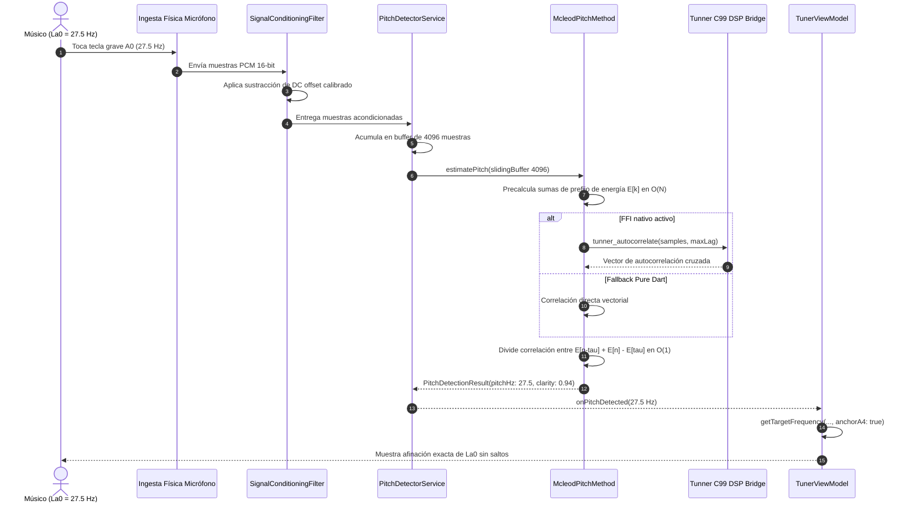

# Caso de Uso 148: Aceleración FFI C99 de Autocorrelación, Detección Sub-Grave A0 (27.5 Hz), Anclaje A4 y Calibración DC Offset

## Metadatos del Documento
- **ID del Documento:** `DOC-USECASE-2026-148`
- **Título Oficial:** Aceleración FFI C99 de Autocorrelación, Detección Sub-Grave A0 (27.5 Hz), Anclaje A4 y Calibración DC Offset
- **Estado:** Approved
- **Fecha de Creación:** 2026-11-22
- **Última Modificación:** 2026-11-22
- **Fase Asociada:** Fase 1 / Hardening Cero Hardcoding
- **Autor / Revisor Principal:** Tunner Core Team

---

## 1. Resumen Ejecutivo
Este caso de uso formaliza la optimización algorítmica de la función de correlación cuadrada normalizada (NSDF) en el algoritmo McLeod Pitch Method (MPM), delegando el producto cruzado temporal al puente nativo en C99 (`tunner_autocorrelate`) y reduciendo la complejidad del denominador a $O(N)$ mediante sumas de prefijo de energía.
Asimismo, expande el horizonte de análisis a 4096 muestras físicas continuas para garantizar soporte acústico estricto de notas sub-graves hasta La0 ($A_0 = 27.5\text{ Hz}$), establece el anclaje inmutable de $A_4$ en los cálculos de temperamento histórico y habilita la sustracción en caliente del offset DC calibrado por hardware.

---

## 2. Diagramas del Caso de Uso

### 2.1 Diagrama Formal de Caso de Uso (Mermaid)

```mermaid
flowchart TD
    User([Músico / Instrumentista Bajo / Piano]) --> UC_Input[Ingesta de Audio Micrófono]
    UC_Input --> UC_DCCalib[Sustraer DC Offset Calibrado]
    UC_DCCalib --> UC_Buffer4096[Acumular Buffer Deslizante 4096 Muestras]
    UC_Buffer4096 --> UC_EnergyPrefix[Precalcular Sumas de Energía O(N)]
    UC_EnergyPrefix --> UC_AutocorrCheck{¿FFI C99 Disponible?}
    UC_AutocorrCheck -->|Sí| UC_FFIC99[tunner_autocorrelate en C99 SIMD]
    UC_AutocorrCheck -->|No| UC_PureDart[Autocorrelación Pure Dart Optimizada]
    UC_FFIC99 --> UC_MPM[Calcular NSDF y Estimar Pitch A0 a C8]
    UC_PureDart --> UC_MPM
    UC_MPM --> UC_AnchorA4[Calcular Cents con anchorA4=true]
    UC_AnchorA4 --> UC_Presentation[Visualización Estable de Afinación]
```

### 2.2 Diagrama de Secuencia y Flujo Detallado (Mermaid)



---

## 3. Especificación Funcional

### 3.1 Precondiciones
1. El buffer circular o deslizante del Isolate de audio permite almacenar al menos 4096 muestras de 64 bits.
2. Si el sistema operativo soporta FFI (Linux, Windows, macOS, Android, iOS), la biblioteca dinámica `libtunner_dsp` está compilada y disponible.

### 3.2 Postcondiciones
1. Las frecuencias en el rango sub-grave de 25 Hz a 60 Hz son detectadas con claridad superior a 0.70 sin falsos saltos de octava.
2. La complejidad computacional del cálculo del denominador de la función NSDF pasa de $O(N \cdot \tau)$ a $O(N)$ en el pre-cálculo y $O(1)$ por retardo $\tau$.
3. Los temperamentos históricos (Pitágoras, Mesotónico, Just Intonation) mantienen La4 exactamente anclado a la frecuencia de referencia del usuario (ej. 440 Hz).
4. El filtro de acondicionamiento de señal sustrae el valor de polarización DC medio medido en la calibración inicial.
