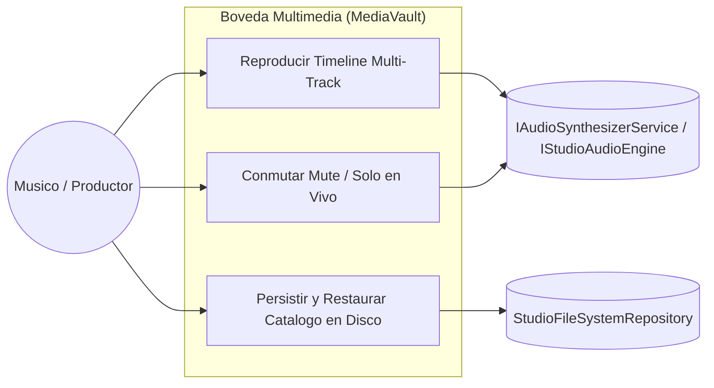
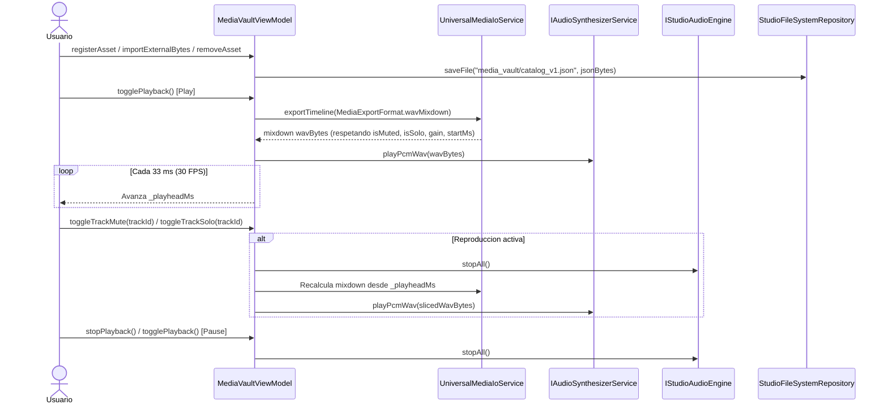

# UC-148: Reproduccion Acustica Real del Timeline Multi-Track en MediaVault, Mute/Solo en Vivo y Persistencia en Disco

## 1. Informacion General

| Campo | Valor |
| :--- | :--- |
| **ID** | UC-148 |
| **Historia de Usuario** | US-5.3 (EPIC-05) |
| **Actores** | Musico / Productor (Usuario), `MediaVaultViewModel`, `UniversalMediaIoService`, `IAudioSynthesizerService`, `IStudioAudioEngine`, `StudioFileSystemRepository` |
| **Precondiciones** | La Boveda Multimedia (`MediaVaultViewModel`) tiene al menos un clip colocado en el timeline o activos registrados en el catalogo. |
| **Postcondiciones** | Al pulsar Play se reproduce el mixdown WAV real sincronizado con `_playheadMs`; Mute/Solo actualizan el audio en vivo; el catalogo de activos (incluyendo `rawBytes` y `pcmSamples` semilla) se persiste en disco. |

---

## 2. Diagrama de Casos de Uso

---

## 3. Diagrama de Secuencia

---

## 4. Flujo Principal

1. Al inicializar `InMemoryMediaVaultRepository`, los 4 activos semilla (`seed_house_groove`, `seed_vocal_stem`, `seed_flute_score`, `seed_bassline_midi`) se crean con `rawBytes` reales (WAV RIFF 16-bit, MusicXML 3.1 y SMF MIDI Type 0) y `pcmSamples` / `waveformPeaks` musicales reales.
2. Si `MediaVaultViewModel` recibe `StudioFileSystemRepository`, restaura asincronicamente `media_vault/catalog_v1.json` al iniciar y guarda automaticamente el catalogo ante altas, importaciones o bajas.
3. Al activar `togglePlayback()`, `MediaVaultViewModel` genera el mixdown WAV del timeline (recortado al offset `_playheadMs` si aplica) y lo envia a `IAudioSynthesizerService.playPcmWav`.
4. Al cambiar `toggleTrackMute` o `toggleTrackSolo` mientras `_isPlaying` esta activo, se detiene la emision previa via `IStudioAudioEngine.stopAll()` y se relanza inmediatamente el mixdown actualizado desde `_playheadMs`.

---

## 5. Flujos Alternativos y de Error

- **FA-1 (Timeline vacio o sin pistas audibles):** Si el timeline no tiene clips o todas las pistas estan silenciadas por Mute/Solo, `stopAll()` detiene el audio y `_playheadMs` continua avanzando visualmente sin lanzar excepciones.
- **FA-2 (Entorno sin motor de audio o sin repositorio en disco):** Si `_audioSynthesizer` o `_fileSystemRepository` son nulos (tests unitarios aislados), `MediaVaultViewModel` opera de forma segura sin fallar.
- **FA-3 (Catalogo en disco aun inexistente):** En el primer arranque sin `media_vault/catalog_v1.json`, `_restoreCatalogFromDisk()` conserva los activos semilla sin sobrescribir ni fallar.
