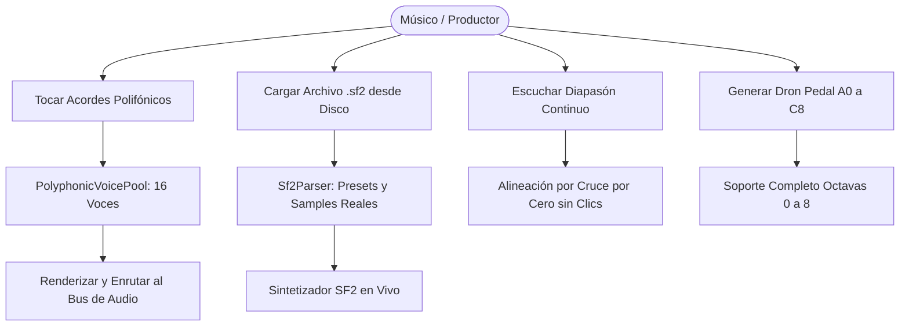
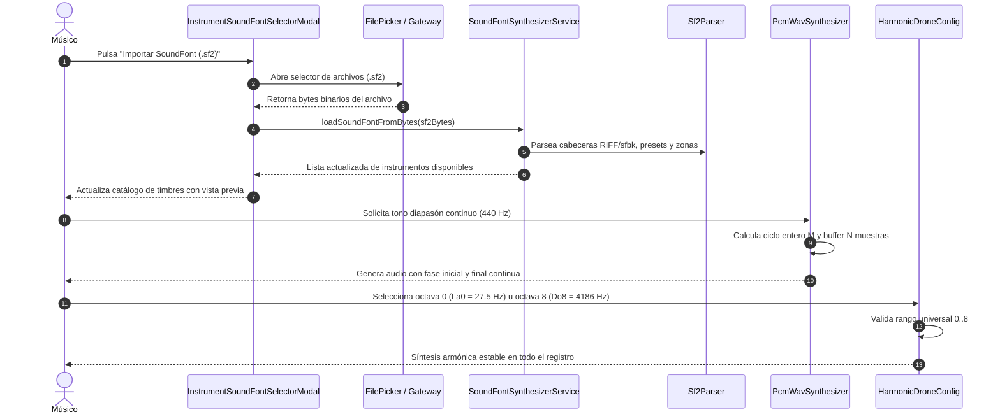

# Caso de Uso 149: Salida de Audio Polifónico, Importador SF2, Diapasón sin Clics y Rango Universal de Dron

## Metadatos del Documento
- **ID del Documento:** `DOC-USECASE-2026-149`
- **Título Oficial:** Salida de Audio Polifónico, Carga de Archivos SoundFont SF2, Diapasón Continuo y Rango Acústico Universal A0-C8
- **Estado:** Approved
- **Fecha de Creación:** 2026-11-22
- **Última Modificación:** 2026-11-22
- **Fase Asociada:** Fase 1 / Hardening Cero Hardcoding
- **Autor / Revisor Principal:** Tunner Core Team

---

## 1. Resumen Ejecutivo
Este caso de uso formaliza la integración del sintetizador polifónico multivoz (`PolyphonicVoicePool`) al bus de audio activo, la capacidad del selector de SoundFonts para examinar y cargar archivos binarios `.sf2` reales desde el sistema de archivos local, la síntesis de diapasón senoidal de concierto con continuidad de fase en bucle infinito (alineación de fase por cruce por cero exacto) y la expansión del rango de octavas en el generador de tono pedal (`HarmonicDroneConfig`) desde la octava 0 hasta la octava 8 ($A_0 = 27.5\text{ Hz}$ hasta $C_8 = 4186\text{ Hz}$), cumpliendo la directriz de rango acústico universal (`AGENTS.md §4.1`).

---

## 2. Diagramas del Caso de Uso

### 2.1 Diagrama Formal de Caso de Uso (Mermaid)

### 2.2 Diagrama de Secuencia y Flujo Detallado (Mermaid)

---

## 3. Especificación Funcional

### 3.1 Precondiciones
1. Acceso al sistema de archivos local para importar archivos `.sf2`.
2. Tasa de muestreo de salida de audio configurada (por defecto 44100 Hz).

### 3.2 Postcondiciones
1. Las voces activas de `PolyphonicVoicePool` generan buffers flotantes que pueden ser reproducidos o volcados al motor de mezcla maestro.
2. Los SoundFonts importados desde el almacenamiento del usuario reemplazan o extienden los bancos esenciales con sus presets reales.
3. El audio senoidal de diapasón generado por `PcmWavSynthesizer` se reproduce en bucle con cero saltos de amplitud o artefactos de chasquido audible.
4. `HarmonicDroneConfig` acepta octavas del 0 al 8 sin excepciones de aserción.

---

## Flujos Alternativos y Manejo de Errores

### Flujo Alternativo A1: Robo de Voces en Saturación Polifónica (Voice Stealing)
1. Si las 16 voces de `PolyphonicVoicePool` están ocupadas cuando ingresa un nuevo evento `noteOn`, el asignador selecciona primero la voz en fase `release` de menor amplitud instantánea, o en su defecto la voz activa más antigua (`oldest allocationOrder`), evitando la pérdida de la nueva nota ejecutada.

### Flujo Alternativo A2: Cancelación del Selector de Archivos SoundFont (.sf2)
1. Si el usuario abre el diálogo de importación de archivos `.sf2` en `InstrumentSoundFontSelectorModal` y lo cancela sin seleccionar ningún archivo (`result == null`), el sistema conserva intacto el banco SoundFont activo sin alterar la reproducción en curso.

### Manejo de Errores E1: Archivo SoundFont (.sf2) Corrupto o Sin Cabecera RIFF/sfbk
1. Cuando los bytes proporcionados a `SoundFontSynthesizerService.loadSoundFontFromBytes` no corresponden a un contenedor RIFF/sfbk válido o están truncados, `Sf2Parser` captura el error de formato, mantiene los presets esenciales de respaldo y notifica en la interfaz mediante un mensaje de error controlado sin bloquear el hilo de audio.

### Manejo de Errores E2: Parámetros Fuera de Rango en Síntesis WAV y Tono Pedal
1. Si se solicita a `PcmWavSynthesizer` o `PolyphonicVoicePool.renderWavBlock` una frecuencia $\le 0\text{ Hz}$ o una duración $\le 0\text{ s}$, el sintetizador retorna un contenedor WAV silencioso válido o acota el número de muestras a un mínimo seguro de 1 ciclo.
2. Si se intenta instanciar `HarmonicDroneConfig` con una octava fuera del intervalo universal $[0, 8]$ o con volumen fuera de $[0.0, 1.0]$, las aserciones de dominio rechazan la configuración inválida en tiempo de desarrollo.

