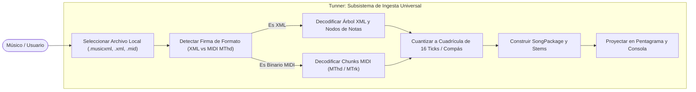
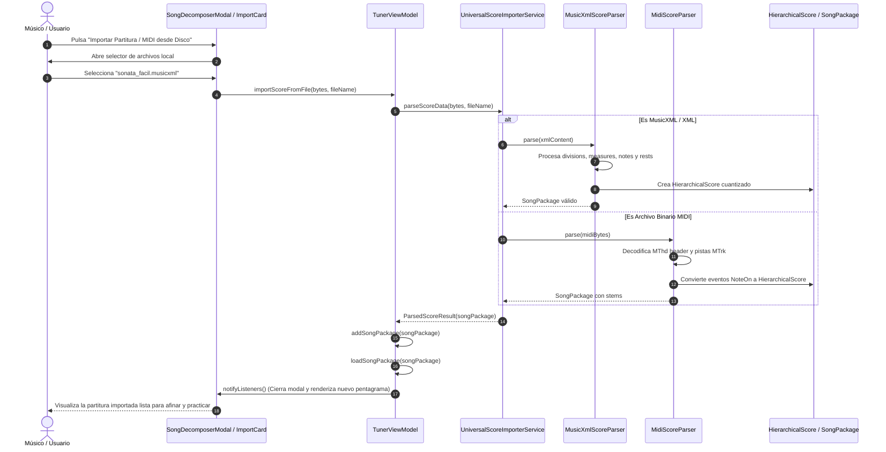

# Caso de Uso 14: Ingesta y Decodificación Universal de Partituras MusicXML y Archivos MIDI

---

## 1. Identificación y Metadatos

- **ID:** `UC-14`
- **Nombre:** Importador Universal de Partituras MusicXML y Archivos MIDI Estándar
- **Actor Principal:** Estudiante / Músico / Pedagogo
- **Fase:** Fase 4 (Estudio de Práctica & Integración Universal - Componente 4.1)
- **Prioridad:** Alta (Requisito Clave para Repertorio Libre y Escalabilidad Pedagógica)

---

## 2. Descripción

Permite al usuario importar archivos de partitura en formato MusicXML (`.musicxml`, `.xml`) o secuencias estándar MIDI (`.mid`, `.midi`) desde el almacenamiento local del dispositivo. El sistema analiza la estructura musical, extrae tempo, compases y notas, normaliza las duraciones a la cuadrícula de semicorcheas del dominio, y monta inmediatamente la obra en el pentagrama SMuFL y la consola de stems de la aplicación.

---

## 3. Diagramas Mermaid Obligatorios

### 3.1 Diagrama de Casos de Uso Formal

### 3.2 Diagrama de Flujo / Secuencia Detallado

---

## 4. Precondiciones, Postcondiciones y Flujos

### 4.1 Precondiciones
- El usuario dispone de un archivo `.musicxml`, `.xml` o `.mid` en el almacenamiento local de su dispositivo.

### 4.2 Postcondiciones
- La nueva obra queda cargada en la biblioteca de Tunner en memoria y activa en el reproductor.
- El pentagrama interactivo muestra las notas reales decodificadas con tipografía SMuFL.
- La consola mezcladora se puebla con las pistas de acompañamiento detectadas.

### 4.3 Flujo Principal
1. El usuario abre el modal de Biblioteca de Canciones (`SongDecomposerModal`).
2. Pulsa el botón "Importar Partitura Local".
3. El explorador del sistema permite seleccionar el archivo musical deseado.
4. El parser decodifica compás por compás, normalizando las duraciones y silencios.
5. Se agrega el paquete a la biblioteca activa del `TunerViewModel`.
6. El usuario visualiza la partitura inmediatamente y puede practicar con el afinador y el metrónomo.

### 4.4 Flujos Alternativos y de Error
- **FA-1 (Formato no reconocido o archivo dañado):** Si los bytes no corresponden a un XML válido ni a un archivo con cabecera `MThd`, el sistema notifica con un mensaje explicativo y no altera la partitura actual.
- **FA-2 (Compases con figuras irregulares):** Si un compás tiene menos o más notas de las esperadas por el compás, el cuantizador completa los ticks vacíos con silencios o trunca los excedentes para mantener el pulso exacto sin romper la reproducción.
