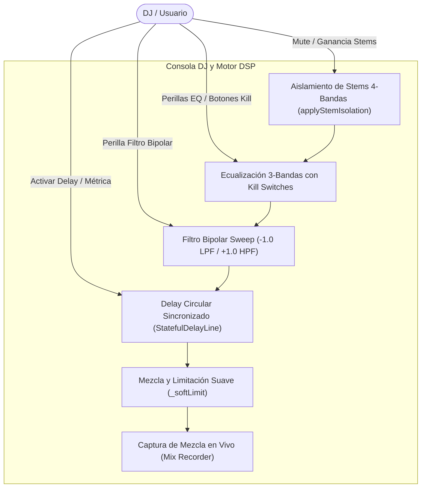
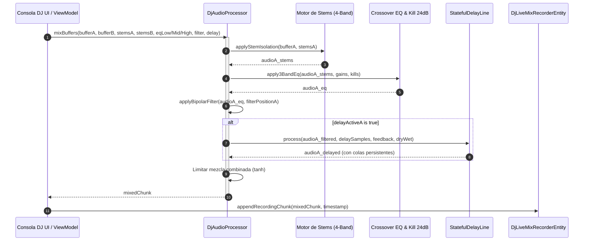

# Caso de Uso Canónico: UC-150

## 1. Identificación y Metadatos
- **ID del Caso de Uso:** UC-150
- **Nombre:** Cadena DSP de Decks DJ (Stems 4-Bandas, Filtro Bipolar y Delay Sincronizado)
- **Historia de Usuario:** US-2.1
- **Épica:** EPIC-02 (Consola DJ DSP en Vivo, Stems & Hardware)
- **Nivel de Abstracción:** Sub-función / Procesamiento DSP en Tiempo Real
- **Autor:** Agente Tunner
- **Fecha:** 2026-11-22
- **Versión:** 1.0.0

---

## 2. Descripción General
Procesar en tiempo real la cadena de audio DSP completa para los canales de la cabina de DJ (Decks A y B). Cada señal de audio que transita por el mezclador atraviesa una matriz de aislamiento de 4 Stems (Vocal, Batería, Bajo, Melodía), una sección de ecualización de 3 bandas con isolators y kill switches totales (-infinito dB), un filtro bipolar de barrido resonante (Paso-Bajo continuo en [-1.0, 0.0) y Paso-Alto continuo en (0.0, 1.0]) y una línea de retardo circular de estado persistente (Stateful Delay Line) sincronizada métricamente con el tempo del deck (1/2, 1/4, 1/8, 1/16 de compás) antes de converger en el limitador suave de mezcla y en la grabadora master.

---

## 3. Diagrama de Casos de Uso (Mermaid)

---

## 4. Diagrama de Secuencia y Flujo de Procesamiento (Mermaid)

---

## 5. Precondiciones y Postcondiciones
- **Precondiciones:**
  1. La consola DJ posee al menos un deck en reproducción o con muestras cargadas.
  2. Las configuraciones de stems, ecualización, filtros y retardos están instanciadas en `DjPerformanceOrchestrator`.
- **Postcondiciones:**
  1. La señal audible y grabada refleja exactamente los silenciamientos de stems, los cortes de frecuencia isolator, el barrido del filtro bipolar y los ecos métricos.
  2. La línea de delay preserva su cola de repetición a través de bloques de audio sin pérdidas ni discontinuidades acústicas.

---

## 6. Flujo Principal
1. El ViewModel recibe la señal de transporte en cada ciclo de audio (30 Hz ticker o bloque PCM).
2. Para cada canal activo:
   a. Aplica atenuación y silenciamiento selectivo por banda de stems (`applyStemIsolation`).
   b. Procesa ecualización de 3 bandas respetando los kill switches (`isKillLow`, `isKillMid`, `isKillHigh`).
   c. Aplica la curva de filtro bipolar resonante según `filterPosition`.
   d. Pasa la señal por la línea de delay circular persistente `StatefulDelayLine` calculada con el BPM efectivo del deck.
3. Combina Deck A y Deck B aplicando los faders de canal y crossfader.
4. Aplica compresión no lineal suave saturada (`_softLimit`) garantizando 0 dBFS sin clipping digital.
5. Emite el fragmento consolidado hacia el grabador de sesión en vivo.

---

## 7. Flujos Alternativos y Manejo de Errores
- **FA-01: Delay desactivado o tiempo cero:** Si `isDelayActive == false` o `delaySamples <= 0`, la etapa de retardo opera en bypass instantáneo sin costo computacional.
- **FA-02: Isolator Kill activo en las 3 bandas:** Si Low, Mid y High están silenciados con kill, el canal resultante es cero absoluto (silencio total).
- **FE-01: Parámetros fuera de rango acústico:** El procesador normaliza cualquier valor atípico de retroalimentación o posición de filtro a rangos estables ([0.0, 0.85] y [-1.0, 1.0]).
