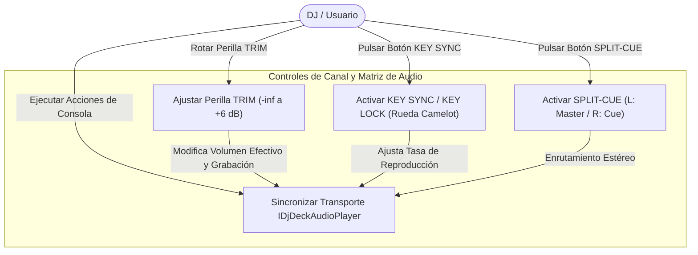
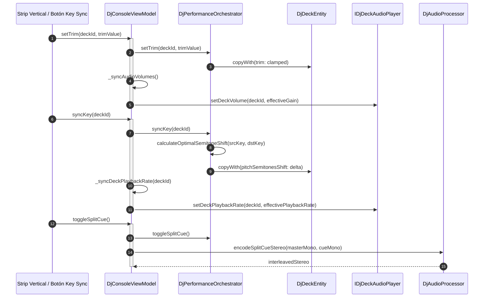

# Caso de Uso Canónico: UC-151

## 1. Identificación y Metadatos
- **ID del Caso de Uso:** UC-151
- **Nombre:** Motor de Ganancia TRIM, Key Sync y Split-Cue en Tiempo Real
- **Historia de Usuario:** US-2.2
- **Épica:** EPIC-02 (Consola DJ DSP en Vivo, Stems & Hardware)
- **Nivel de Abstracción:** Sub-función / Procesamiento DJ en Tiempo Real
- **Autor:** Agente Tunner
- **Fecha:** 2026-11-22
- **Versión:** 1.0.0

---

## 2. Descripción General
Implementar el control de nivel de preamplificación TRIM en cada canal del mezclador DJ, permitiendo atenuación y realce analógico calibrado de $-\infty\text{ dB}$ a $+6.02\text{ dB}$, el acoplamiento tonal armónico inteligente (Key Sync y Key Lock) mediante cálculo de desplazamientos en semitonos en la Rueda de Camelot sincronizado con la tasa de reproducción del motor de audio, la matriz estéreo Split-Cue para preescucha en auriculares por canal izquierdo (Cue) y derecho (Master), y la sincronización exhaustiva de transporte en `IDjDeckAudioPlayer` ante todas las acciones de hardware y UI.

---

## 3. Diagrama de Casos de Uso (Mermaid)

---

## 4. Diagrama de Secuencia y Flujo de Procesamiento (Mermaid)

---

## 5. Precondiciones y Postcondiciones
- **Precondiciones:**
  1. La consola DJ está inicializada con los canales A y B vinculados a `IDjDeckAudioPlayer`.
- **Postcondiciones:**
  1. Las variaciones en la perilla TRIM modifican la ganancia auditiva en vivo y la amplitud en la grabación de mezcla.
  2. Al accionar KEY SYNC, las tonalidades se alinean en la Rueda de Camelot calculando el menor desplazamiento en semitonos.
  3. SPLIT-CUE separa la señal de monitoreo y master en canales estéreo izquierdo y derecho independientes.
  4. El reproductor de audio `IDjDeckAudioPlayer` refleja fielmente el estado de transporte de cada plato.

---

## 6. Flujo Principal
1. El usuario rota la perilla TRIM en el canal A o B:
   a. El ViewModel actualiza la ganancia en `DjPerformanceOrchestrator`.
   b. Se recalcula el valor en decibelios ($20 \log_{10}(\text{trim})$).
   c. Se sincroniza el volumen en `_deckAudioPlayer`.
2. El usuario pulsa KEY SYNC:
   a. Se calcula la distancia mínima de semitonos entre la clave armónica del deck y la del deck opuesto.
   b. Si Key Lock está deshabilitado, la velocidad del reproductor se actualiza exponencialmente ($2^{\Delta / 12}$).
3. El usuario activa SPLIT-CUE:
   a. Se enruta la señal de monitoreo PFL al canal izquierdo y el máster al derecho.
   b. Se aplica limitación suave para evitar saturación en auriculares.

---

## 7. Flujos Alternativos y Manejo de Errores
- **FA-01: TRIM en cero absoluto:** Si `trim <= 0.001`, la ganancia se silencia a cero absoluto ($-\infty\text{ dB}$).
- **FA-02: Key Lock habilitado:** Si Key Lock está activo al cambiar la velocidad o sincronizar tempo, el tono nominal se mantiene fijado en la clave original.
- **FE-01: Deck sin pista cargada al sincronizar tonalidad:** La operación se ignora sin generar excepciones ni alterar el plato opuesto.
