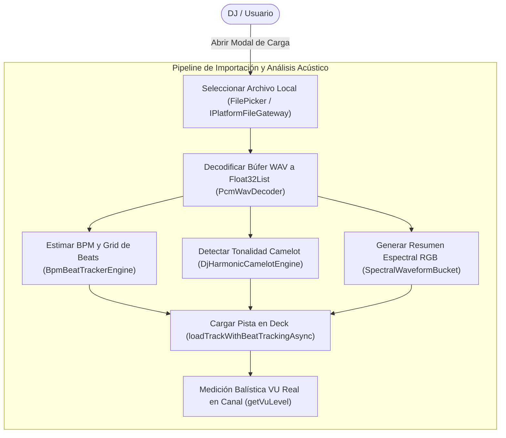
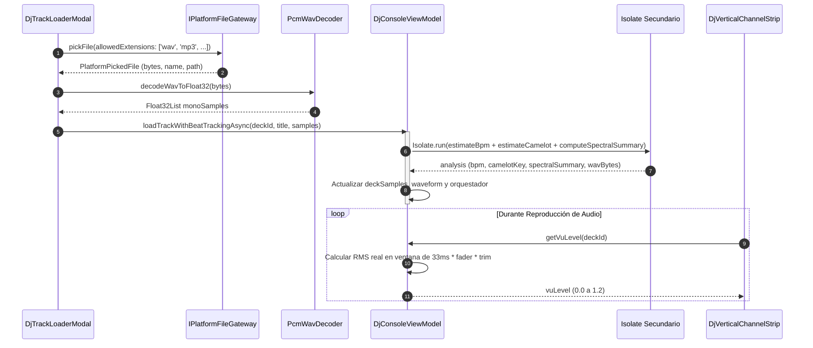

# Caso de Uso Canónico: UC-152

## 1. Identificación y Metadatos
- **ID del Caso de Uso:** UC-152
- **Nombre:** Decodificación Real PCM, Detección BPM/Camelot y Waveforms Espectrales
- **Historia de Usuario:** US-2.3
- **Épica:** EPIC-02 (Consola DJ DSP en Vivo, Stems & Hardware)
- **Nivel de Abstracción:** Sub-función / Procesamiento e Importación de Audio
- **Autor:** Agente Tunner
- **Fecha:** 2026-11-22
- **Versión:** 1.0.0

---

## 2. Descripción General
Proveer a la Consola DJ de capacidades completas de decodificación de archivos de audio locales en formato PCM estándar (WAV 8, 16 y 32 bits punto flotante) para alimentar los motores de análisis acústico en tiempo real: cálculo de tempo y transitorios (`BpmBeatTrackerEngine`), estimación armónica en la Rueda de Camelot (`DjHarmonicCamelotEngine`), renderizado de barras de onda espectrales policromáticas (`computeSpectralWaveformSummary`) y visualización de niveles VU de canal basados en la energía RMS de las muestras en reproducción activa.

---

## 3. Diagrama de Casos de Uso (Mermaid)

---

## 4. Diagrama de Secuencia y Flujo de Procesamiento (Mermaid)

---

## 5. Precondiciones y Postcondiciones
- **Precondiciones:**
  1. El usuario tiene un archivo de audio accesible en su dispositivo o almacenamiento local.
- **Postcondiciones:**
  1. El archivo importado se decodifica en un arreglo de muestras PCM punto flotante.
  2. El tempo nominal, la clave Camelot y la visualización espectral se extraen matemáticamente del contenido acústico real sin recurrir a fallbacks estáticos (como 124 BPM).
  3. Los vúmetros de canal miden la energía instantánea verídica de la ventana acústica.

---

## 6. Flujo Principal
1. El usuario abre el selector de pistas y selecciona un archivo local.
2. `PcmWavDecoder` extrae los chunks RIFF y los canales de datos a un `Float32List` normalizado $[-1.0, 1.0]$.
3. En un Isolate secundario, se calcula:
   a. Estimación espectral de transitorios y periodicidad para determinar el BPM exacto.
   b. Detección armónica de chroma para clasificar la tonalidad en código Camelot (ej. 8A, 11B).
   c. Generación de las barras espectrales en tres bandas de color (rojo graves, verde medios, azul agudos).
4. El deck se inicializa con los metadatos y muestras procesadas.
5. El strip de canal consulta `viewModel.getVuLevel(deckId)` en cada cuadro de renderizado, reflejando el RMS real del audio.

---

## 7. Flujos Alternativos y Manejo de Errores
- **FA-01: Formato no WAV (e.g. MP3/AAC):** Si el archivo es un formato comprimido sin decodificador WAV puro, se delega al reproductor de plataforma conservando metadatos por defecto.
- **FA-02: Deck detenido:** Si el deck no está reproduciendo, `getVuLevel` retorna cero instantáneamente.
- **FE-01: Archivo corrupto o cabecera RIFF truncada:** `PcmWavDecoder` retorna un búfer vacío de forma segura sin generar excepciones no controladas.
