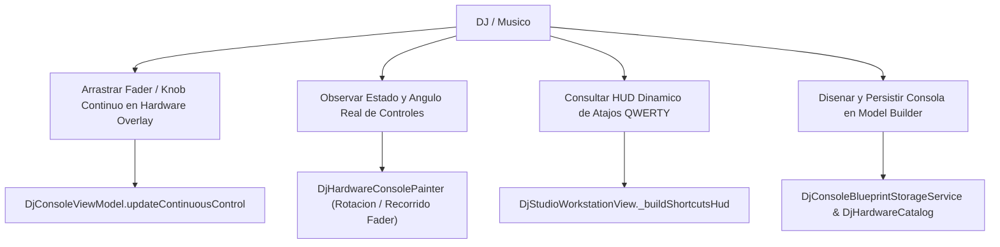
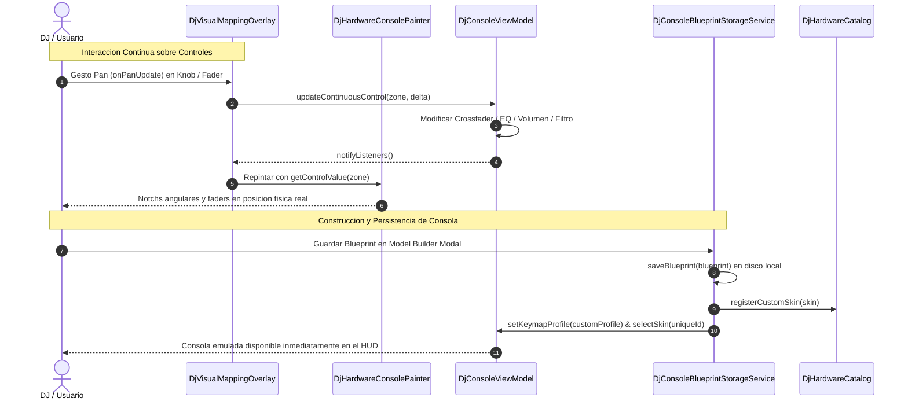

# Caso de Uso 153: Superficie Tactil Hardware Interactiva y Persistencia Real de Consolas DJ

## 1. Descripcion General
Permite al usuario interactuar de forma continua y reactiva con la representacion visual vectorial de cualquier controlador DJ de hardware (`DjHardwareConsolePainter` y `DjVisualMappingOverlay`), reflejando el angulo real de los potenciometros giratorios y la posicion espacial de faders de canal y crossfader segun el estado acustico en vivo. Asimismo, habilita el arrastre tactil continuo sobre knobs, faders y jog wheels sin desfase, renderiza un HUD de atajos dinamico vinculado al mapa de teclas activo (`DjKeymapProfileEntity`) y garantiza la persistencia real de consolas personalizadas construidas en `DjConsoleModelBuilderModal` mediante `IDjConsoleBlueprintStorageService` y el registro dinamico en `DjHardwareCatalog.registerCustomSkin`.

---

## 2. Diagrama de Casos de Uso (Mermaid)

---

## 3. Diagrama de Secuencia y Flujo Detallado (Mermaid)

---

## 4. Precondiciones
1. La aplicacion Tunner se encuentra en ejecucion en el entorno de escritorio o movil.
2. La vista de estacion DJ o el modal de consola esta activo y visualiza una skin de hardware (`ddjFlx4`, `cdj3000`, `traktorKontrolS4`, etc.).
3. Se dispone de acceso a almacenamiento local de documentos para guardar blueprints `.djconsole`.

---

## 5. Postcondiciones
1. Los knobs rotatorios reflejan su valor normalizado en un arco fisico de $270^\circ$ ($135^\circ$ a $405^\circ$), apuntando a las 12 en punto a ganancia unitaria o centro.
2. Los faders horizontales y verticales desplazan sus tapas graficas a lo largo del riel segun el volumen, pitch o crossfader activo.
3. El arrastre sobre la superficie vectorial muta continuamente los parametros acusticos en `DjConsoleViewModel`.
4. El HUD de atajos refleja los mapeos reales de teclas definidos en `keymapProfile`.
5. Los blueprints guardados persisten en almacenamiento local y quedan registrados en memoria en `DjHardwareCatalog`.

---

## 6. Flujo Principal
1. El usuario interactua con un control (knob o fader) en la superficie visual mediante arrastre del raton o dedo.
2. `DjVisualMappingOverlay` intercepta el evento `onPanUpdate` y calcula el delta relativo a las dimensiones de la zona.
3. Se invoca `DjConsoleViewModel.updateContinuousControl(zone, delta)` que altera el parametro acustico correspondiente.
4. El repintado vectorial lee el nuevo valor mediante `getControlValue(zone)` y actualiza la posicion de la aguja o tapa del fader.
5. El motor de audio y la UI mantienen sincronia determinista sin saltos discretos.

---

## 7. Flujos Alternativos y Manejo de Errores
- **FA-1:** El usuario toca un boton discreto (PLAY, CUE, HOT CUE, SYNC, KILL). En lugar de delta continuo, se despacha `executeAction(zone.action)` manteniendo la compatibilidad completa.
- **FA-2:** Error de E/S en disco al persistir el plano de la consola: se captura en `DjConsoleBlueprintStorageService`, se registra en el log diagnostico y se mantiene el skin en la memoria de ejecucion mediante `DjHardwareCatalog.registerCustomSkin`.
