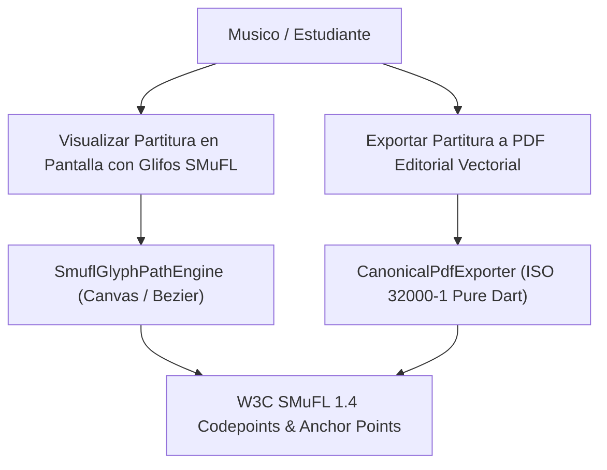
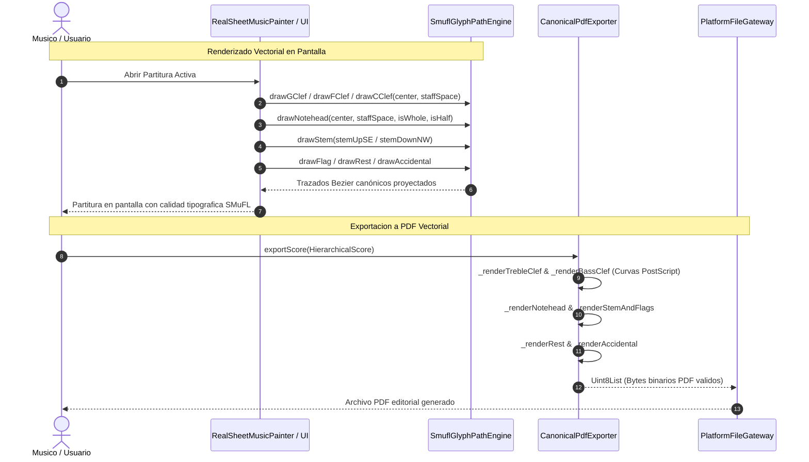

# Caso de Uso 154: Tipografia Musical Vectorial Estandar W3C SMuFL y Exportacion PDF Canónica

## 1. Descripcion General
Permite el renderizado e impresion tipografica musical con fidelidad editorial profesional basada en el estandar abierto W3C SMuFL (Standard Music Font Layout 1.4). Tanto el motor de lienzo en pantalla (`SmuflGlyphPathEngine`) como el serializador vectorial PostScript/PDF (`CanonicalPdfExporter`) generan contornos Bezier matematicamente calibrados para claves (Sol `U+E050`, Fa `U+E062`, Do `U+E05C`), cabezas de notas (redonda `U+E0A2`, blanca `U+E0A3`, negra `U+E0A4`), plicas con anclaje optico (`stemUpSE`, `stemDownNW`), corchetes (`U+E240`–`U+E243`), alteraciones (sostenido `U+E262`, bemol `U+E260`, becuadro `U+E261`), silencios (`U+E4E3`–`U+E4E7`) y puntillos de aumentacion (`U+E1E7`), erradicando primitivas geometricas toscas y cumpliendo rigurosamente `AGENTS.md §4.2`.

---

## 2. Diagrama de Casos de Uso (Mermaid)

---

## 3. Diagrama de Secuencia y Flujo Detallado (Mermaid)

---

## 4. Precondiciones
1. La entidad `HierarchicalScore` contiene compases y notas con duraciones y alturas tonales validas.
2. La escala metrica del pentagrama (`staffSpace`) esta definida en puntos tipograficos reales.

---

## 5. Postcondiciones
1. Los glifos musicales dibujados en pantalla presentan proporciones, masa y curvatura conformes al estandar W3C SMuFL 1.4.
2. Las plicas se conectan con precision optica milimetrica a los puntos de anclaje `stemUpSE` y `stemDownNW`.
3. El exportador PDF genera documentos vectoriales nativos con curvas cubicas Bezier para claves, alteraciones, silencios y notas completas.

---

## 6. Flujo Principal
1. El renderizador consulta las coordenadas de las notas y solicita los glifos correspondientes.
2. `SmuflGlyphPathEngine` calcula los trazados Bezier parametrizados en funcion de `staffSpace`.
3. Para la exportacion PDF, `CanonicalPdfExporter` traduce los mismos contornos a operadores PostScript (`m`, `c`, `l`, `h`, `f`, `s`).
4. Se obtienen graficos vectoriales identicos e interoperables en cualquier resolucion de pantalla o impresion.

---

## 7. Flujos Alternativos y Manejo de Errores
- **FA-1:** Clave de Do (Alto / Tenor): `SmuflGlyphPathEngine` proporciona `drawCClef` anclada en la linea de referencia del pentagrama (`U+E05C`), complementando `InstrumentClef.treble` (`gClef`) e `InstrumentClef.bass` (`fClef`).
- **FA-2:** Notas alteradas en PDF: `CanonicalPdfExporter._renderAccidental` emite el trazado PostScript correspondiente al sostenido (`#`), bemol (`b`) o becuadro (`n` / `N`) adyacente a la cabeza de nota, referenciando los pasos diatonicos respecto a `Mi4` (`E4`) en Clave de Sol o `Sol2` (`G2`) en Clave de Fa.
