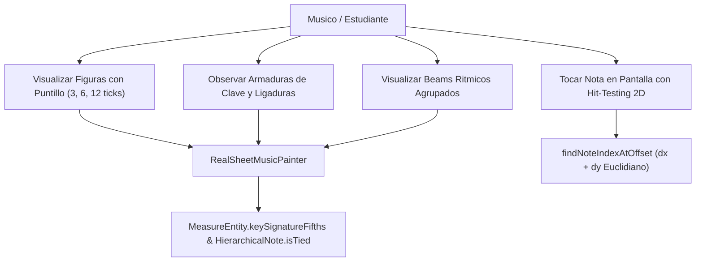
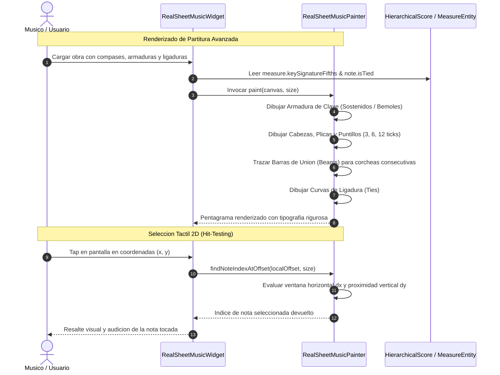

# Caso de Uso 155: Renderizado de Puntillos, Armaduras, Ligaduras, Barras de Corchea, Octavas Negativas y Hit-Testing Vertical

## 1. Descripcion General
Permite a los musicos, docentes y estudiantes visualizar e interactuar con partituras complejas que incorporan ritmos con puntillo (`3, 6, 12` ticks), armaduras de clave (`keySignatureFifths`), ligaduras de prolongacion (`isTied`), barras de union ritmica para corcheas y semicorcheas (beams), soporte para octavas subgraves negativas (e.g. `-1`), clave de Do (`InstrumentClef.alto`) y seleccion tactil o con puntero de notas especificas dentro de acordes polifonicos mediante calculo de distancia vertical en `RealSheetMusicPainter`.

---

## 2. Diagrama de Casos de Uso (Mermaid)

---

## 3. Diagrama de Secuencia y Flujo Detallado (Mermaid)

---

## 4. Precondiciones
1. La partitura contiene notas estructuradas en `MeasureEntity`.
2. Las duraciones corresponden a subdivisiones metricas estandar (`1, 2, 3, 4, 6, 8, 12, 16` ticks).

---

## 5. Postcondiciones
1. Las notas con duraciones `3, 6, 12` ticks dibujan el puntillo SMuFL al lado de la cabeza de nota en el espacio interlineal correspondiente.
2. Las armaduras de clave alteran graficamente el inicio de cada sistema.
3. Las ligaduras conectan suavemente las cabezas de notas consecutivas.
4. Las corcheas consecutivas se agrupan mediante barras horizontales continuas (beams).
5. Las octavas negativas como `-1` no se colapsan a valores positivos.
6. El puntero detecta con precision la nota mas cercana en el plano vertical 2D.

---

## 6. Flujo Principal
1. Se calcula la posicion geometrica de cada compas y nota.
2. Para cada nota con duracion con puntillo, se ubica el punto en el espacio interlineal adyacente.
3. Se verifica si notas adyacentes forman un grupo de corcheas y se unen sus plicas con un beam.
4. Las notas con `isTied = true` trazan un arco cuadratico Bezier hacia la siguiente cabeza de nota.
5. Al hacer tap, el calculo euclidiano `(dx, dy)` identifica la nota exacta.
