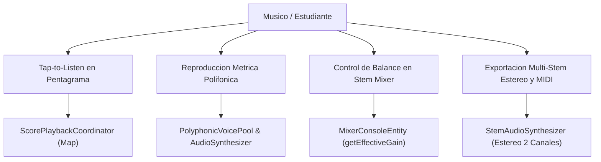
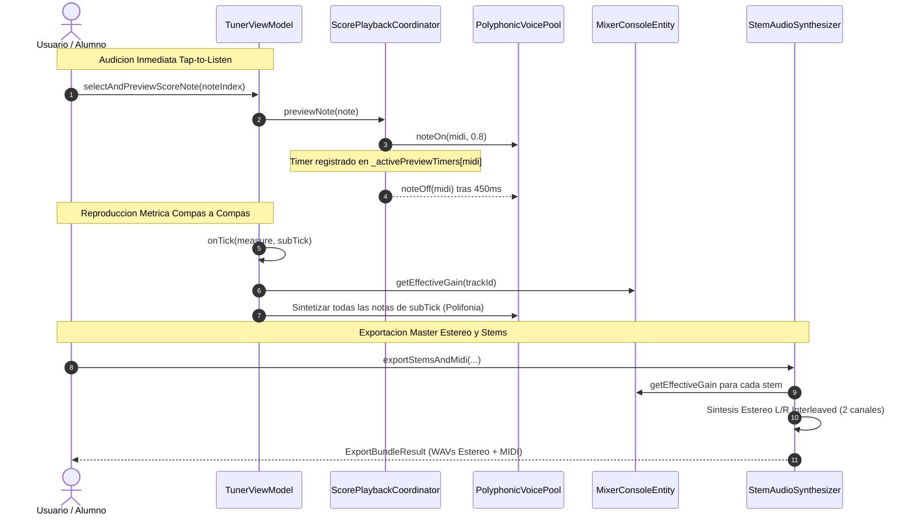

# Caso de Uso 156: Unificacion de ScorePlaybackCoordinator Polifonico, Eliminacion de Doble Audio en Tap-to-Listen y Sintesis Multi-Stem Estereo Real

## Metadatos
- **ID:** UC-156
- **Titulo:** Unificacion de ScorePlaybackCoordinator Polifonico y Sintesis Multi-Stem Estereo Real
- **Estado:** Approved
- **Fecha:** 2026-11-22
- **Autor:** Nicolas Leon (SM/PO/Devs) & Agentes 01/02
- **Epica:** EPIC-03 Notacion Musical Interactiva SMuFL, Edicion y Sintesis de Partituras

---

## 1. Descripcion General
Este caso de uso formaliza la unificacion de la reproduccion polifonica de partituras en `TunerViewModel` y `ScorePlaybackCoordinator`, eliminando la duplicidad acustica en la audicion inmediata de notas (*Tap-to-Listen*) y extendiendo el sintetizador de stems `StemAudioSynthesizer` para procesar el 100 % de las pistas en `MixerConsoleEntity.stems`, aplicar sus ganancias efectivas y exportar una mezcla maestra estéreo de 2 canales con paneo espacial por pista.

---

## 2. Diagrama de Casos de Uso (Mermaid)

---

## 3. Diagrama de Secuencia (Mermaid)

---

## 4. Precondiciones, Flujo Principal y Alternativo

### 4.1 Precondiciones
1. Existe un paquete activo (`SongPackage`) cargado en memoria con partitura jerarquica (`HierarchicalScore`).
2. El mezclador (`MixerConsoleEntity`) tiene configuradas las pistas de acompañamiento y metronomo con niveles de volumen válidos.

### 4.2 Flujo Principal (Audicion Inmediata Tap-to-Listen)
1. El usuario hace clic o toca una nota en el pentagrama.
2. `TunerViewModel.selectAndPreviewScoreNote` recibe el índice de la nota.
3. Se delega la reproducción acústica exclusivamente a `ScorePlaybackCoordinator.previewNote(note)`.
4. El coordinador cancela cualquier temporizador anterior para ese pitch MIDI y programa un nuevo `Timer` en `_activePreviewTimers[midi]`.
5. Al cumplirse la duración de pre-escucha (450 ms), se emite `noteOff(midi)`.

### 4.3 Flujo Principal (Reproduccion Metrica Polifonica)
1. El secuenciador de sub-ticks avanza al siguiente tick.
2. Si la reproducción de partitura está habilitada, se identifican todas las notas de la voz principal cuya propiedad `startTick == subTick`.
3. Se calcula la ganancia efectiva de la voz principal con `mixerConsole.getEffectiveGain(leadTrackId)`.
4. Se sintetizan todas las notas concurrentes en el grupo polifónico.
5. Se itera sobre las pistas de acompañamiento (`tracks.skip(1)`) y se sintetizan sus notas correspondientes escaladas por sus respectivas ganancias.

### 4.4 Flujo de Exportacion Estereo
1. Se invoca `StemAudioSynthesizer.exportStemsAndMidi`.
2. Se procesan todas las pistas presentes en `mixerConsole.stems`.
3. Para la mezcla maestra (`master_mixdown.wav`), se sintetizan los canales izquierdo y derecho intercalados en formato PCM de 16 bits a 44.1 kHz con encabezado WAV de 2 canales.
4. Se exportan los stems individuales y el archivo Standard MIDI File.

### 4.5 Postcondiciones
- Cero artefactos de fase o duplicidad de audio en audición táctil.
- Reproducción polifónica fiel a la partitura y balance del mezclador.
- Archivos WAV estéreo estándar legibles por cualquier DAW o reproductor.
