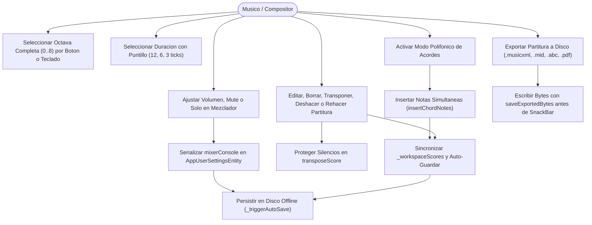
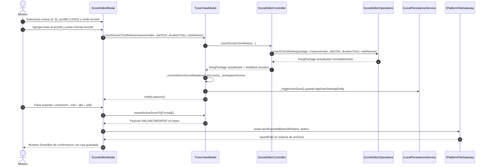

# Caso de Uso 157: Persistencia Automatica de Partituras, Rango Completo de Octavas 0..8, Modo Acordes y Exportacion a Disco

## Metadatos del Documento
- **ID del Documento:** `DOC-USECASE-2026-157`
- **Titulo Oficial:** Persistencia Automatica de Ediciones de Partitura y Mezclador, Rango de Octavas 0..8, Modo Acordes Polifonico y Exportacion Real a Disco
- **Estado:** Approved
- **Fecha de Creacion:** 2026-11-22
- **Ultima Modificacion:** 2026-11-22
- **Fase Asociada:** Fase 3 / US-3.4 ScoreEditorModal & Persistencia
- **Autor / Revisor Principal:** Devs 1 (Core & ScoreEditor)

---

## 1. Resumen Ejecutivo
Este caso de uso formaliza la persistencia automatica e integral de todas las mutaciones realizadas en el editor de partituras (`ScoreEditorModal` y `TunerViewModel`) y en la consola mezcladora (`MixerConsoleEntity`), la ampliacion del rango de registro de octavas de `0` a `8`, la incorporacion de figuras ritmicas con puntillo (`12`, `6` y `3` ticks), la habilitacion de insercion polifonica de acordes simultaneos desde la interfaz de usuario, la proteccion de silencios durante la transposicion en dominio puro, y la escritura efectiva en disco de los cuatro formatos de exportacion canonicos (`.musicxml`, `.mid`, `.abc` y `.pdf`).

---

## 2. Diagramas del Caso de Uso

### 2.1 Diagrama Formal de Caso de Uso (Mermaid)

### 2.2 Diagrama de Secuencia y Flujo Detallado (Mermaid)

---

## 3. Especificacion Funcional

### 3.1 Precondiciones
1. `TunerViewModel` inicializado con `ILocalPersistenceService` e `IPlatformFileGateway` inyectados por interfaz de dominio.
2. Partitura activa (`_activePackage`) cargada con al menos un compas valido en `HierarchicalScore`.

### 3.2 Postcondiciones
1. Toda mutacion de partitura (`insertOrUpdateScoreNote`, `insertScoreChordNotes`, `deleteScoreNote`, `undoScoreEdit`, `redoScoreEdit`, `addScoreMeasure`, `removeScoreMeasure`, `transposeActiveScore`, `transposeActiveScoreForInstrument`) sincroniza `_workspaceScores` con `_activePackage` y dispara `_triggerAutoSave()` automaticamente.
2. Todo cambio en `setTrackVolume`, `toggleTrackMute` y `toggleTrackSolo` persiste `_mixerConsole` dentro de `AppUserSettingsEntity.mixerConsole`, restaurandose al reiniciar o llamar `loadPersistedState()`.
3. `ScoreEditorOperations.transposeScore` preserva intactos todos los silencios (`note.isRest || note.noteName.isEmpty || note.noteName == "--"`).
4. `ScoreEditorModal` permite seleccionar octavas `0..8` mediante botones y teclas de flecha arriba/abajo, figuras con puntillo de `12`, `6` y `3` ticks, insercion polifonica de acordes y guardado en disco previo al `SnackBar` en los 4 formatos de exportacion.

### 3.3 Flujo Principal
1. El musico abre `ScoreEditorModal`.
2. Ajusta la octava en el rango completo `0..8` (desde sub-contra `Do0` hasta sobreagudo `Si8`) usando botones `+/-` o las flechas del teclado.
3. Elige una figura ritmica simple o con puntillo (`12` ticks Blanca con puntillo, `6` ticks Negra con puntillo, `3` ticks Corchea con puntillo).
4. Opcionalmente activa el modo `Acorde`, acumula varias notas (por ejemplo `Do4`, `Mi4`, `Sol4`) y presiona el boton de insercion.
5. `TunerViewModel` delega en `ScoreEditorController` y `ScoreEditorOperations`, invoca `_commitActiveScoreMutation()`, actualiza `_workspaceScores` y ejecuta `_triggerAutoSave()`.
6. El musico ajusta ganancias/mute/solo en el mezclador; `TunerViewModel` serializa `_mixerConsole` en `AppUserSettingsEntity` y ejecuta `_triggerAutoSave()`.
7. Al exportar en MusicXML, MIDI, ABC o PDF, `ScoreEditorModal` espera (`await`) a `vm.platformFileGateway.saveExportedBytes(...)` antes de mostrar el `SnackBar` de confirmacion.

### 3.4 Flujos Alternativos y Excepciones
- **Transposicion sobre compases con silencios:** Si un compas contiene silencios creados con `HierarchicalNote.rest(...)` (`isRest == true`, `noteName == ""`), el guard de `transposeScore` evita invocar el motor de frecuencias y conserva el silencio intacto.
- **Error de escritura en disco al exportar:** Si `saveExportedBytes` lanza una excepcion de E/S, el modal captura el error sin cerrar la vista de forma abrupta y notifica en el `SnackBar` tras verificar `mounted`.
- **Estado heredado sin campo `mixerConsole`:** Si un archivo `tunner_settings.json` previo no contiene la clave `mixerConsole`, `AppUserSettingsEntity.fromMap` mantiene `mixerConsole = null` y la consola utiliza la configuracion por defecto sin errores de deserializacion.
