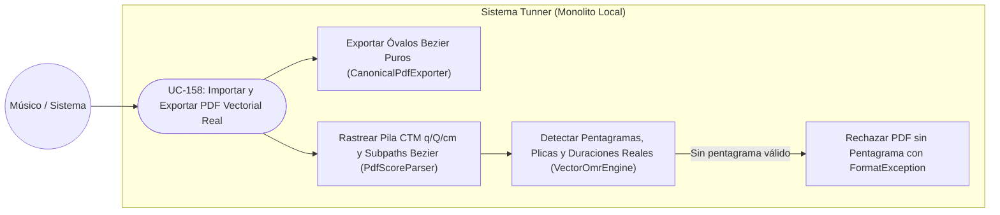
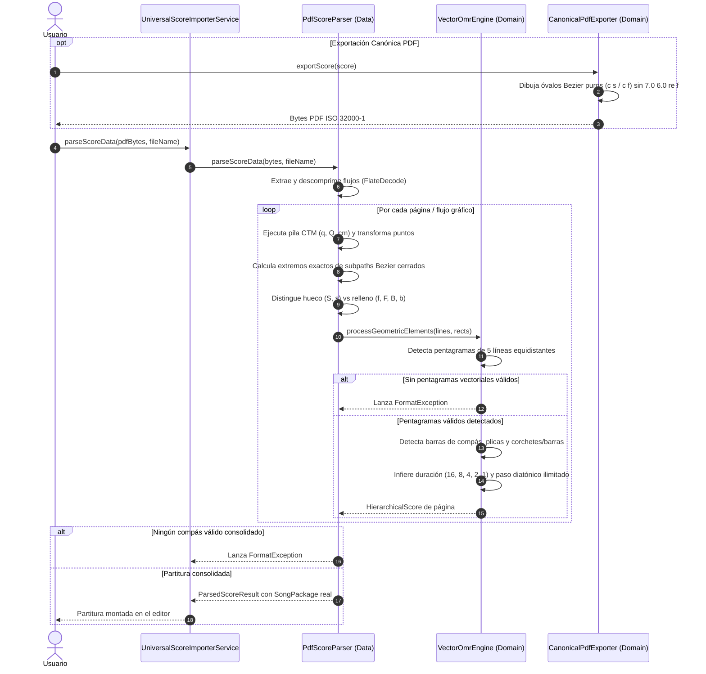

# Caso de Uso 158: Saneamiento del Motor Vector OMR PDF sin Notas Sol4 Falsas ni Marcadores Artificiales

## Metadatos del Caso de Uso
- **ID del Caso de Uso:** `UC-158-VECTOR-OMR-PDF-WITHOUT-FAKE-SOL4`
- **ID del Documento:** `DOC-USECASE-2026-158`
- **Nombre Canónico:** Decodificar y exportar partituras PDF vectoriales mediante geometría Bezier real sin marcadores artificiales ni notas Sol4 fabricadas
- **Estado:** Approved
- **Issue Relacionado:** `#142` (`[US-4.1] Saneamiento de Vector OMR PDF sin Notas Sol4 Falsas ni Marcadores Artificiales`)
- **Fecha de Creación:** 2026-11-22
- **Última Modificación:** 2026-11-22
- **Fase Asociada:** Fase 4 / Hardening Cero Simulación en Importers & Vector OMR
- **Actor Principal:** Músico / Estudiante / Motor de Importación Universal
- **Actores Secundarios:** `CanonicalPdfExporter` (Domain), `PdfScoreParser` (Data), `VectorOmrEngine` (Domain)

---

## 1. Descripción Breve y Propósito

Este caso de uso formaliza la eliminación de atajos artificiales y datos fabricados en el flujo bidireccional de exportación e importación de partituras en formato PDF vectorial (`CanonicalPdfExporter`, `PdfScoreParser` y `VectorOmrEngine`).

En concreto, sustituye el marcador rectangular artificial `7.0 6.0 re f` en la exportación PDF por primitivas Bezier puras (`m..c..c`), dota al parser vectorial de seguimiento completo de la pila de matrices de transformación (`q`/`Q`/`cm`) y cálculo exacto de caja delimitadora de subpaths Bezier cerrados diferenciando trazo hueco (`S`/`s`) de relleno (`f`/`F`/`B`), elimina el generador heurístico falso `_buildFallbackScore` que fabricaba notas `'Sol4'` ante PDFs sin pentagramas válidos (lanzando `FormatException`), e incorpora inferencia rítmica real (`16, 8, 4, 2, 1` ticks) y mapeo diatónico sin tope fijo de 13 notas.

---

## 2. Diagramas del Caso de Uso

### 2.1 Diagrama de Caso de Uso (Mermaid)

### 2.2 Diagrama de Flujo y Secuencia (Mermaid)

---

## 3. Precondiciones y Postcondiciones

### 3.1 Precondiciones
1. El documento de entrada posee bytes no vacíos y cabecera estándar `%PDF-` para el flujo de importación.
2. En el flujo de exportación, el objeto `HierarchicalScore` contiene al menos un compás o estructura válida de dominio.
3. Toda la ejecución ocurre 100% offline en el dispositivo local sin servicios externos.

### 3.2 Postcondiciones
1. Los archivos PDF exportados por `CanonicalPdfExporter` no contienen ningún rectángulo artificial `7.0 6.0 re f` en `_renderNotehead`.
2. `PdfScoreParser` transforma correctamente coordenadas bajo bloques `q`/`Q`/`cm` y produce `OmrRect` con el atributo `isFilled` fiel al operador de pintado (`S`/`s` vs `f`/`F`/`B`).
3. `VectorOmrEngine` lanza `FormatException` cuando existen primitivas geométricas sin un sistema de pentagrama válido de 5 líneas equidistantes (o cuando `PdfScoreParser` no detecta ningún compás válido en el PDF).
4. Las notas detectadas conservan su duración real (`16`, `8`, `4`, `2`, `1` ticks) y su altura diatónica exacta en clave de Sol más allá del rango de 13 pasos (`C4..A5`).

---

## 4. Flujo Principal de Eventos (Happy Path)

1. **Paso 1 (Exportación o Carga):** El usuario exporta una partitura con `CanonicalPdfExporter` (obteniendo curvas Bezier cerradas puras `c s` para blancas/redondas y `c f` para negras/corcheas/semicorcheas) o selecciona un PDF vectorial existente.
2. **Paso 2 (Extracción de Flujos):** `PdfScoreParser` valida la cabecera `%PDF-` y extrae/descomprime cada flujo de contenido gráfico de página.
3. **Paso 3 (Interpretación Vectorial y CTM):** `_parseGraphicOperators` mantiene la pila de matrices CTM (`q`, `Q`, `cm`), acumula subpaths (`m`, `l`, `c`, `v`, `y`, `re`, `h`) en coordenadas de página y calcula los bounding boxes exactos de curvas Bezier cerradas al encontrar `S`/`s` (hueco) o `f`/`F`/`B`/`b` (relleno).
4. **Paso 4 (Detección de Pentagramas y Compases):** `VectorOmrEngine` agrupa conjuntos de 5 líneas horizontales equidistantes y alineadas como sistemas `StaffSystem`, ordenados de arriba hacia abajo, y delimita compases mediante barras verticales válidas (excluyendo plicas).
5. **Paso 5 (Inferencia Rítmica y Diatónica):** Para cada cabeza de nota en la región de compás, `_findNotesInStaffRegion` verifica relleno, plica vertical adyacente y cantidad de corchetes/barras en la punta de la plica para inferir `16`, `8`, `4`, `2` o `1` tick, y traduce la ordenada `Y` a nombre de nota diatónica sin truncar a 13 pasos.

---

## 5. Flujos Alternativos y Excepciones

### Flujo Alternativo A1: Compás vacío o silencio de compás completo
- Si una región de compás dentro de un pentagrama válido no contiene cabezas de nota reconocidas, `VectorOmrEngine` inserta un silencio completo (`HierarchicalNote.rest`) de duración `maxTicks`.

### Flujo Alternativo A2: PDF multipágina con portada sin pentagramas
- Si una página de portada contiene gráficos vectoriales sin pentagramas, el parser evalúa las páginas restantes; si las páginas musicales producen compases válidos, se consolida la partitura ignorando la portada no musical.

### Flujo de Excepción E1: PDF sin pentagramas vectoriales válidos
- Si ninguna página del PDF contiene un sistema de 5 líneas equidistantes válido (por ejemplo, PDF solo de texto, figuras arbitrarias, líneas no equidistantes o PDF vacío de primitivas musicales), se lanza `FormatException` de forma determinista y sin fabricar notas `'Sol4'`.

### Flujo de Excepción E2: Flujo FlateDecode corrupto o que excede cuota
- Si un stream comprimido excede el límite de seguridad (`32 MiB`), se lanza `FormatException`.

---

## 6. Criterios de Calidad y No Negociables Asociados

- **Cero Simulación:** Prohibida la fabricación silenciosa de notas `'Sol4'` o marcadores `re f` ocultos.
- **Clean Architecture:** `CanonicalPdfExporter` y `VectorOmrEngine` permanecen en `domain/` (Pure Dart); `PdfScoreParser` permanece en `data/`.
- **Exactitud Geométrica:** Cálculo analítico de extremos de curvas Bezier cúbicas sin discretización costosa ni aproximaciones imprecisas.
- **Pruebas y Análisis Estático:** `0` issues en `flutter analyze --no-fatal-infos` y `100%` de éxito en `flutter test`.
