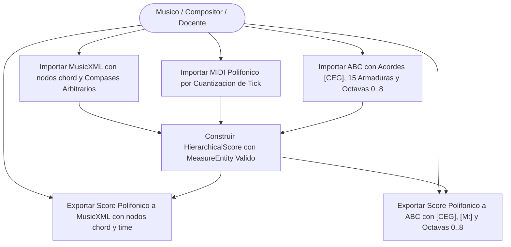
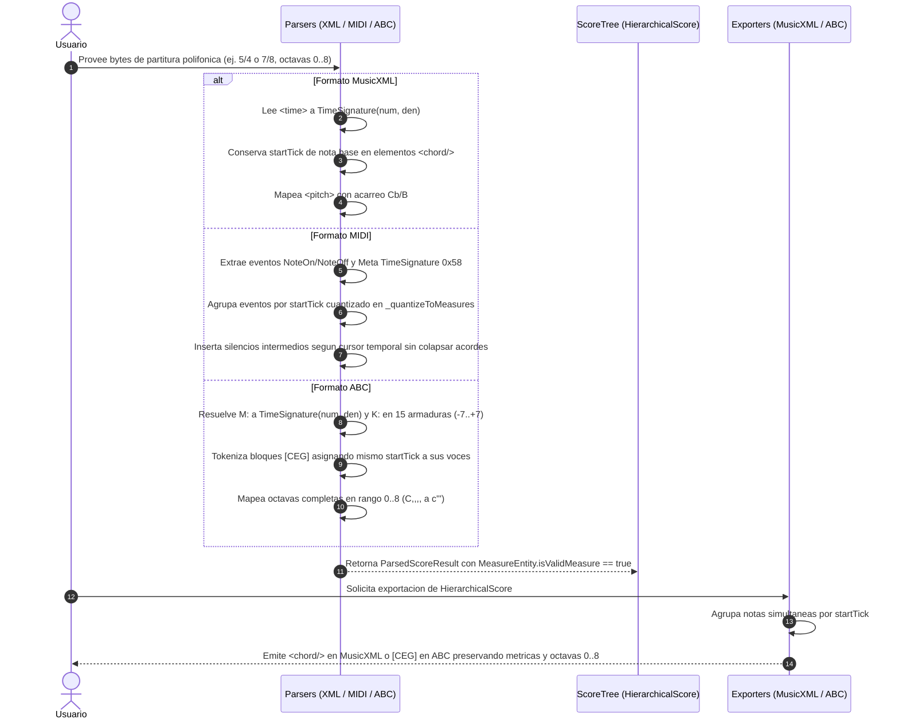

# Caso de Uso 159: Preservacion Polifonica de Acordes, Compases Arbitrarios y Rango 0..8 en Parsers y Exportadores MusicXML, MIDI y ABC

## Metadatos del Documento
- **ID del Documento:** `DOC-USECASE-2026-159`
- **Titulo Oficial:** Preservacion Polifonica de Acordes, Compases Arbitrarios y Rango de Octavas 0..8 en Parsers y Exportadores Canonicos
- **Estado:** Approved
- **Fecha de Creacion:** 2026-11-22
- **Ultima Modificacion:** 2026-11-22
- **Fase Asociada:** Fase 4 / Universal Importer & Exportadores Polifonicos (US-4.2)
- **Autor / Revisor Principal:** Devs 3 (Parsers Polifonicos y Audio DSP)

---

## 1. Resumen Ejecutivo
Este caso de uso formaliza la actualizacion integral de los decodificadores y serializadores canonicos de Tunner para los tres formatos simbolicos principales de intercambio musical: **MusicXML** (`MusicXmlScoreParser` y `CanonicalMusicXmlExporter`), **Standard MIDI File** (`MidiScoreParser`) y **ABC Notation** (`AbcScoreParser` y `CanonicalAbcExporter`).

El objetivo es erradicar tres perdidas estructurales detectadas durante la auditoria tecnica: (1) el descarte o aplanamiento secuencial de acordes polifonicos simultaneos, (2) la reduccion forzada de metricas irregulares o compuestas hacia `4/4`, y (3) la restriccion artificial del rango de octavas (`clamp(1, 8)`) y de armaduras parciales en notacion ABC. Con esta especificacion, toda obra polifonica en compases arbitrarios (como `5/4`, `7/8`, `9/8`, `12/8`, `2/2`, `5/16`), dentro del rango completo `0..8` y en cualquiera de las 15 armaduras estandar (`-7` a `+7` alteraciones) conserva su fidelidad temporal, armonica y metrica al importarse o exportarse en `HierarchicalScore`.

---

## 2. Diagramas del Caso de Uso

### 2.1 Diagrama Formal de Casos de Uso (Mermaid)

### 2.2 Diagrama de Secuencia y Flujo Detallado (Mermaid)

---

## 3. Especificacion Funcional Detallada

### 3.1 Fundamento Matematico y Musical
1. **Resolucion Base de Ticks:** Tunner opera a una resolucion de 4 sub-ticks por negra (semicorchea = 1 tick). La capacidad de cualquier compas arbitrario `TimeSignature(numerator, denominator)` se define como:
   $$\text{totalTicks} = \text{numerator} \times \left\lfloor \frac{16}{\text{denominator}} \right\rfloor$$
   valida para denominadores binarios estandar $d \in \{1, 2, 4, 8, 16\}$.
2. **Cuantizacion MIDI a Sub-Ticks:** Para un evento MIDI con desplazamiento local $\Delta t_{\text{midi}}$ respecto al inicio del compas y resolucion $PPQ$:
   $$\text{startTick} = \text{clamp}\left(\text{round}\left(\frac{\Delta t_{\text{midi}} \cdot 4}{PPQ}\right), 0, \text{totalTicks} - 1\right)$$
3. **Invariante Polifonico en `MeasureEntity`:** Multiples instancias de `HierarchicalNote` pueden compartir el mismo `startTick` (acordes simultaneos) siempre que para toda nota $0 \le \text{startTick} < \text{endTick} \le \text{totalTicks}$ y la union de intervalos $[\text{startTick}, \text{endTick})$ cubra exactamente $[0, \text{totalTicks})$.
4. **Circulo de Quintas (-7..+7):** En ABC Notation, el numero de alteraciones de armadura $f \in [-7, 7]$ se deriva de la tonica en modo Jonico mas el desplazamiento modal ($\Delta_{\text{menor}} = -3$, $\Delta_{\text{dorico}} = -2$, $\Delta_{\text{frigio}} = -4$, $\Delta_{\text{lidio}} = +1$, $\Delta_{\text{mixolidio}} = -1$, $\Delta_{\text{locrio}} = -5$).
5. **Rango de Octavas 0..8:** Cubre desde `Do0` ($C_0 \approx 16.35\text{ Hz}$, MIDI 12) hasta `Si8` ($B_8 \approx 7902.13\text{ Hz}$, MIDI 119), abarcando el piano de concierto completo ($A_0$ a $C_8$) y registros extremos orquestales.

### 3.2 Precondiciones
1. Archivo o flujo de bytes valido en formato MusicXML (`.musicxml`/`.xml`/`.mxl`), Standard MIDI (`.mid`/`.midi`) o ABC Notation (`.abc`).
2. Para exportacion, instancia valida de `HierarchicalScore` o `SongPackage`.

### 3.3 Postcondiciones
1. Todos los acordes presentes en MusicXML (`<chord/>`), MIDI (NoteOn simultaneos tras cuantizacion) y ABC (`[...]`) producen notas con identico `startTick` dentro de `MeasureEntity.notes`.
2. Las metricas de compas arbitrarias (`5/4`, `7/8`, `9/8`, `12/8`, `2/2`, `5/16`, etc.) se preservan como `TimeSignature(numerator, denominator)` sin conversion forzada a `4/4`.
3. Todas las notas y silencios en el rango `0..8` y en cualquiera de las 15 armaduras estandar mantienen su altura y duracion sin truncamiento de octava.
4. Todo compas generado satisface `MeasureEntity.isValidMeasure == true`.

### 3.4 Flujo Principal
1. El usuario o servicio `UniversalScoreImporterService` invoca `parseScoreData` sobre el parser correspondiente.
2. El parser extrae los metadatos globales (titulo, compositor, tempo, armadura y metrica inicial).
3. Para cada compas, el parser lee los eventos de nota/silencio, asigna o agrupa notas simultaneas bajo el mismo `startTick`, rellena huecos temporales con silencios canonicos y calcula las alturas en nomenclatura Tunner para octavas `0..8`.
4. Al exportar mediante `CanonicalMusicXmlExporter` o `CanonicalAbcExporter`, las notas del compas se ordenan por `startTick`, agrupando eventos concurrentes mediante `<chord/>` (MusicXML) o corchetes `[...]` (ABC) e insertando cambios de compas cuando cambie la metrica entre medidas.

### 3.5 Flujos Alternativos y Condiciones de Error
- **Notas de gracia (`<grace/>`) en MusicXML:** Continuan ignorandose para no alterar la cuadricula metrica del compas.
- **Denominadores de compas no soportados o nulos (ej. `0` o `32`):** Se aplica respaldo seguro a denominador `4` para evitar division por cero o `totalTicks == 0`.
- **Campos de texto o anotaciones de acorde `"Am7"` y decoraciones `!fermata!` en ABC:** Se eliminan antes de la tokenizacion polifonica para evitar falsos positivos con notas reales.
- **Marcadores inline `[M:...]` / `[K:...]` / `[L:...]` y voltas `[1` / `[2` en ABC:** No se confunden con acordes polifonicos `[CEG]`; los cambios de metrica/armadura/unidad actualizan el estado del compas vigente.
- **Octavas fuera del limite `0..8` en entradas corruptas:** Se acotan de forma segura mediante `clamp(0, 8)`.
