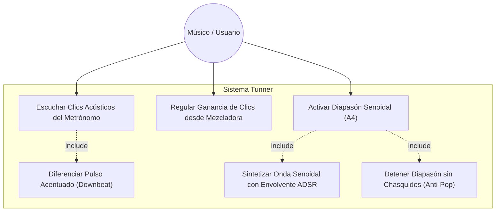
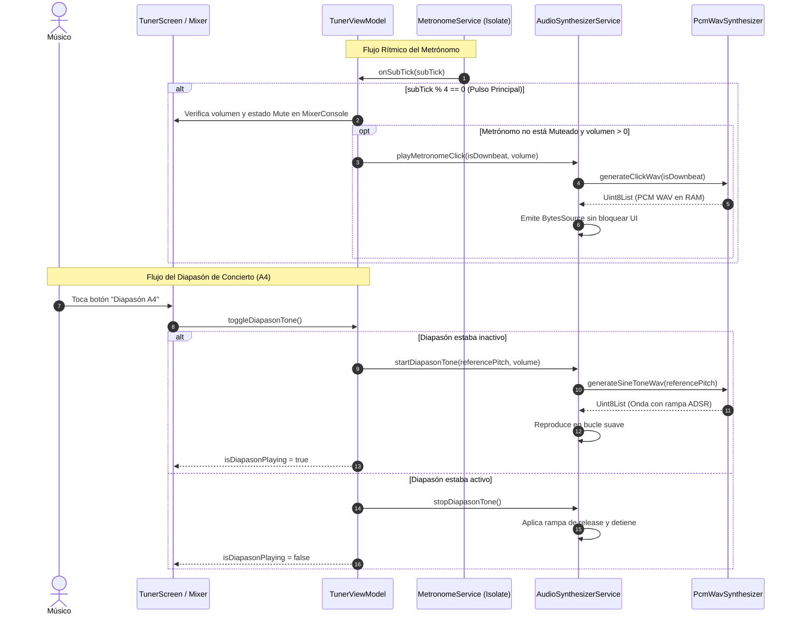

# Caso de Uso Canónico UC-15: Clics Acústicos del Metrónomo y Diapasón de Concierto

- **Módulo:** Audio Synthesizer & Metronome Clicks
- **Actor Principal:** Músico / Estudiante de Conservatorio
- **Fase:** Fase 5 (Vanguardia de Audio Digital)
- **Estado:** Aprobado

---

## 1. Diagrama Formal de Casos de Uso (Mermaid)

---

## 2. Diagrama de Secuencia y Flujo en Tiempo Real (Mermaid)

---

## 3. Especificación Formal de Flujos

### 3.1 Precondiciones
1. La aplicación Tunner está en ejecución en el dispositivo.
2. La salida de audio (altavoces o auriculares) del dispositivo está operativa.

### 3.2 Flujo Principal A: Clics Acústicos del Metrónomo
1. El usuario inicia el metrónomo desde la barra de transporte o pantalla principal.
2. El `Isolate` de temporización envía los sub-ticks al hilo principal.
3. Al alcanzar el sub-tick 0 de un compás ($4/4, 3/4, 2/4, 6/8$), el sintetizador emite un clic percusivo acentuado a $2200\text{ Hz}$ con decaimiento rápido.
4. En los pulsos secundarios (ej. 2, 3, 4), el sintetizador emite clics normales a $1400\text{ Hz}$.
5. Si el usuario modifica el fader del metrónomo o activa el botón *Mute (M)* en la consola mezcladora, el sintetizador ajusta la amplitud o se silencia de inmediato.

### 3.3 Flujo Principal B: Diapasón de Concierto
1. El usuario abre la modal de calibración de concierto o presiona el botón de diapasón en el afinador.
2. El sistema toma el valor de `referencePitch` activo (ej. 440 Hz, 442 Hz, 432 Hz o 415 Hz).
3. El sintetizador genera proceduralmente un buffer PCM senoidal con ataque suave de 15 ms para evitar chasquidos digitales.
4. El tono suena de forma continua permitiendo al músico afinar su instrumento acústico de oído.
5. Al tocar nuevamente el botón, el sintetizador aplica una rampa de desvanecimiento de 20 ms y se detiene.

### 3.4 Postcondiciones
1. Cero uso de bucles bloqueantes (busy-waiting) y nulo impacto en la tasa de refresco a 60/120 FPS del pentagrama.
2. Los buffers se generan en memoria volátil sin persistir archivos innecesarios en disco.
