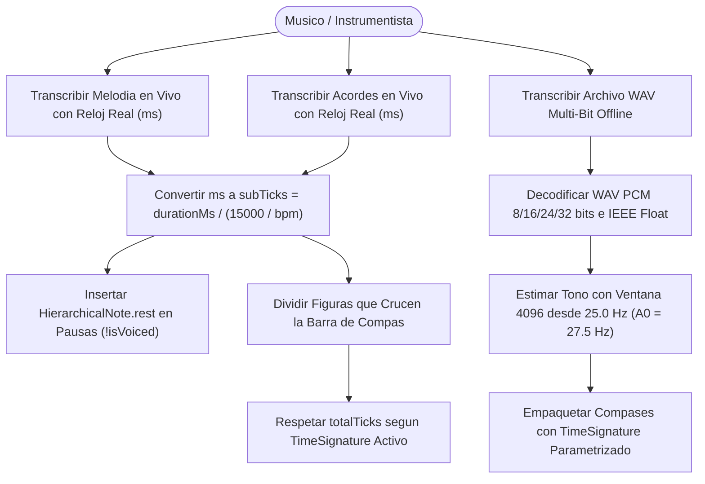
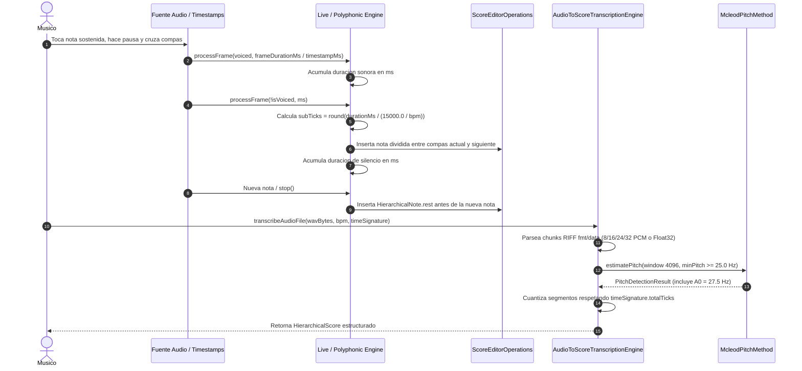

# Caso de Uso 160: Reloj Musical Real en Transcripcion en Vivo, Insercion de Silencios y Soporte A0 / WAV Multi-Bit

## Metadatos del Documento
- **ID del Documento:** `DOC-USECASE-2026-160`
- **Titulo Oficial:** Reloj Musical Real en Transcripcion en Vivo (ms a subTicks), Insercion de Silencios, Division de Barra de Compas y Decodificacion WAV Multi-Bit / 27.5 Hz
- **Estado:** Approved
- **Fecha de Creacion:** 2026-11-22
- **Ultima Modificacion:** 2026-11-22
- **Fase Asociada:** Fase 4 / US-4.4 Transcripcion En Vivo y Offline
- **Autor / Revisor Principal:** Devs 1 (Core & ScoreEditor)

---

## 1. Resumen Ejecutivo
Este caso de uso corrige las distorsiones temporales y de rango espectral en los motores de transcripcion de Tunner:
1. En transcripcion en vivo monofonica (`LiveTranscriptionEngine`) y polifonica (`PolyphonicTranscriptionEngine`), reemplaza el conteo rigido de frames por un reloj musical en milisegundos (`frameDurationMs` o marcas de tiempo `timestampMs`) mediante la formula $subTicks = \text{round}(durationMs / (15000.0 / bpm))$, inserta silencios `HierarchicalNote.rest` durante pausas no sonoras (`!isVoiced`), divide notas y silencios que crucen la barra de compas, y elimina el limite fijo `math.min(startTick, 15)` para soportar metricas arbitrarias (`3/4`, `6/8`, `12/8`, `5/4`).
2. En transcripcion offline (`AudioToScoreTranscriptionEngine`), amplia la ventana por defecto a `4096` muestras y reduce el umbral minimo de frecuencia a `25.0 Hz` para capturar registros sub-graves como piano $A_0 = 27.5\text{ Hz}$, decodifica WAV PCM de `8/16/24/32` bits e `IEEE Float` (`audioFormat == 3`), y parametriza `TimeSignature`.

---

## 2. Diagramas del Caso de Uso

### 2.1 Diagrama Formal de Caso de Uso (Mermaid)

### 2.2 Diagrama de Secuencia y Flujo Detallado (Mermaid)

---

## 3. Especificacion Funcional

### 3.1 Precondiciones
1. Para transcripcion en vivo, `start(initialPackage: ..., bpm: ...)` ha sido invocado con un `SongPackage` valido que contiene al menos un compas.
2. Para transcripcion offline, se provee un arreglo de bytes WAV (8, 16, 24, 32 bits PCM o IEEE Float) o PCM crudo junto con un `TimeSignature` valido y `bpm` positivo.

### 3.2 Postcondiciones
1. Toda duracion de nota o silencio medida con `frameDurationMs` o `timestampMs` se transforma mediante `subTicks = (durationMs / (15000.0 / bpm)).round()`.
2. Las pausas acusticas con duracion `>= 1` sub-tick generan `HierarchicalNote.rest` con division automatica entre compases si exceden el espacio restante.
3. Ningun tick de inicio queda truncado artificialmente en `15` (`math.min(startTick, 15)` eliminado), respetando `measure.timeSignature.totalTicks`.
4. `AudioToScoreTranscriptionEngine` detecta tonos fundamentales desde `25.0 Hz` ($A_0 = 27.5\text{ Hz}$ con ventana de `4096` muestras), normaliza audio de `8`, `16`, `24`, `32` bits PCM e IEEE Float (`audioFormat == 3`), y construye compases con el `TimeSignature` solicitado.

### 3.3 Flujo Principal
1. El motor de transcripcion en vivo recibe frames sucesivos con duracion o timestamp en milisegundos.
2. Si el frame es sonoro y coincide con el candidato actual, acumula su duracion en milisegundos; si alcanza `minFramesForOnset` tras una pausa acumulada, consolida primero el silencio pendiente con `HierarchicalNote.rest`.
3. Al cambiar de nota, aparecer silencio o invocarse `stop()`, calcula `subTicks = (durationMs / (15000.0 / bpm)).round()` y divide la figura secuencialmente a traves de los compases necesarios, creando compases adicionales con la misma metrica cuando sea preciso.
4. En el flujo offline, `AudioToScoreTranscriptionEngine` lee `audioFormat`, `channels`, `sampleRate` y `bitsPerSample` del chunk `fmt `, convierte el chunk `data` a `Float64List` normalizado en `[-1.0, 1.0]`, aplica MPM con ventana `4096` aceptando frecuencias `>= 25.0 Hz`, y empaqueta los compases usando `timeSignature.totalTicks`.

### 3.4 Flujos Alternativos y Excepciones
- **Modo de compatibilidad sin marcas temporales:** Si un invocador llama `processPitchFrame` o `processPolyphonicFrame` sin `frameDurationMs`, `timestampMs` ni `clockMsProvider`, el motor usa incremento determinista de `1` sub-tick por frame sonoro para mantener compatibilidad con pruebas heredadas.
- **WAV malformado o canales en cero:** `AudioToScoreTranscriptionEngine` protege `channels`, `sampleRate`, `bitsPerSample` y limites de chunk contra valores cero o truncados sin lanzar excepciones.
- **Audio demasiado corto (< windowSize):** Devuelve un compas unico relleno con `HierarchicalNote.rest` de duracion `timeSignature.totalTicks`.
