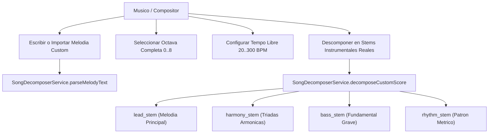
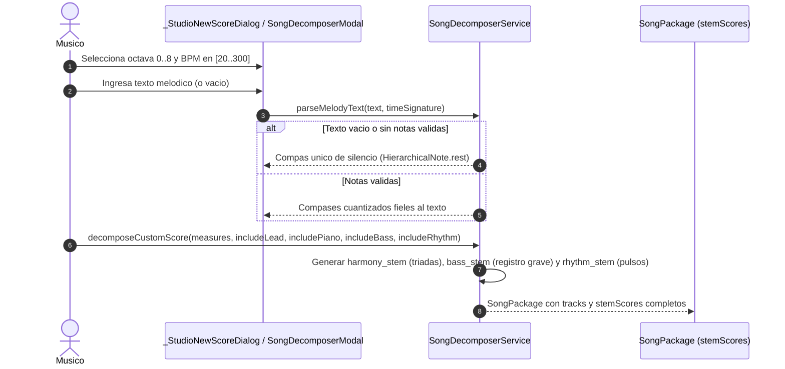

# Caso de Uso 161: Descomposicion Algoritmica Real por Stems en SongDecomposerService y Rango Completo 0..8 / BPM 20..300

## Metadatos
- **ID:** UC-161
- **Titulo:** Descomposicion Algoritmica Real por Stems y Eliminacion de Compases/Octavas Hardcodeados
- **Estado:** Approved
- **Fecha:** 2026-11-22
- **Autor:** Nicolas Leon (SM/PO/Devs)
- **Epica:** EPIC-04 Importers/OMR, Transcripcion, AutoTune WAV & Grabadora

---

## 1. Descripcion General
Este caso de uso formaliza la generacion algoritmica real de partes instrumentales por stem en `SongDecomposerService.decomposeCustomScore` (melodia principal, acompanamiento triadico, linea de bajo en registro grave y patron ritmico), asi como la eliminacion de valores hardcodeados en `parseMelodyText` (retornando silencio ante entrada vacia en lugar de `Do4-Mi4-Sol4-Do5`), en `SongDecomposerModal` (habilitando octavas `0..8`) y en `_StudioNewScoreDialog` (habilitando el rango completo `20..300` BPM).

---

## 2. Diagrama de Casos de Uso (Mermaid)

---

## 3. Diagrama de Secuencia (Mermaid)

---

## 4. Precondiciones, Flujo Principal y Flujos Alternativos

### 4.1 Precondiciones
1. El usuario accede al compositor/descomponedor de obras (`SongDecomposerModal`) o al dialogo de nueva obra (`_StudioNewScoreDialog`).

### 4.2 Flujo Principal
1. El usuario selecciona cualquier octava del piano/orquesta en el rango `0..8` y cualquier tempo en `[20..300]` BPM.
2. `SongDecomposerService.parseMelodyText` analiza la entrada textual respetando el `timeSignature`.
3. `SongDecomposerService.decomposeCustomScore` construye `SongPackage` incluyendo `tracks` y el mapa `stemScores` con partituras reales independientes para `lead_stem`, `harmony_stem`, `bass_stem` y `rhythm_stem`.

### 4.3 Flujos Alternativos y Manejo de Errores
1. **FA-01 (Entrada vacia en `parseMelodyText`):** Si el texto no contiene notas reconocibles, retorna un compas con un silencio completo de duracion `timeSignature.totalTicks` (cero notas fabricadas).
2. **FA-02 (BPM fuera de rango):** Todo valor fuera de `[20, 300]` es acotado con `.clamp(20, 300)`.
3. **FA-03 (Compas sin notas sonoras al generar acompanamiento):** Si un compas contiene solo silencios, los stems de armonia y bajo respetan el silencio completo sin inventar acordes sobre compases mudos.

### 4.4 Postcondiciones
- `SongPackage.stemScores` contiene partituras estructuradas y reproducibles por cada pista activa.
- Cero compases o rangos de octava/tempo hardcodeados.
